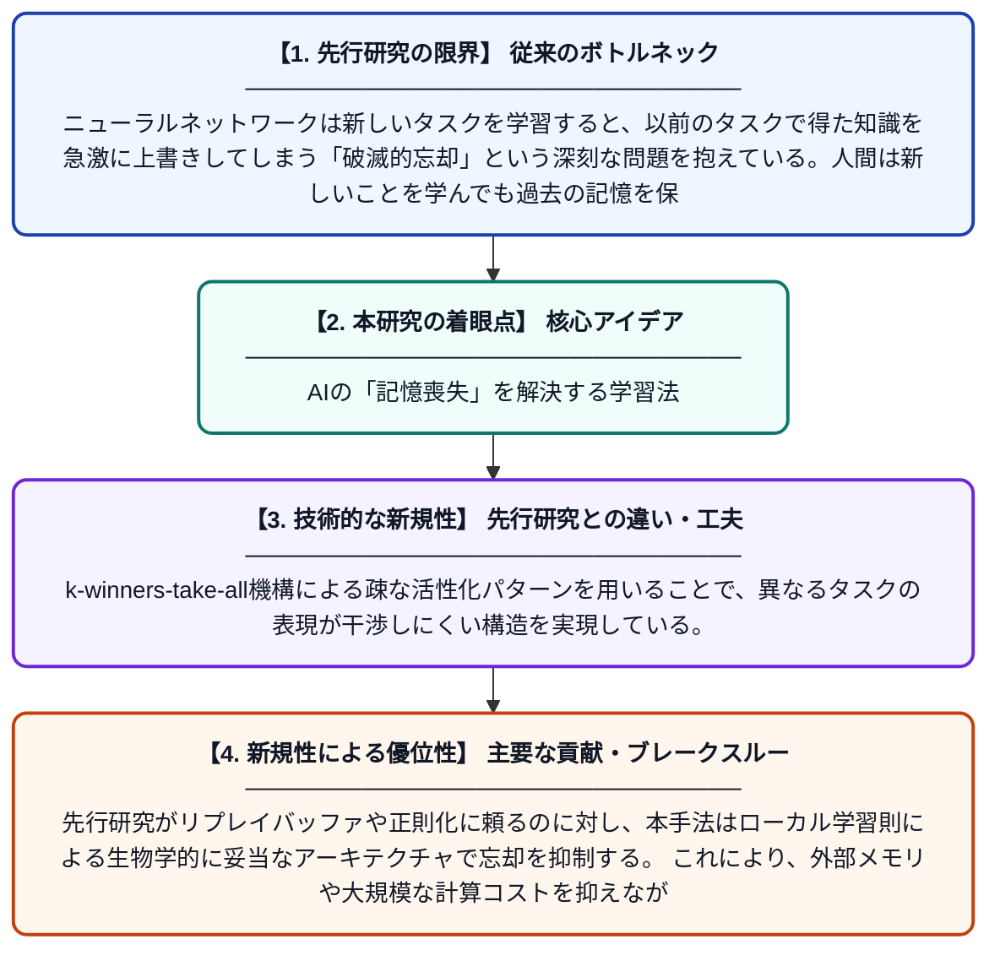

# 忘却しない技術：継続的学習のためのローカル学習アーキテクチャ

**Original Title**: *The Art of Not Forgetting A Local Learning Architecture for Continual Learning*

> **💡 一言要約**: AIの「記憶喪失」を解決する学習法

| 項目 | 内容 |
|---|---|
| **著者** | A Atmuri, YR Bhogarajula |
| **掲載誌** | arXiv preprint arXiv:2607.26523 2026 |
| **アラートキーワード** | sparse coding |
| **PDF** | [https://arxiv.org/pdf/2607.26523](https://arxiv.org/pdf/2607.26523) |
| **原文リンク** | [https://arxiv.org/abs/2607.26523](https://arxiv.org/abs/2607.26523) |
| **PDF版要約** | [README.pdf](./README.pdf) |

---

## 📊 新規性の図解（先行研究との違いと本研究のブレークスルー）

## 📝 要約

本論文は、AIが新しいことを学ぶと以前学んだことを忘れてしまう「破滅的忘却」問題に取り組んでいる。スパースコーディングやk-winners-take-allといった生物学的に根拠のある手法を活用したローカル学習アーキテクチャを提案し、継続的学習における記憶保持を実現する。視覚野の仕組みを参考にした表現学習により、新旧の知識を両立できるモデルを構築している。

## ❓ どんな問題に取り組んだか

ニューラルネットワークは新しいタスクを学習すると、以前のタスクで得た知識を急激に上書きしてしまう「破滅的忘却」という深刻な問題を抱えている。人間は新しいことを学んでも過去の記憶を保ち続けられるが、従来のAIモデルはこの能力を持たず、実世界への応用に大きな制限が生じていた。

## ✨ 何が新しい？何がすごい？（新規性）

本研究は、大脳視覚野の受容野に似た表現を生み出すスパースコーディングの原理を継続的学習に応用した点が新しい。k-winners-take-all機構による疎な活性化パターンを用いることで、異なるタスクの表現が干渉しにくい構造を実現している。先行研究がリプレイバッファや正則化に頼るのに対し、本手法はローカル学習則による生物学的に妥当なアーキテクチャで忘却を抑制する。これにより、外部メモリや大規模な計算コストを抑えながら継続的学習を可能にしている。

## 🎓 大学1年生向けの解説

AIは新しいことを勉強すると、以前覚えたことをすっかり忘れてしまうという弱点があります。これは人間の「健忘症」に似た問題で、実際のロボットや自動運転などの応用では大きな障害になります。この論文では、人間の脳の視覚野が情報を効率よく保存する仕組みを参考に、少数のニューロンだけを使って情報を記録する方法を開発しました。こうすることで、新しい情報と古い情報が互いに邪魔し合わず、両方をうまく覚えておけるAIを作ることができます。
