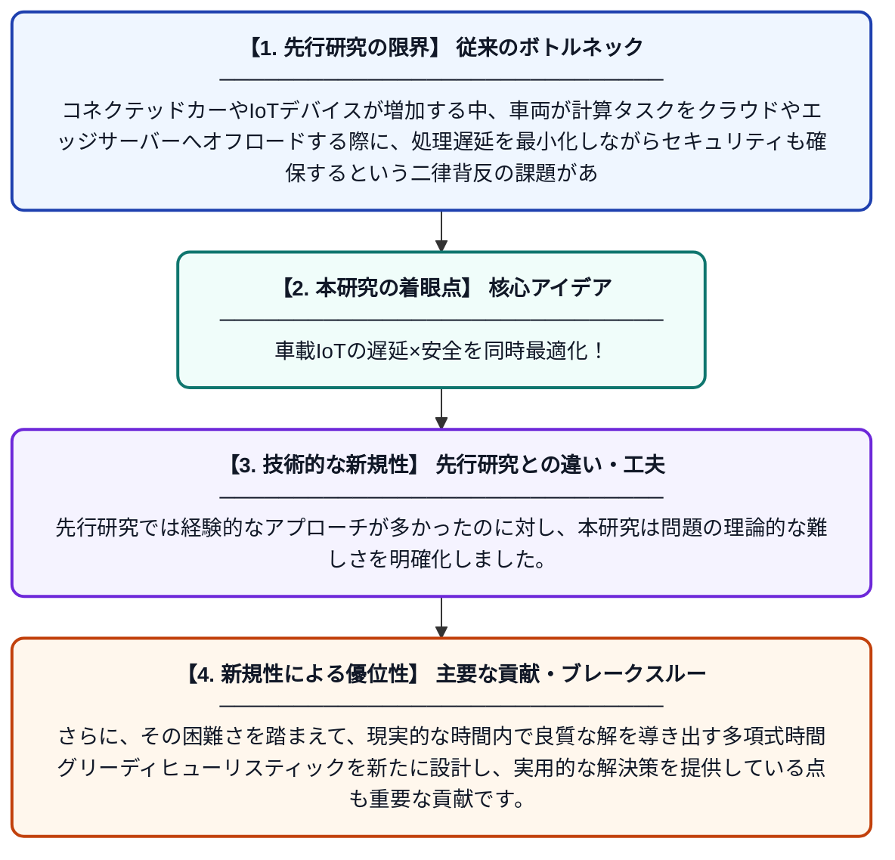

# IoT対応車載ネットワークにおけるタスクオフローディングの遅延とセキュリティの同時最適化はNP困難である

**Original Title**: *NP-Hard Joint Latency and Security Optimization for Task Offloading in IoT-Enabled Vehicular Networks*

> **💡 一言要約**: 車載IoTの遅延×安全を同時最適化！

| 項目 | 内容 |
|---|---|
| **著者** | A Alkhresheh |
| **掲載誌** | preprints.org 2026 |
| **アラートキーワード** | generalized assignment ... |
| **原文リンク** | [https://www.preprints.org/manuscript/202607.1909](https://www.preprints.org/manuscript/202607.1909) |
| **PDF版要約** | [README.pdf](./README.pdf) |

---

## 📊 新規性の図解（先行研究との違いと本研究のブレークスルー）

## 📝 要約

本論文は、IoTを活用した車載ネットワーク（車同士や道路インフラが繋がった環境）において、計算タスクを外部サーバーに転送する際の「遅延」と「セキュリティ」を同時に最適化する問題を研究しています。この問題がNP困難な一般化割り当て問題に帰着されることを数学的に証明しました。さらに、現実的な解を効率的に求めるための多項式時間グリーディヒューリスティックアルゴリズムを提案しています。

## ❓ どんな問題に取り組んだか

コネクテッドカーやIoTデバイスが増加する中、車両が計算タスクをクラウドやエッジサーバーへオフロードする際に、処理遅延を最小化しながらセキュリティも確保するという二律背反の課題があります。既存研究では遅延とセキュリティを個別に扱うことが多く、両者を同時に最適化する問題の計算複雑性が十分に議論されていませんでした。

## ✨ 何が新しい？何がすごい？（新規性）

本研究の最大の貢献は、遅延とセキュリティの同時最適化問題がNP困難（計算機科学的に解くのが極めて難しいクラス）であることを厳密に証明した点です。先行研究では経験的なアプローチが多かったのに対し、本研究は問題の理論的な難しさを明確化しました。さらに、その困難さを踏まえて、現実的な時間内で良質な解を導き出す多項式時間グリーディヒューリスティックを新たに設計し、実用的な解決策を提供している点も重要な貢献です。

## 🎓 大学1年生向けの解説

最近の車はインターネットに繋がっており、難しい計算（例えば自動運転の判断）を外部のサーバーに任せることがあります（これを「タスクオフローディング」といいます）。でも、速く処理してもらいたい（低遅延）と、安全に通信したい（高セキュリティ）という2つの目標は、しばしばぶつかり合います。この論文は、「両方を同時に満たす最良の方法を見つけるのは、数学的にとても難しい問題（NP困難）だ」ということを証明しました。そこで、完璧な答えではないけれど「十分に良い答え」を素早く見つける近似アルゴリズムも一緒に提案しています。スマートな妥協点を素早く見つける「賢い方法」を作った研究です。
