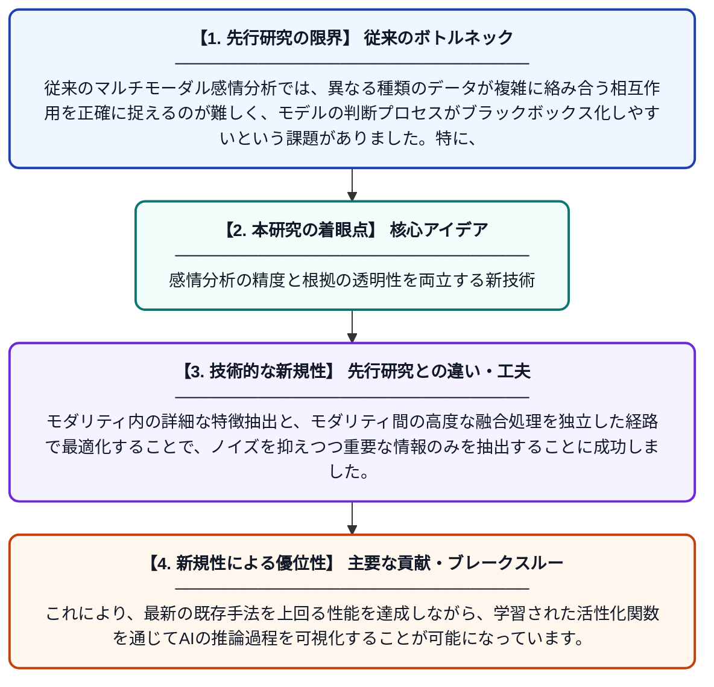

# I²-KAN：マルチモーダル感情分析のための解釈可能なモダリティ内・間マルチパス表現学習

**Original Title**: *I $^ 2$-KAN: Interpretable Intra-and Inter-Modal Multi-Pathway Representation Learning for Multimodal Sentiment Analysis*

> **💡 一言要約**: 感情分析の精度と根拠の透明性を両立する新技術

| 項目 | 内容 |
|---|---|
| **著者** | X Xie, F Qiao, X Zhang, H Chen, K Zheng, JM Jose… |
| **掲載誌** | arXiv preprint arXiv … 2026 |
| **アラートキーワード** | representation learning |
| **PDF** | [https://arxiv.org/pdf/2610.31087](https://arxiv.org/pdf/2610.31087) |
| **原文リンク** | [https://arxiv.org/pdf/2610.31087](https://arxiv.org/pdf/2610.31087) |
| **PDF版要約** | [README.pdf](./README.pdf) |

---

## 📊 新規性の図解（先行研究との違いと本研究のブレークスルー）

## 📝 要約

テキスト、音声、映像の複数情報を統合して感情を分析する手法において、Kolmogorov-Arnold Networks (KAN) をベースとした新フレームワーク「I²-KAN」を提案しています。このモデルは、各モダリティ内部の特徴とモダリティ間の相互作用をマルチパス構造で学習し、高い予測精度と判断根拠の解釈可能性を両立させています。

## ❓ どんな問題に取り組んだか

従来のマルチモーダル感情分析では、異なる種類のデータが複雑に絡み合う相互作用を正確に捉えるのが難しく、モデルの判断プロセスがブラックボックス化しやすいという課題がありました。特に、単一のデータ種別が持つ特性と、複数が組み合わさって生まれる情報の両方を効率的に整理して学習する仕組みが不足していました。

## ✨ 何が新しい？何がすごい？（新規性）

本研究は、従来の多層パーセプトロン（MLP）に代わる次世代ネットワークであるKANをマルチモーダル分野に応用し、解釈可能な「マルチパス表現学習」を実現した点が独創的です。モダリティ内の詳細な特徴抽出と、モダリティ間の高度な融合処理を独立した経路で最適化することで、ノイズを抑えつつ重要な情報のみを抽出することに成功しました。これにより、最新の既存手法を上回る性能を達成しながら、学習された活性化関数を通じてAIの推論過程を可視化することが可能になっています。

## 🎓 大学1年生向けの解説

この研究は、人間が「言葉」「声のトーン」「顔の表情」を組み合わせて相手の気持ちを理解するプロセスを、AIでより正確に再現するものです。これまでのAIは判断の理由が分かりにくいのが欠点でしたが、この「I²-KAN」という手法を使うと、AIがどの情報のどこに注目したかを人間が理解しやすくなります。最新の数学的な工夫を取り入れることで、分析の精度を上げながら、同時に「AIの頭の中」をのぞきやすくした画期的な仕組みです。
