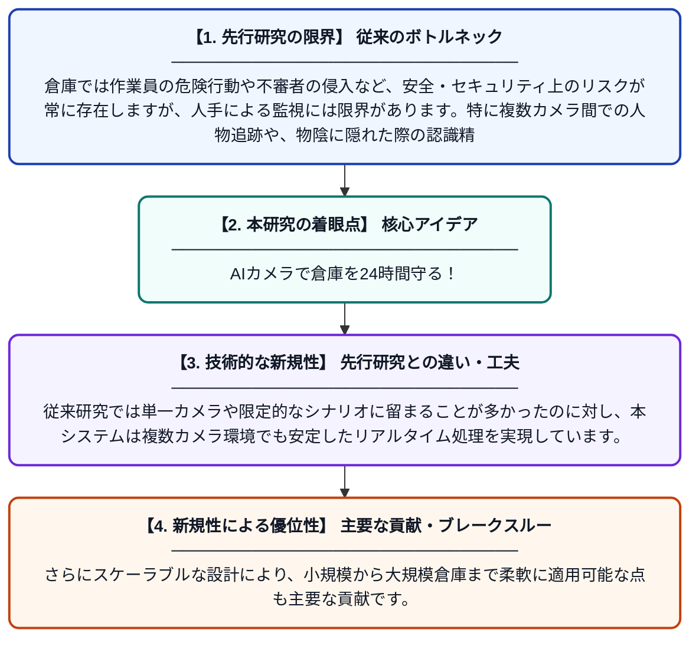

# コンピュータビジョンを用いた倉庫の安全・セキュリティ監視

**Original Title**: *Warehouse Safety and Security Monitoring with Computer Vision*

> **💡 一言要約**: AIカメラで倉庫を24時間守る！

| 項目 | 内容 |
|---|---|
| **著者** | D Vimukthi, P Thilakarathna, D Silva, K Galgamuwa |
| **掲載誌** | 2026 18th International Conference 2026 |
| **アラートキーワード** | Multi Camera Tracking |
| **原文リンク** | [https://ieeexplore.ieee.org/abstract/document/11613798/](https://ieeexplore.ieee.org/abstract/document/11613798/) |
| **PDF版要約** | [README.pdf](./README.pdf) |

---

## 📊 新規性の図解（先行研究との違いと本研究のブレークスルー）

## 📝 要約

本研究では、倉庫環境における安全性とセキュリティの向上を目的として、コンピュータビジョン技術を活用したマルチモーダルな監視システムを提案しています。人間行動認識（HAR）や遮蔽状況下でのマルチカメラによる動的な人物再識別などの技術を統合しています。スケーラブルなアーキテクチャにより、既存手法の主要な課題を克服し、リアルタイムでの安定した追跡を実現しています。

## ❓ どんな問題に取り組んだか

倉庫では作業員の危険行動や不審者の侵入など、安全・セキュリティ上のリスクが常に存在しますが、人手による監視には限界があります。特に複数カメラ間での人物追跡や、物陰に隠れた際の認識精度低下といった技術的課題が解決されていませんでした。

## ✨ 何が新しい？何がすごい？（新規性）

本研究は、人間行動認識・マルチカメラ追跡・遮蔽下での人物再識別を統合したマルチモーダルアプローチを提案している点が新しいです。従来研究では単一カメラや限定的なシナリオに留まることが多かったのに対し、本システムは複数カメラ環境でも安定したリアルタイム処理を実現しています。さらにスケーラブルな設計により、小規模から大規模倉庫まで柔軟に適用可能な点も主要な貢献です。

## 🎓 大学1年生向けの解説

倉庫にたくさんのカメラを設置して、AIにその映像を分析させることで、危ない行動や不審者を自動で検知するシステムを作りました。例えば、作業員が転倒したり危険な場所に立ち入ったりしたとき、AIがすぐに気づくことができます。カメラの死角や物陰に隠れてしまっても、複数のカメラを連携させることで人を見失わないように工夫しています。これにより、人が常に監視しなくても倉庫を安全に保つことが可能になります。
