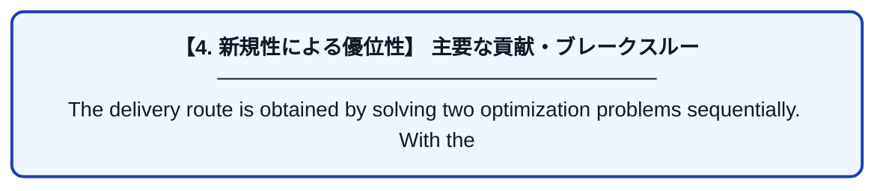

# Long-Term Optimal Delivery Planning for Replacing the Liquefied Petroleum Gas Cylinder

| 項目 | 内容 |
|---|---|
| **PDF版要約** | [README.pdf](./README.pdf) |

---

## 📊 新規性の図解（先行研究との違いと本研究のブレークスルー）

## 📝 要約

The delivery route is obtained by solving two optimization problems sequentially. With
the first problem, we determine a delivery route that maximizes the number of deliveries to
moderate-risk customers, ensuring deliveries to high-risk customers. When the two routes
have the same number of deliveries, the routes can differ in terms of the working time.
Therefore, a second optimization problem is prepared to minimize the working time, ensuring
the replacement to the customers obtained from the first optimization problem. When the
solution is not found within the time limit, the heuristic algorithms shown in Section 5.3 are
applied to determine the delivery route for applying the proposed system to the real world.

2-opt

混合整数計画問題を解くためのソルバーを使ったよ。

評価指標は

The quality of the replacement plan was investigated using the following evaluation metrics.
• Average traveling time per day (travel-time/day)
• Average traveling time per customer (travel-time/customer)
• Total number of nonreplacement visits (nonreplacement)
