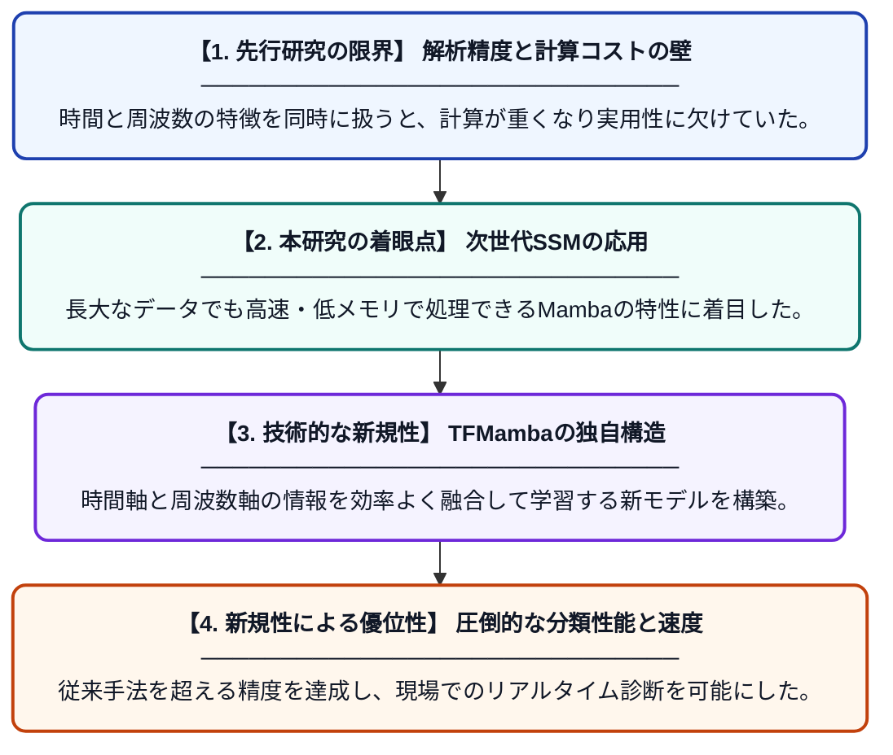

# TFMamba：超音波溶接欠陥分類のためのMambaを用いた時間・周波数表現学習

**Original Title**: *TFMamba: Time-Frequency Representation Learning with Mamba for Ultrasonic Welding Defect Classification*

> **💡 一言要約**: Mambaで溶接欠陥を高速・高精度に自動判別

| 項目 | 内容 |
|---|---|
| **著者** | R Chen, L Hua, P Hu, J Li |
| **掲載誌** | 11th Asia-Pacific Conference on Intelligent … 2026 |
| **アラートキーワード** | representation learning |
| **原文リンク** | [https://ieeexplore.ieee.org/abstract/document/11741468/](https://ieeexplore.ieee.org/abstract/document/11741468/) |
| **PDF版要約** | [README.pdf](./README.pdf) |

---

## 📊 新規性の図解（先行研究との違いと本研究のブレークスルー）

## 📝 要約

超音波溶接の品質管理において、時間と周波数の情報を統合的に学習する新しいモデル「TFMamba」を提案しました。最新のState Space ModelであるMambaを採用することで、従来の深層学習モデルよりも効率的かつ高精度に溶接欠陥を分類することが可能です。

## ❓ どんな問題に取り組んだか

超音波溶接の欠陥検出では、信号の時間的な変化と周波数の特徴を同時に捉える必要があります。しかし、従来のCNNやTransformerベースの手法では、計算コストが増大したり、長期間の依存関係を十分にモデル化できなかったりする課題がありました。

## ✨ 何が新しい？何がすごい？（新規性）

本研究は、計算効率に優れた次世代アーキテクチャ「Mamba」を、時間・周波数ドメインの表現学習にはじめて本格導入した点が画期的です。先行研究のTransformerが抱えていた計算量の課題を克服しつつ、Mambaの選択的状態空間モデルにより、ノイズの多い信号から欠陥特有の微細なパターンを抽出することに成功しました。これにより、高い分類精度と推論の高速化を両立しています。

## 🎓 大学1年生向けの解説

金属同士をくっつける「超音波溶接」がうまくいったかどうかを、AIが自動で判断する技術の研究です。溶接中のデータには「いつ」「どんな音（周波数）」が出たかという重要な情報が詰まっていますが、これを分析するのは非常に複雑でした。この論文では、最新の「Mamba」という計算手法を使うことで、まるでベテランの職人のように素早く正確に不良品を見分けるAIを作り上げました。これにより、工場の製造ラインをよりスムーズに、より高品質に保つことができます。
