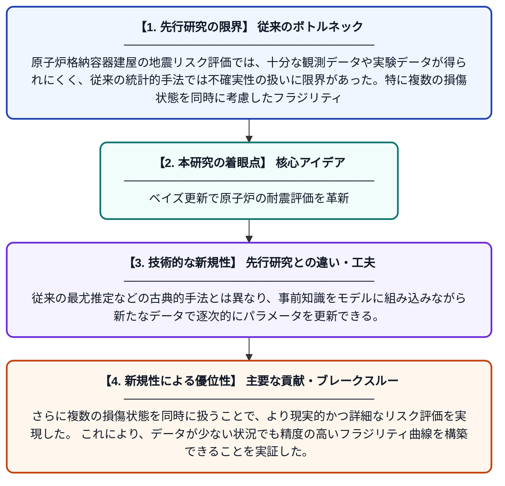

# 複数損傷状態を考慮したベイズ更新による原子炉格納容器建屋の地震フラジリティ評価

**Original Title**: *Bayesian-Updated Seismic Fragility of Reactor Containment Building considering Multiple Damage States*

> **💡 一言要約**: ベイズ更新で原子炉の耐震評価を革新

| 項目 | 内容 |
|---|---|
| **著者** | MS Azad, DD Nguyen, B Thusa, M Choi, TH Lee |
| **掲載誌** | Nuclear Engineering and … 2026 |
| **アラートキーワード** | MCMC |
| **原文リンク** | [https://www.sciencedirect.com/science/article/pii/S1738573326004754](https://www.sciencedirect.com/science/article/pii/S1738573326004754) |
| **PDF版要約** | [README.pdf](./README.pdf) |

---

## 📊 新規性の図解（先行研究との違いと本研究のブレークスルー）

## 📝 要約

本研究は、原子炉格納容器建屋（RCB）の地震フラジリティ評価において、ベイズ更新とマルコフ連鎖モンテカルロ（MCMC）シミュレーションを組み合わせた手法を適用した。複数の損傷状態を考慮することで、従来の手法では困難だったフラジリティ曲線の精度向上を実現している。この手法により、限られたデータからでも信頼性の高い地震リスク評価が可能となることが示された。

## ❓ どんな問題に取り組んだか

原子炉格納容器建屋の地震リスク評価では、十分な観測データや実験データが得られにくく、従来の統計的手法では不確実性の扱いに限界があった。特に複数の損傷状態を同時に考慮したフラジリティ評価は困難であり、安全評価の精度に課題があった。

## ✨ 何が新しい？何がすごい？（新規性）

本研究は、ベイズ更新とMCMCシミュレーションを組み合わせた手法をRCBの地震フラジリティ評価に適用した点が新しい。従来の最尤推定などの古典的手法とは異なり、事前知識をモデルに組み込みながら新たなデータで逐次的にパラメータを更新できる。さらに複数の損傷状態を同時に扱うことで、より現実的かつ詳細なリスク評価を実現した。これにより、データが少ない状況でも精度の高いフラジリティ曲線を構築できることを実証した。

## 🎓 大学1年生向けの解説

原子力発電所にある格納容器という建物が、地震でどれくらい壊れやすいかを数値で表す研究です。「ベイズ更新」とは、新しい情報が入るたびに予測を賢く修正していく数学的な方法です。コンピュータでたくさんの計算をシミュレーションすることで、データが少なくても正確な評価ができるようになります。この技術を使うことで、原子力発電所の安全性をより正確に評価し、地震への備えを強化することができます。
