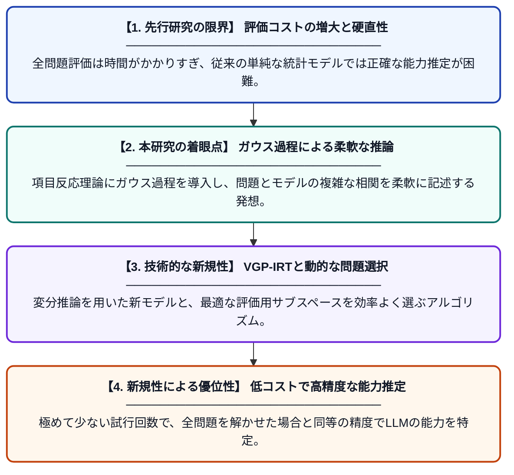

# ベイズ項目反応理論と経路制御型サブスペース選択による効率的な大規模言語モデルのベンチマーク評価

**Original Title**: *Efficient LLM Benchmark Evaluation with Bayesian Item Response and Routed Subspace Selection*

> **💡 一言要約**: 少ない問題でLLMの能力を正確に測る評価手法

| 項目 | 内容 |
|---|---|
| **著者** | XY Zhang, HJ Ye, DC Zhan |
| **掲載誌** | Proceedings of the 35th ACM International Conference … 2026 |
| **アラートキーワード** | gaussian process |
| **原文リンク** | [https://dl.acm.org/doi/abs/10.1145/3799682.3841162](https://dl.acm.org/doi/abs/10.1145/3799682.3841162) |
| **PDF版要約** | [README.pdf](./README.pdf) |

---

## 📊 新規性の図解（先行研究との違いと本研究のブレークスルー）

## 📝 要約

大規模言語モデル（LLM）の膨大なベンチマーク評価コストを削減するため、ベイズ項目反応理論とガウス過程を組み合わせた新しい評価枠組みを提案しています。プロンプトとモデルの複雑な非線形相互作用を捉えつつ、少数の問題選択で高精度な能力推定を実現しました。

## ❓ どんな問題に取り組んだか

近年のLLMの進化に伴いベンチマークの規模が膨大になり、全問題を評価するには多大な時間と計算リソースが必要になっています。また、従来の評価モデルは線形な関係を前提とすることが多く、問題の難易度とモデルの能力の複雑な相関を十分に捉えられない課題がありました。

## ✨ 何が新しい？何がすごい？（新規性）

ガウス過程を用いた項目反応理論（VGP-IRT）を導入し、プロンプトとモデル間の非線形な関係を柔軟にモデル化した点が極めて独創的です。さらに、評価に最も寄与する問題を動的に選ぶ「経路制御型サブスペース選択」を組み合わせることで、評価効率を最大化しました。これにより、先行研究のパラメトリックな制約を克服し、未知のモデルに対しても頑健な推定を可能にしています。

## 🎓 大学1年生向けの解説

AIの実力を測るテストは今や数万問もあり、全部解かせるには膨大な時間とお金がかかります。この研究は、数問解かせただけで「このAIはこのレベルだ」と賢く推測する新しい計算方法を開発しました。例えば、難しい問題と簡単な問題を数問選んで解かせるだけで、テスト全体の点数を正確に当てるような仕組みです。これにより、最新のAIをより速く、効率的に評価できるようになります。
