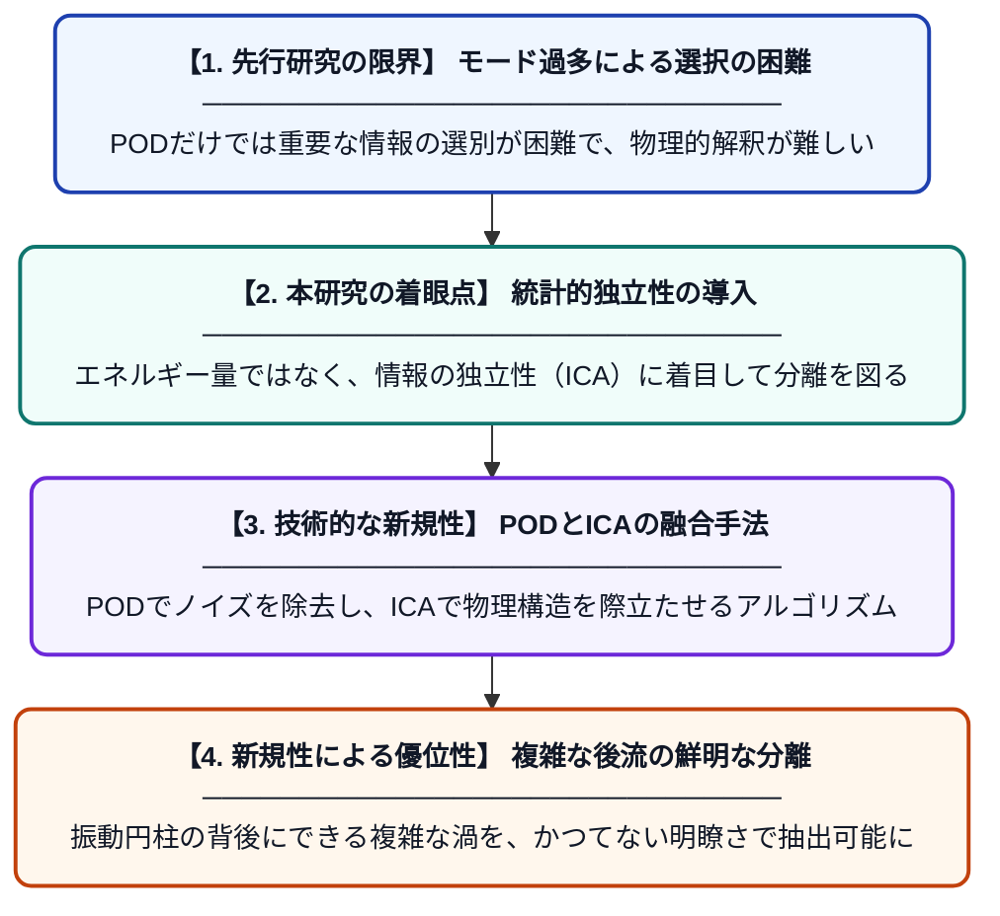

# 振動円柱の後流における画像ベースの固有直交分解と独立成分分析を用いたコヒーレント構造の抽出

**Original Title**: *Extracting coherent structures in oscillating cylinder wakes by means of image-based proper orthogonal decomposition and independent component analysis*

> **💡 一言要約**: 画像解析の新手法で複雑な流れの渦を鮮やかに抽出

| 項目 | 内容 |
|---|---|
| **著者** | X Zhou, P Zhou, Y Wu, D Wu, Z Yao |
| **掲載誌** | Physics of Fluids 2026 |
| **アラートキーワード** | independent component ... |
| **原文リンク** | [https://pubs.aip.org/aip/pof/article/38/10/108129/3407553](https://pubs.aip.org/aip/pof/article/38/10/108129/3407553) |
| **PDF版要約** | [README.pdf](./README.pdf) |

---

## 📊 新規性の図解（先行研究との違いと本研究のブレークスルー）

## 📝 要約

本研究は、高速流体可視化画像から物理的に意味のある渦構造（コヒーレント構造）を抽出するため、POD（固有直交分解）とICA（独立成分分析）を組み合わせた新しい手法を提案しました。従来の画像ベースPODでは膨大なモードが生成され選択が困難でしたが、ICAを統合することで重要な構造を鮮明に特定することに成功しています。

## ❓ どんな問題に取り組んだか

高速ビデオカメラで撮影された流体の画像から、流れの秩序だった構造を取り出す際、従来のPOD法ではノイズを含む大量のデータ（モード）が生成されてしまいます。そのため、どのデータが物理的に重要なのかを判断し、正確な現象を再構成することが非常に困難であるという課題がありました。

## ✨ 何が新しい？何がすごい？（新規性）

本研究の最大の特徴は、PODで次元を圧縮した後に独立成分分析（ICA）を適用し、統計的に独立な特徴を抽出した点にあります。従来のPODがエネルギー強度に基づいて分離するのに対し、本手法は情報の独立性を重視するため、重なり合った複雑な渦の挙動を個別に分離することが可能です。これにより、振動する円柱の後流に潜む物理的に重要な構造を、従来よりも少ない手順で高精度に同定できることを示しました。

## 🎓 大学1年生向けの解説

川の中で柱を揺らすと、その後ろには複雑な水の渦が発生します。この渦の形をカメラで撮影して分析しようとすると、情報が多すぎて何が大事な動きなのかを見分けるのは至難の業でした。この研究では、複雑なデータを整理する2つの計算手法を組み合わせることで、まるで「騒音の中から特定の楽器の音だけを聞き分ける」ように、大事な渦のパターンだけをきれいに取り出すことに成功しました。
