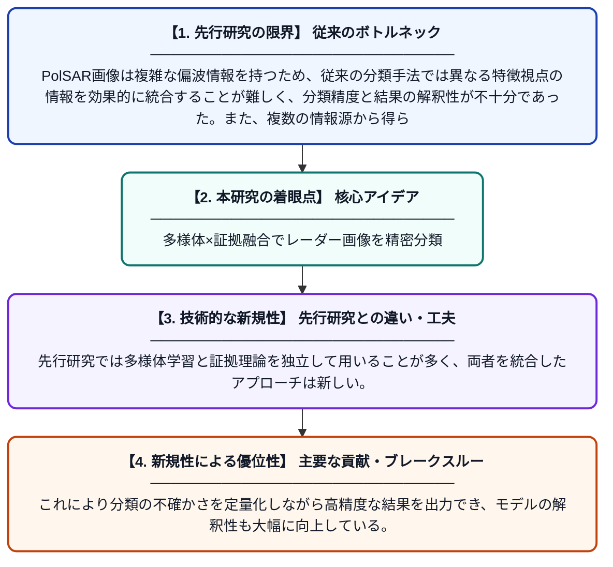

# PolSARイメージ分類の高精度化のための多様体認識型マルチビュー証拠融合

**Original Title**: *Manifold-aware Multiview Evidence Fusion for Robust PolSAR Image Classification*

> **💡 一言要約**: 多様体×証拠融合でレーダー画像を精密分類

| 項目 | 内容 |
|---|---|
| **著者** | J Shi, H Zhang, H Jin, J Li, M Gong, W Lin |
| **掲載誌** | IEEE Transactions on Circuits and Systems for … 2026 |
| **アラートキーワード** | manifold learning |
| **原文リンク** | [https://ieeexplore.ieee.org/abstract/document/11622534/](https://ieeexplore.ieee.org/abstract/document/11622534/) |
| **PDF版要約** | [README.pdf](./README.pdf) |

---

## 📊 新規性の図解（先行研究との違いと本研究のブレークスルー）

## 📝 要約

本論文では、偏波合成開口レーダー（PolSAR）画像の分類精度と解釈性を向上させるため、多様体学習とDempster-Shafer（DS）証拠理論を統合したMMEFNetを提案している。複数の視点から得られる特徴情報を証拠として融合し、不確かさを明示的に扱いながら分類を行う。これにより、従来手法に比べてロバストかつ信頼性の高い分類結果を実現する。

## ❓ どんな問題に取り組んだか

PolSAR画像は複雑な偏波情報を持つため、従来の分類手法では異なる特徴視点の情報を効果的に統合することが難しく、分類精度と結果の解釈性が不十分であった。また、複数の情報源から得られる不確かさを適切に扱う仕組みが欠けていたため、ノイズや複雑な地表面に対してロバスト性が低い課題があった。

## ✨ 何が新しい？何がすごい？（新規性）

本研究は多様体学習によってデータの幾何学的構造を保持した特徴表現を行い、それをDS証拠理論と組み合わせることで複数視点の分類証拠を体系的に融合する初めての枠組みを提案した。先行研究では多様体学習と証拠理論を独立して用いることが多く、両者を統合したアプローチは新しい。これにより分類の不確かさを定量化しながら高精度な結果を出力でき、モデルの解釈性も大幅に向上している。

## 🎓 大学1年生向けの解説

人工衛星から地面にレーダー電波を当てて地形や土地の種類を調べる技術があり、その画像を自動で分類することが目標です。この研究では、データの「形やつながり」を数学的に捉える「多様体学習」と、複数の証拠を組み合わせて判断する「証拠理論」という2つの手法をうまく組み合わせました。たとえば、地図を複数の角度から見て総合的に判断するようなイメージです。これにより、難しい地形でも正確かつ「なぜそう判断したか」がわかりやすい分類ができるようになりました。
