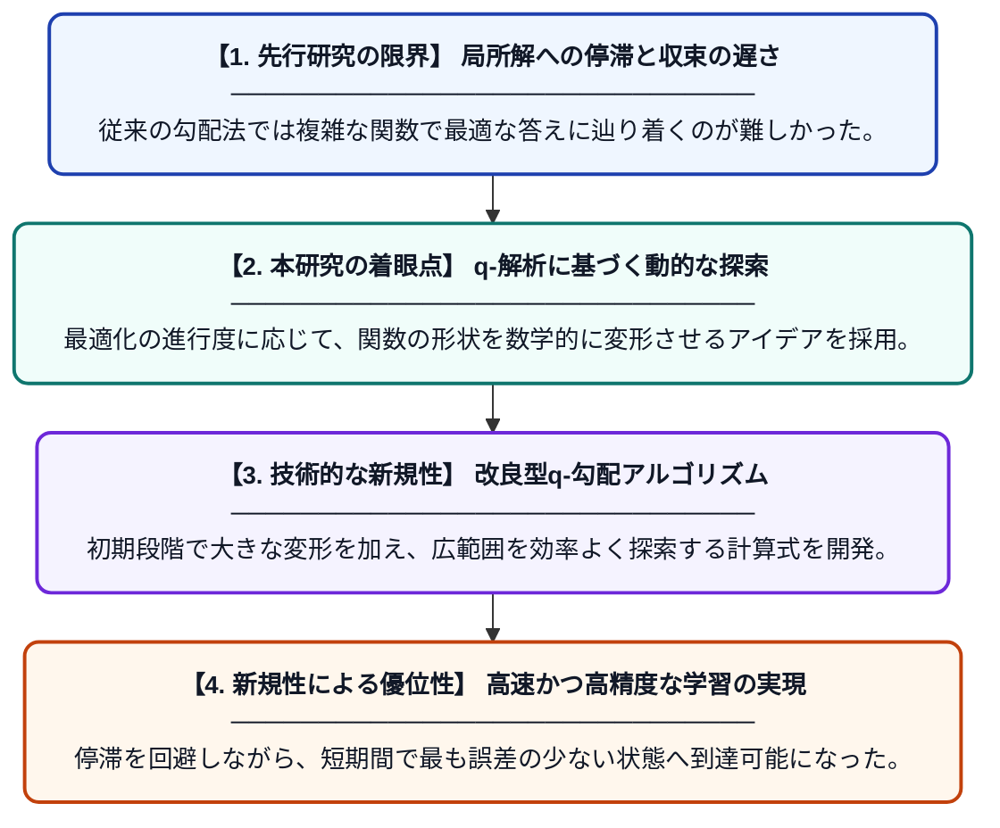

# 改良型q-勾配降下法による機械学習の最適化性能の向上

**Original Title**: *Enhancing machine learning optimization using an improved q-gradient descent method*

> **💡 一言要約**: q-勾配法で学習の効率と精度を劇的に改善

| 項目 | 内容 |
|---|---|
| **著者** | OF Razzouki, A Charroud, ZE Allali, A Chetouani |
| **掲載誌** | Multimedia Tools and Applications 2026 |
| **アラートキーワード** | optimization |
| **原文リンク** | [https://link.springer.com/article/10.1007/s11042-026-21985-1](https://link.springer.com/article/10.1007/s11042-026-21985-1) |
| **PDF版要約** | [README.pdf](./README.pdf) |

---

## 📊 新規性の図解（先行研究との違いと本研究のブレークスルー）

## 📝 要約

本論文は、q-解析（量子解析）に基づいた新しい勾配降下法を機械学習の最適化に導入し、その性能を向上させる手法を提案しています。最適化の各段階において、初期には探索範囲を広げるための大きな変形を加え、終盤には収束を安定させる動的な制御を実現しています。

## ❓ どんな問題に取り組んだか

従来の勾配降下法では、学習の初期段階で局所的な最適解（罠）に陥りやすく、収束速度が遅いという課題がありました。特に複雑な構造を持つ機械学習モデルにおいて、効率的なパラメータ更新の制御は非常に困難でした。

## ✨ 何が新しい？何がすごい？（新規性）

本研究の新規性は、q-勾配降下法に動的なパラメータ調整機能を組み込み、最適化のフェーズに応じて探索特性を変化させた点にあります。先行研究のq-勾配法と異なり、初期反復で関数形状を大きく変形させることで、局所解を回避しつつ大域的な最適解へ高速に接近するアルゴリズムを構築しました。これにより、計算コストを抑えながら精度の高い学習を可能にしたことが主要な貢献です。

## 🎓 大学1年生向けの解説

AIが「正解」を見つける作業は、霧の中で山の谷底を探すようなものです。これまでの方法だと、途中の小さな窪みにハマって動けなくなったり、時間がかかりすぎたりしていました。この研究では、数学の特別な計算を使って、最初はジャンプするように広く探し、目的地に近づくと慎重に歩くという賢い方法を開発しました。これによって、AIがより短時間で、より正確に賢くなることができるようになります。
