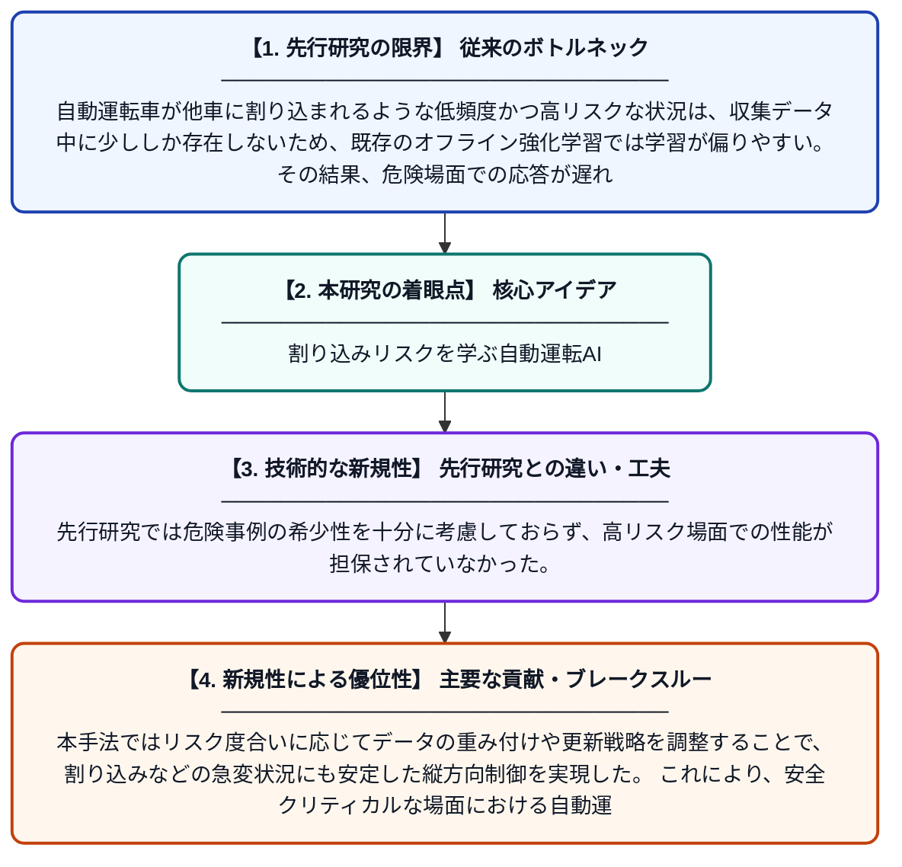

# 割り込み車両による潜在的外乱下での縦方向意思決定のためのリスク認識型オフライン強化学習

**Original Title**: *Risk-aware offline reinforcement learning for longitudinal decision-making under potential cut-in disturbances*

> **💡 一言要約**: 割り込みリスクを学ぶ自動運転AI

| 項目 | 内容 |
|---|---|
| **著者** | Q Xue, J Ma, X Zhao, R Liu, S Li, Y He, X Zhu |
| **掲載誌** | Engineering Applications of Artificial Intelligence 2026 |
| **アラートキーワード** | reinforcement |
| **原文リンク** | [https://www.sciencedirect.com/science/article/pii/S0952197626020579](https://www.sciencedirect.com/science/article/pii/S0952197626020579) |
| **PDF版要約** | [README.pdf](./README.pdf) |

---

## 📊 新規性の図解（先行研究との違いと本研究のブレークスルー）

## 📝 要約

本論文は、自動運転における割り込み車両などの低頻度・高リスク状況に対して、既存のオフライン強化学習手法が応答遅延・不安定な更新・性能劣化を引き起こす問題に取り組んでいる。これを解決するため、リスクを明示的に考慮したオフライン強化学習手法を新たに提案し、縦方向（加減速）の意思決定性能を向上させた。希少な危険シナリオへの対応能力を高めることで、より安全で信頼性の高い自動運転制御の実現を目指している。

## ❓ どんな問題に取り組んだか

自動運転車が他車に割り込まれるような低頻度かつ高リスクな状況は、収集データ中に少ししか存在しないため、既存のオフライン強化学習では学習が偏りやすい。その結果、危険場面での応答が遅れたり、制御が不安定になったり、安全性能が大幅に低下するという課題があった。

## ✨ 何が新しい？何がすごい？（新規性）

本研究は、リスク認識（Risk-aware）の概念をオフライン強化学習に組み込むことで、低頻度の危険シナリオを重点的に学習できる新しいフレームワークを提案した点が新しい。先行研究では危険事例の希少性を十分に考慮しておらず、高リスク場面での性能が担保されていなかった。本手法ではリスク度合いに応じてデータの重み付けや更新戦略を調整することで、割り込みなどの急変状況にも安定した縦方向制御を実現した。これにより、安全クリティカルな場面における自動運転の信頼性を大幅に向上させることができる。

## 🎓 大学1年生向けの解説

自動運転車はコンピュータが過去の走行データから運転を学ぶのですが、「急に別の車が割り込んでくる」ような危険な場面は滅多に起きないので、データが少なくてうまく学習できません。この研究では、そういう珍しいけど危ない場面を特別に重視して学習する仕組みを作りました。人間でいえば、普段の練習だけでなく「もしもの危険な状況」を意識して繰り返し練習するイメージです。これによって、いざ危険な割り込みが起きたときでも、自動運転車がすばやく安全に対応できるようになります。
