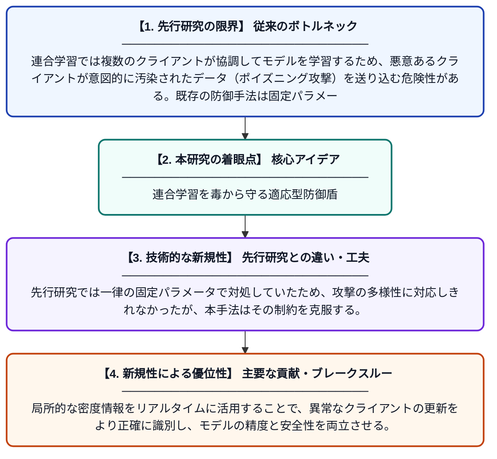

# 連合学習におけるポイズニング攻撃に対する適応型局所密度ベースの防御手法

**Original Title**: *Adaptive Local Density-based Defense Against Poisoning Attacks in Federated Learning*

> **💡 一言要約**: 連合学習を毒から守る適応型防御盾

| 項目 | 内容 |
|---|---|
| **著者** | MV Ramana, C Nagabharani, SG Krishna, VV Mojesh |
| **掲載誌** | 2026 5th International Conference 2026 |
| **アラートキーワード** | kernel density estimation |
| **原文リンク** | [https://ieeexplore.ieee.org/abstract/document/11619730/](https://ieeexplore.ieee.org/abstract/document/11619730/) |
| **PDF版要約** | [README.pdf](./README.pdf) |

---

## 📊 新規性の図解（先行研究との違いと本研究のブレークスルー）

## 📝 要約

本論文は、連合学習システムにおけるポイズニング攻撃への防御手法として、適応型局所密度推定に基づく新しいメカニズムを提案する。既存の固定近傍カーネル密度推定法が抱えるパラメータ調整の難しさや、多様なデータ分布への適応不足という問題を解決することを目的としている。提案手法は局所的なデータ密度を動的に評価することで、悪意あるデータを柔軟かつ精度高く検出する。

## ❓ どんな問題に取り組んだか

連合学習では複数のクライアントが協調してモデルを学習するため、悪意あるクライアントが意図的に汚染されたデータ（ポイズニング攻撃）を送り込む危険性がある。既存の防御手法は固定パラメータのカーネル密度推定を用いるため、精密なパラメータ調整が必要であり、多様なデータ分布や攻撃パターンに柔軟に対応できないという限界があった。

## ✨ 何が新しい？何がすごい？（新規性）

本研究は、固定的な近傍設定ではなく「適応型局所密度推定」を採用することで、データの分布状況に応じて動的に閾値を調整できる点が最大の新規性である。先行研究では一律の固定パラメータで対処していたため、攻撃の多様性に対応しきれなかったが、本手法はその制約を克服する。局所的な密度情報をリアルタイムに活用することで、異常なクライアントの更新をより正確に識別し、モデルの精度と安全性を両立させる。

## 🎓 大学1年生向けの解説

連合学習とは、スマホやパソコンなど多くの端末が協力してAIを一緒に育てる仕組みです。しかし、悪意のある端末が嘘のデータを混ぜてAIを意図的に壊そうとする「ポイズニング攻撃」という危険があります。この論文では、データの「密度（どれだけ似たデータが周りにあるか）」を柔軟に測ることで、怪しいデータを自動的に見つけ出す防御システムを提案しています。従来の方法は設定が固定されていて融通が利かなかったのに対し、この手法は状況に応じて自動で調整されるため、より賢く攻撃を防ぐことができます。
