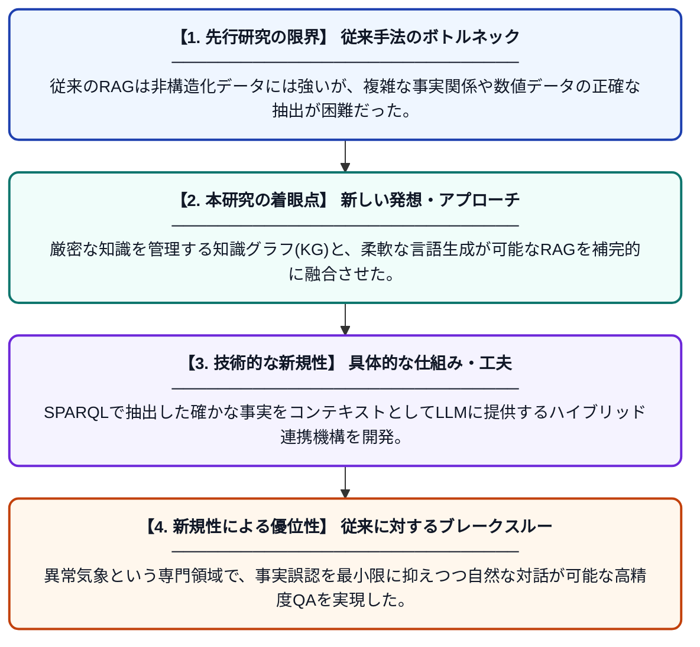

# 異常気象イベントのためのハイブリッドKG-RAG質問回答システム

**Original Title**: *Hybrid KG-RAG Question-Answering for Extreme Weather Events*

> **💡 一言要約**: KGとRAGの融合で、複雑な気象質問に高精度で回答

| 項目 | 内容 |
|---|---|
| **著者** | L Augello, M Ionov, J Gracia |
| **掲載誌** | 2026 |
| **アラートキーワード** | graph rag |
| **PDF** | [https://ceur-ws.org/Vol-4312/paper23.pdf](https://ceur-ws.org/Vol-4312/paper23.pdf) |
| **Git リポジトリ** | [https://github.com/sid-unizar/borrajas](https://github.com/sid-unizar/borrajas) |
| **原文リンク** | [https://ceur-ws.org/Vol-4312/paper23.pdf](https://ceur-ws.org/Vol-4312/paper23.pdf) |
| **PDF版要約** | [README.pdf](./README.pdf) |

---

## 📊 新規性の図解（先行研究との違いと本研究のブレークスルー）

## 📝 要約

異常気象に関する複雑な質問に対し、知識グラフ（KG）による厳密なデータ抽出と検索拡張生成（RAG）による柔軟な回答生成を組み合わせた手法を提案しています。RDF形式の知識グラフに対するSPARQLクエリと、大規模言語モデルを統合することで、情報の正確性と自然な対話の両立を図っています。KGのみ、RAGのみといった複数の構成と比較評価を行い、ハイブリッド手法の有効性を実証しました。

## ❓ どんな問題に取り組んだか

異常気象のような動的で専門的なデータを扱う際、従来のRAGだけでは構造化された事実の正確な把握が難しく、ハルシネーション（もっともらしい嘘）のリスクがありました。一方で、知識グラフ（KG）を用いた検索は正確ですが、自然言語での柔軟な解釈や人間らしい回答生成には不向きという課題がありました。

## ✨ 何が新しい？何がすごい？（新規性）

本研究の核心は、SPARQLを用いた構造化データの検索と、RAGによる非構造化データの処理を高度に統合したハイブリッドアーキテクチャにあります。極端な気象イベントという専門性の高いドメインに特化し、複数のシステム構成（KGのみ、RAGのみ、ハイブリッド）を詳細に比較評価した点が大きな貢献です。これにより、事実の正確性を担保しつつ、ユーザーの多様な質問に自然言語で対応できる実用的なフレームワークを構築しました。

## 🎓 大学1年生向けの解説

異常気象についてAIに質問したときに、正確でわかりやすい答えを返してくれるシステムの研究です。これまでのAIは、文章を作るのは得意ですが、細かい数字やデータ間の関係を間違えることがありました。この研究では、事実が整理された「知識の地図」と「文章作成が得意なAI」を組み合わせることで、間違いが少なく、かつ人間にとって読みやすい回答を作れるようにしました。
