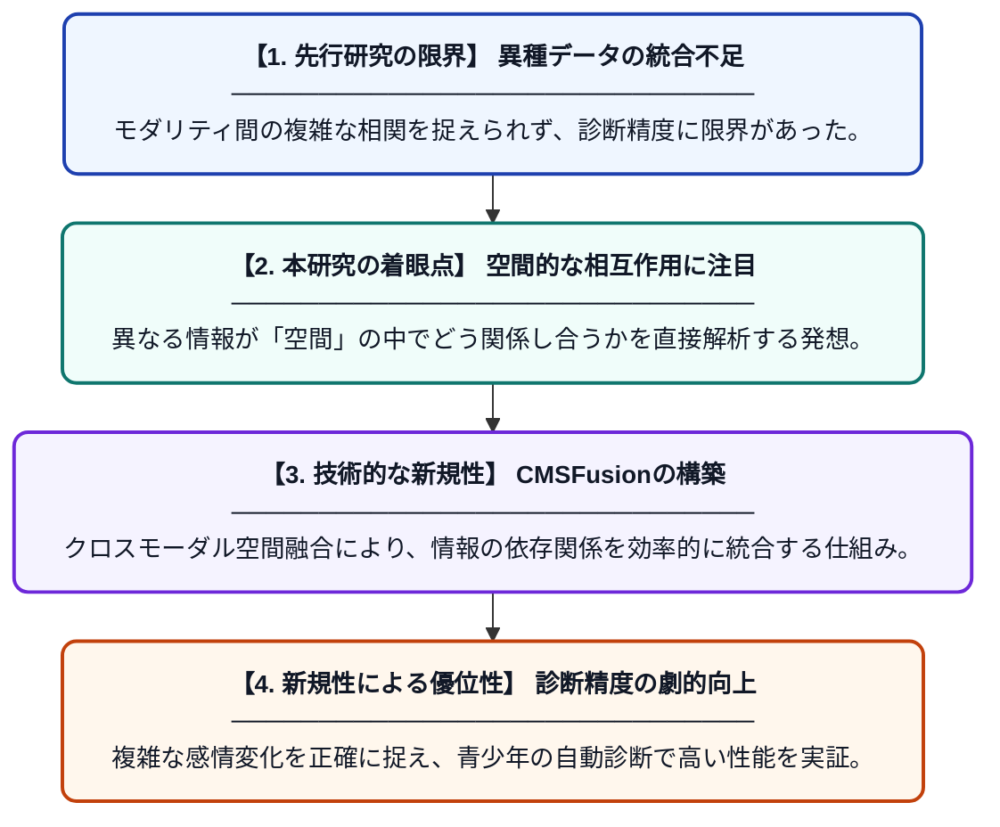

# CMSFusion: 青少年のメンタルヘルス評価のためのクロスモーダル空間融合ネットワーク

**Original Title**: *CMSFusion: A Cross-Modal Spatial Fusion Network for Adolescent Mental Health Assessment*

> **💡 一言要約**: 複数データの「空間融合」で若者の心の不調をAIが早期発見

| 項目 | 内容 |
|---|---|
| **著者** | K Qin, F Zhou, Y Huang, J Zhang, P Zeng, X Wang… |
| **掲載誌** | Proceedings of the 34th … 2026 |
| **アラートキーワード** | affective computing |
| **原文リンク** | [https://dl.acm.org/doi/abs/10.1145/3767308.3836622](https://dl.acm.org/doi/abs/10.1145/3767308.3836622) |
| **PDF版要約** | [README.pdf](./README.pdf) |

---

## 📊 新規性の図解（先行研究との違いと本研究のブレークスルー）

## 📝 要約

感情コンピューティング技術を用いて、会話中の音声、表情、テキストといった複数の行動情報を統合し、青少年のメンタルヘルスを自動評価する手法を提案しています。新開発の「CMSFusion」ネットワークにより、異なる情報源（モダリティ）間の空間的な相関関係を効果的に捉えることで、高精度なスクリーニングを実現しました。

## ❓ どんな問題に取り組んだか

青少年のメンタルヘルス診断は専門家への依存度が高く、早期発見が難しいという課題があります。既存のAI手法では、音声や表情など複数の情報を組み合わせる際、それらが互いにどのように影響し合っているかという「空間的な相互関係」を十分に反映できておらず、診断精度に限界がありました。

## ✨ 何が新しい？何がすごい？（新規性）

本研究の核心は、異なるモダリティ間の空間的依存関係を直接抽出・融合する「CMSFusion」ネットワークを導入した点にあります。従来の単純な特徴統合とは異なり、空間的な重なりを考慮したクロスモーダル学習を行うことで、感情の微細なニュアンスや行動パターンの不一致をより正確にモデル化することに成功しました。この結果、青少年特有の複雑な心理状態の把握において、既存の最先端モデルを凌駕する性能を達成しています。

## 🎓 大学1年生向けの解説

この研究は、AIを使って「若者の心の健康状態」を自動で見守る技術について解説しています。人間が話すとき、声の震え、顔の暗さ、言葉の選び方はバラバラではなく、お互いに関係し合っていますが、これまでのAIはこの「関係性」を捉えるのが苦手でした。この研究では、それらの情報を一つの「空間」にまとめて分析する新しい計算モデルを作ることで、AIがより深く人の感情を理解できるようにしました。これにより、病院に行く前の段階で心のSOSに気づける未来を目指しています。
