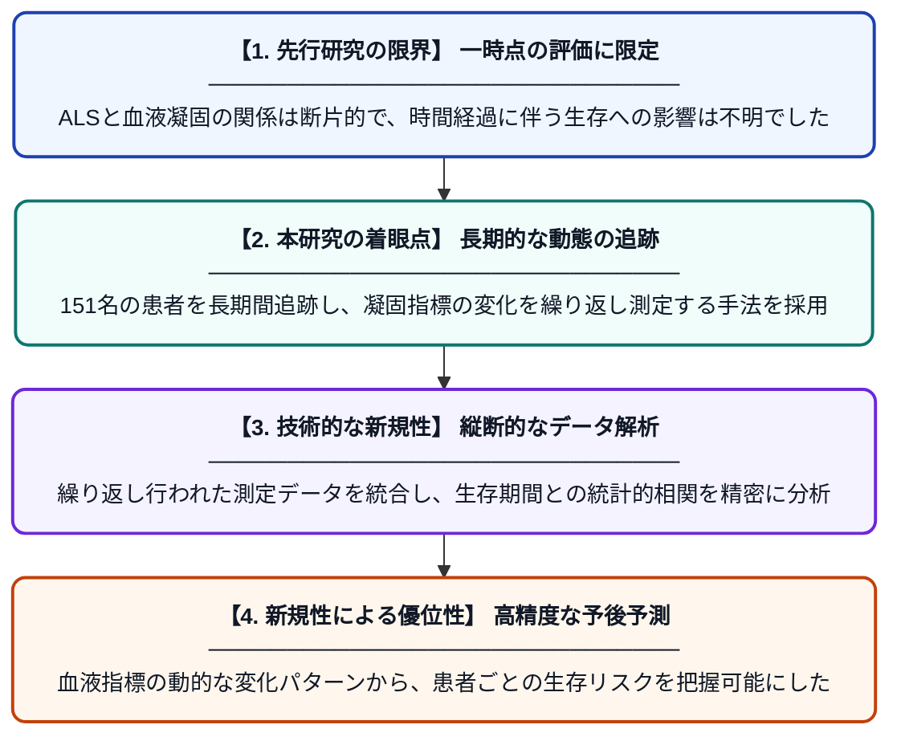

# 筋萎縮性側索硬化症における凝固・線溶動態の長期的変化と生存期間の関連：前向きコホート研究

**Original Title**: *Longitudinal coagulation–fibrinolysis dynamics are associated with survival in amyotrophic lateral sclerosis: a prospective cohort study*

> **💡 一言要約**: ALSの生存期間、血液の「固まりやすさ」の変化で予測可能に

| 項目 | 内容 |
|---|---|
| **著者** | H Lin, C Li, J Wu, J Yin |
| **掲載誌** | Amyotrophic Lateral Sclerosis and Frontotemporal … 2026 |
| **アラートキーワード** | ALS |
| **原文リンク** | [https://www.tandfonline.com/doi/abs/10.1080/21678421.2026.2750602](https://www.tandfonline.com/doi/abs/10.1080/21678421.2026.2750602) |
| **PDF版要約** | [README.pdf](./README.pdf) |

---

## 📊 新規性の図解（先行研究との違いと本研究のブレークスルー）

## 📝 要約

筋萎縮性側索硬化症（ALS）患者151名を対象に血液の凝固・線溶系指標を長期的に調査し、生存期間との関連を解析しました。その結果、これら指標の動的な変化が患者の予後と密接に関連していることが明らかになり、新たなバイオマーカーとしての有用性が示されました。

## ❓ どんな問題に取り組んだか

ALS患者において血液凝固系の異常が示唆されてきましたが、その経時的な変化（動態）が生存期間にどう影響するかは不明でした。特に、一度きりの検査ではなく、病状の進行に伴う連続的な変化が予後予測に役立つかどうかを検証する必要がありました。

## ✨ 何が新しい？何がすごい？（新規性）

本研究の最大の特徴は、151名という規模でALS患者の血液状態を長期間追跡した点にあります。単発の測定ではなく、縦断的なデータを用いて凝固・線溶系の変化を捉えることで、病気の進行と血液状態の関連をより精密にモデル化しました。これにより、特定の血液指標の変化率が生存率を左右する重要な予後因子であることを突き止めた点が画期的です。

## 🎓 大学1年生向けの解説

ALSは筋肉が徐々に動かなくなる病気ですが、実は血液の「固まりやすさ」も関係していることがわかりました。この研究では、患者さんの血液の状態を何度も繰り返し調べることで、その変化の仕方を詳しく分析しました。すると、血液の状態がどう変わっていくかを見ることで、その後の病気の経過や寿命を予測できることがわかったのです。将来、血液検査だけで病状をより正確に把握できるようになるかもしれません。
