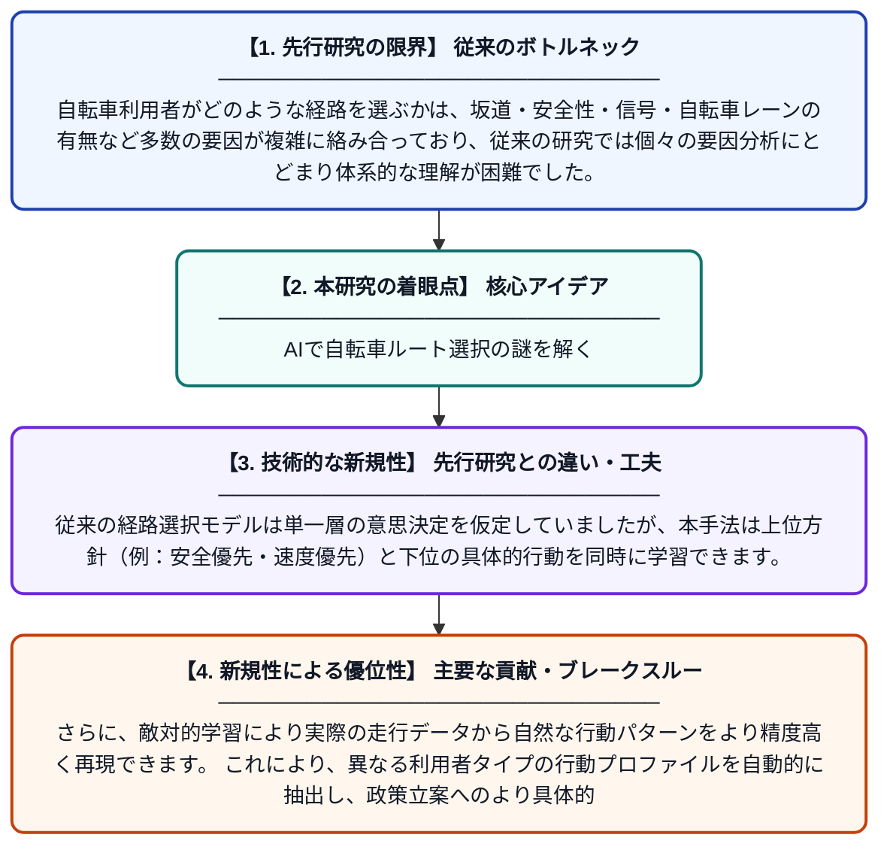

# 自転車利用者の経路選択行動の解明：階層的敵対的逆強化学習を用いた行動プロファイリング手法

**Original Title**: *Understanding cyclist route choice: A hierarchical adversarial inverse reinforcement learning approach to behavioral profiling*

> **💡 一言要約**: AIで自転車ルート選択の謎を解く

| 項目 | 内容 |
|---|---|
| **著者** | X Ma, Z Zhao, C Zhang, D Liu, Q Cui, Y Zhang, Y Gong |
| **掲載誌** | Journal of Transport Geography 2026 |
| **アラートキーワード** | reinforcement |
| **原文リンク** | [https://www.sciencedirect.com/science/article/pii/S0966692326002334](https://www.sciencedirect.com/science/article/pii/S0966692326002334) |
| **PDF版要約** | [README.pdf](./README.pdf) |

---

## 📊 新規性の図解（先行研究との違いと本研究のブレークスルー）

## 📝 要約

本研究は、都市における自転車利用者の経路選択行動を解明するため、階層的敵対的逆強化学習（HAIRL）という新しいアプローチを提案しています。このモデルは、利用者の意思決定における階層構造（例：安全性重視か時間効率重視かなどの上位方針と、具体的な道路選択という下位行動）を統合的に学習します。これにより、異なるタイプの自転車利用者の行動パターンを体系的にプロファイリングし、自転車インフラの最適化や持続可能な都市モビリティの推進に貢献します。

## ❓ どんな問題に取り組んだか

自転車利用者がどのような経路を選ぶかは、坂道・安全性・信号・自転車レーンの有無など多数の要因が複雑に絡み合っており、従来の研究では個々の要因分析にとどまり体系的な理解が困難でした。また、利用者ごとに異なる価値観や優先順位（行動の階層的構造）を同時にモデル化する手法が不足していました。これにより、都市の自転車インフラ整備に向けた実践的な知見の獲得が限られていました。

## ✨ 何が新しい？何がすごい？（新規性）

本研究は、逆強化学習（専門家の行動から報酬関数を推定する手法）に「階層的」かつ「敵対的」学習を組み合わせたHAIRLフレームワークを自転車経路選択に初めて適用した点が独自です。従来の経路選択モデルは単一層の意思決定を仮定していましたが、本手法は上位方針（例：安全優先・速度優先）と下位の具体的行動を同時に学習できます。さらに、敵対的学習により実際の走行データから自然な行動パターンをより精度高く再現できます。これにより、異なる利用者タイプの行動プロファイルを自動的に抽出し、政策立案へのより具体的な示唆を提供します。

## 🎓 大学1年生向けの解説

自転車で移動するとき、人によって「なるべく早く着きたい」「車道は怖いので避けたい」など、好みや考え方が違いますよね。この研究は、AIを使って実際の自転車の走行データを分析し、『人がどんな理由でそのルートを選んでいるか』を自動的に学習する方法を開発しました。コンピュータゲームのAI同士が競い合いながら学ぶ『敵対的学習』という技術を使い、さらに『大きな方針』と『細かい行動』の2段階で意思決定を再現しているのが特徴です。これにより、自転車利用者のタイプ別にルート選びのクセを明らかにすることができます。最終的には、自転車レーンの整備など、もっと自転車で移動しやすい街づくりに役立てることが目標です。
