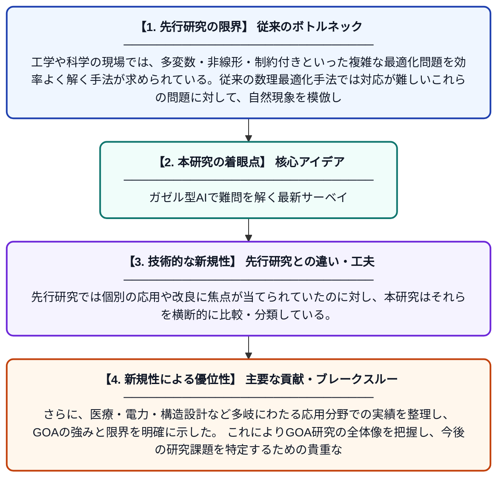

# ガゼル最適化アルゴリズム：バリアント・改良手法・科学工学への応用に関するサーベイ

**Original Title**: *Gazelle Optimization Algorithm: A Survey of Variants, Enhancements, and Applications in Science and Engineering*

> **💡 一言要約**: ガゼル型AIで難問を解く最新サーベイ

| 項目 | 内容 |
|---|---|
| **著者** | MN Sholeh, AM Arifai, L Karlina |
| **掲載誌** | Archives of Computational Methods in Engineering 2026 |
| **アラートキーワード** | optimization |
| **原文リンク** | [https://link.springer.com/article/10.1007/s11831-026-10728-y](https://link.springer.com/article/10.1007/s11831-026-10728-y) |
| **PDF版要約** | [README.pdf](./README.pdf) |

---

## 📊 新規性の図解（先行研究との違いと本研究のブレークスルー）

## 📝 要約

ガゼル最適化アルゴリズム（GOA）は、ガゼルの機敏で適応的な動きを模倣した群れベースのメタヒューリスティック手法であり、複雑な最適化問題を解くために設計されている。本論文はGOAに関する既存研究を体系的に調査し、アルゴリズムの変種・改良手法・応用事例を網羅的にまとめたサーベイ論文である。科学や工学分野におけるGOAの有効性と今後の研究方向性を包括的に示している。

## ❓ どんな問題に取り組んだか

工学や科学の現場では、多変数・非線形・制約付きといった複雑な最適化問題を効率よく解く手法が求められている。従来の数理最適化手法では対応が難しいこれらの問題に対して、自然現象を模倣したメタヒューリスティックアルゴリズムが注目されているが、GOAに関する系統的な整理・比較が不足していた。

## ✨ 何が新しい？何がすごい？（新規性）

本論文はGOAに関する初めての包括的サーベイとして、アルゴリズムの理論的基盤から多数の改良バリアントまでを体系的に整理した点が新しい。先行研究では個別の応用や改良に焦点が当てられていたのに対し、本研究はそれらを横断的に比較・分類している。さらに、医療・電力・構造設計など多岐にわたる応用分野での実績を整理し、GOAの強みと限界を明確に示した。これによりGOA研究の全体像を把握し、今後の研究課題を特定するための貴重なロードマップが提供されている。

## 🎓 大学1年生向けの解説

「最適化」とは、たくさんの選択肢の中から最も良い答えを見つけることです。このアルゴリズムは、草原を素早く駆け回るガゼルの動きをコンピュータ上で真似することで、難しい問題の答えを効率よく探します。まるでガゼルが天敵を避けながら最短ルートを見つけるように、プログラムも「良い解」を賢く探索します。この論文は、そのガゼル型アルゴリズムに関するこれまでの研究をまとめた「教科書」のような存在です。どんな改良が行われてきたか、どんな問題に使えるかを一冊にまとめて整理しています。
