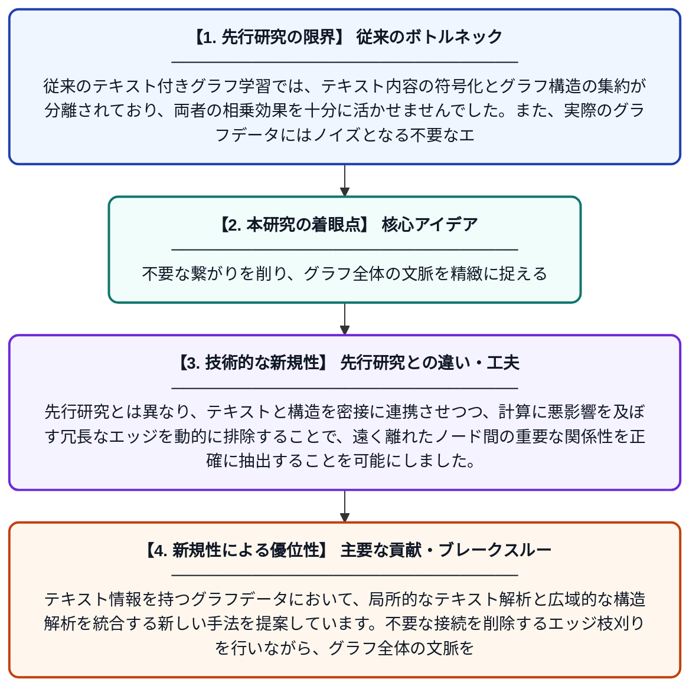

# テキスト属性付きグラフの表現学習に向けたエッジ削減によるグローバルコンテキストモデリング

**Original Title**: *Edge-Pruned Global Context Modeling for Text-Attributed Graphs Representation Learning*

> **💡 一言要約**: 不要な繋がりを削り、グラフ全体の文脈を精緻に捉える

| 項目 | 内容 |
|---|---|
| **著者** | Z Liu, Z Wen, C Fan, J Tao |
| **掲載誌** | International Symposium on Artificial Intelligence 2026 |
| **アラートキーワード** | representation learning |
| **原文リンク** | [https://ebooks.iospress.nl/doi/10.3233/FAIA260995](https://ebooks.iospress.nl/doi/10.3233/FAIA260995) |
| **PDF版要約** | [README.pdf](./README.pdf) |

---

## 📊 新規性の図解（先行研究との違いと本研究のブレークスルー）

## 📝 要約

テキスト情報を持つグラフデータにおいて、局所的なテキスト解析と広域的な構造解析を統合する新しい手法を提案しています。不要な接続を削除するエッジ枝刈りを行いながら、グラフ全体の文脈を効率的に捉えることで、ノイズに強く高精度な表現学習を実現しました。

## ❓ どんな問題に取り組んだか

従来のテキスト付きグラフ学習では、テキスト内容の符号化とグラフ構造の集約が分離されており、両者の相乗効果を十分に活かせませんでした。また、実際のグラフデータにはノイズとなる不要なエッジが多く含まれており、広域的な情報を収集しようとすると精度が低下するという課題がありました。

## ✨ 何が新しい？何がすごい？（新規性）

本研究の最大の特徴は、エッジの枝刈りとグローバルな文脈モデリングを融合させた点にあります。先行研究とは異なり、テキストと構造を密接に連携させつつ、計算に悪影響を及ぼす冗長なエッジを動的に排除することで、遠く離れたノード間の重要な関係性を正確に抽出することを可能にしました。

## 🎓 大学1年生向けの解説

SNSの友人関係や論文の引用ネットワークのように、文章（テキスト）と繋がり（エッジ）の両方を持つデータをAIにうまく理解させるための研究です。これまでは「近くの関係」ばかりを気にしたり「余計な繋がり」に惑わされたりしていましたが、この手法では「遠くても大事な繋がり」を見つけつつ「邪魔な繋がり」を消す工夫をしました。これにより、複雑なデータからでも、その本質的な特徴を賢く抜き出すことができるようになります。
