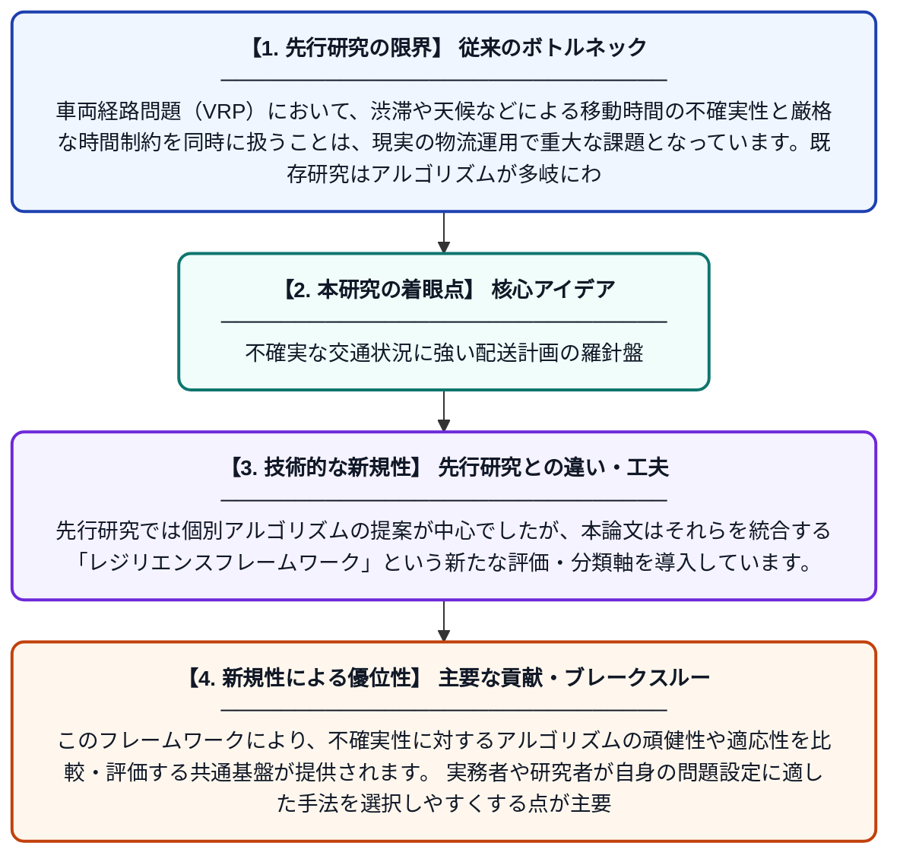

# 時間制約と不確実な移動時間を持つ車両経路問題のアルゴリズム：体系的レビューとレジリエンスフレームワーク

**Original Title**: *Algorithms for Routing Vehicles With Time Constraints and Uncertain Travel Times: A Systematic Review and Resilience Framework*

> **💡 一言要約**: 不確実な交通状況に強い配送計画の羅針盤

| 項目 | 内容 |
|---|---|
| **著者** | SY Flórez Rojas, SI Polo Triana |
| **掲載誌** | Archives of Computational Methods in Engineering 2026 |
| **アラートキーワード** | VRP |
| **原文リンク** | [https://link.springer.com/article/10.1007/s11831-026-10746-w](https://link.springer.com/article/10.1007/s11831-026-10746-w) |
| **PDF版要約** | [README.pdf](./README.pdf) |

---

## 📊 新規性の図解（先行研究との違いと本研究のブレークスルー）

## 📝 要約

本論文は、時間制約と不確実な移動時間を考慮した車両経路問題（VRP）に関するアルゴリズムを体系的にレビューしたものです。VRPの様々なバリアントと解法パラダイムを整理し、不確実性に対応するためのレジリエンスフレームワークを提案しています。運用研究の中心的課題であるVRPについて、現実的な不確実性への対処方法を包括的に整理・分類しています。

## ❓ どんな問題に取り組んだか

車両経路問題（VRP）において、渋滞や天候などによる移動時間の不確実性と厳格な時間制約を同時に扱うことは、現実の物流運用で重大な課題となっています。既存研究はアルゴリズムが多岐にわたり断片化しており、どの手法がどの状況に適しているかを体系的に把握することが困難でした。

## ✨ 何が新しい？何がすごい？（新規性）

本研究は、時間制約と不確実な移動時間を組み合わせたVRP手法を網羅的に収集・分類した体系的レビューとして位置づけられます。先行研究では個別アルゴリズムの提案が中心でしたが、本論文はそれらを統合する「レジリエンスフレームワーク」という新たな評価・分類軸を導入しています。このフレームワークにより、不確実性に対するアルゴリズムの頑健性や適応性を比較・評価する共通基盤が提供されます。実務者や研究者が自身の問題設定に適した手法を選択しやすくする点が主要な貢献です。

## 🎓 大学1年生向けの解説

宅配便のトラックが複数の家に荷物を届ける際、どの順番で回れば最も効率的かを考える問題を「車両経路問題」といいます。現実では渋滞や工事で予定通りに移動できないことがよくあり、さらに「この家には午前中に届けて」という時間指定もあります。この論文では、そのような「不確実な移動時間」と「時間の制約」の両方に対応するための様々なアルゴリズムを世界中の研究からまとめて整理しました。さらに、どのアルゴリズムがトラブルに強いかを評価する新しい枠組みも提案しています。物流の現場で使える賢い配送計画を作るための「地図」のような論文です。
