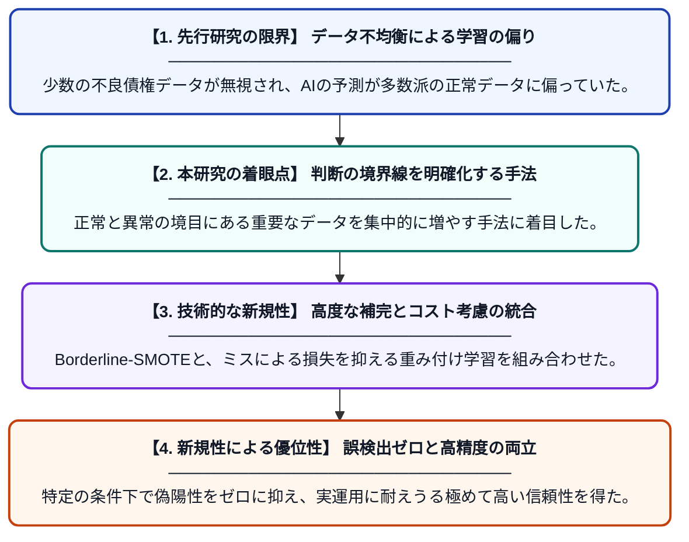

# シャリア金融の不良債権予測におけるリサンプリングとコスト考慮型ランダムフォレストおよびXGBoostの活用

**Original Title**: *Resampling And Cost-Sensitive Random Forest and Xgboost For Non Performing Sharia Financing Prediction.*

> **💡 一言要約**: 不均衡データを克服しシャリア金融の債務不履行を正確に予測

| 項目 | 内容 |
|---|---|
| **著者** | F Syafitri, T Mauritsius |
| **掲載誌** | Equivalent: Jurnal Ilmiah Sosial Teknik (Jequi) 2026 |
| **アラートキーワード** | SMOTE |
| **原文リンク** | [https://openurl.ebsco.com/contentitem/gcd:198785851?sid=ebsco:plink:crawler-gcd&id=ebsco:gcd:198785851&crl=c&jrnl=27750329](https://openurl.ebsco.com/contentitem/gcd:198785851?sid=ebsco:plink:crawler-gcd&id=ebsco:gcd:198785851&crl=c&jrnl=27750329) |
| **PDF版要約** | [README.pdf](./README.pdf) |

---

## 📊 新規性の図解（先行研究との違いと本研究のブレークスルー）

## 📝 要約

シャリア金融における不良債権（NPL）の予測精度を向上させるため、データの不均衡を解消するリサンプリング技術と機械学習モデルを組み合わせた手法を提案しています。Borderline-SMOTEを用いることで、境界線付近のデータを重点的に補完し、誤検出を抑えつつ高い予測性能を実現しました。

## ❓ どんな問題に取り組んだか

シャリア金融のデータセットでは、正常な取引に対して不良債権の事例が極端に少なく、AIが正常なケースばかりを学習してしまう「不均衡データ問題」がありました。また、返済不能者を見逃すリスクと、優良顧客を誤って拒絶するリスクを最小化する高度な予測モデルが求められていました。

## ✨ 何が新しい？何がすごい？（新規性）

従来のSMOTE法がデータを一様に増やすのに対し、境界線付近のサンプルを重点的に生成するBorderline-SMOTEを導入した点が独創的です。これをランダムフォレストやXGBoostといった強力なアルゴリズム、さらには誤分類の重みを調整するコスト考慮型学習と組み合わせました。その結果、特定の構成において偽陽性（誤検出）をゼロにしつつ、高い再現率を達成するという顕著な成果を上げています。

## 🎓 大学1年生向けの解説

銀行が「お金を返してくれなさそうな人」を事前に見つけるのは、実はとても難しいことです。なぜなら、ほとんどの人はちゃんとお金を返してくれるので、AIがお手本にする「返してくれない人」のデータが少なすぎるからです。この研究では、少ない方のデータを賢く人工的に増やして、AIに「見分けるコツ」を叩き込みました。これにより、銀行が損をするのを防ぎ、より健全な経営ができるようになります。
