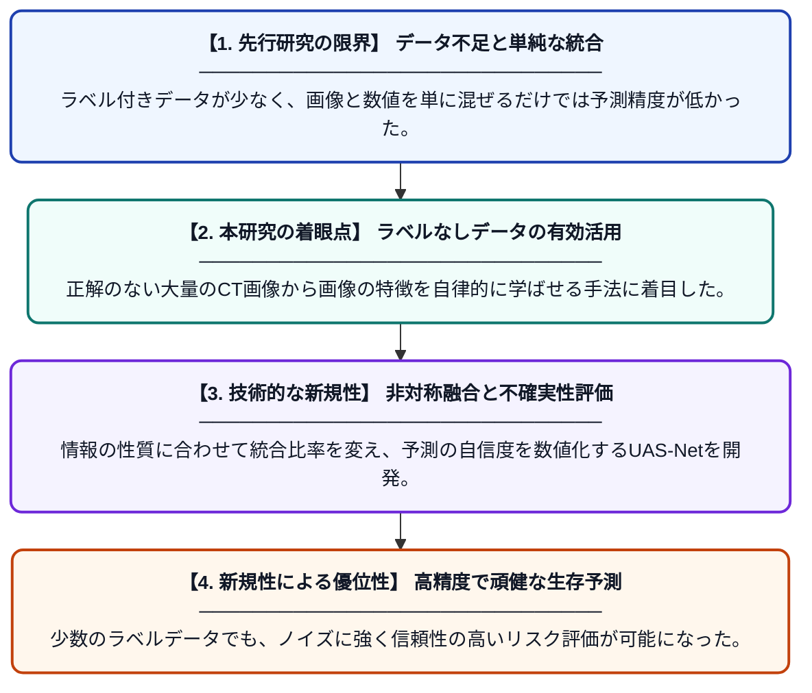

# 非対称的特徴融合を用いた食道癌の半教師ありマルチモーダル生存予測学習

**Original Title**: *Semi-supervised multimodal survival learning for esophageal cancer using asymmetric feature fusion*

> **💡 一言要約**: 画像と数値の融合×AIの自習で食道癌の生存を予測

| 項目 | 内容 |
|---|---|
| **著者** | X Zhao, Z Wu, W Wang, Y Qiao, F Li |
| **掲載誌** | Array 2026 |
| **アラートキーワード** | Semi supervise |
| **原文リンク** | [https://www.sciencedirect.com/science/article/pii/S2590005626007538](https://www.sciencedirect.com/science/article/pii/S2590005626007538) |
| **PDF版要約** | [README.pdf](./README.pdf) |

---

## 📊 新規性の図解（先行研究との違いと本研究のブレークスルー）

## 📝 要約

CT画像と臨床データを統合して食道癌患者の生存リスクを予測する、不確実性を考慮した半教師あり学習ネットワーク「UAS-Net」を提案しました。ラベルのない大量のデータを活用する自己教師あり学習と、画像と数値データの性質の違いを考慮した非対称な融合により、高精度な予後予測を実現しています。

## ❓ どんな問題に取り組んだか

医療現場ではラベル付きのデータ収集が困難であり、少数のデータでは生存予測モデルの精度が安定しない課題がありました。また、CT画像のような高次元データと数値的な臨床情報を、情報の欠落なく効果的に統合する手法も不足していました。

## ✨ 何が新しい？何がすごい？（新規性）

本研究の核心は、マスクされたCT画像を再構成する「自己教師あり学習」を生存予測に組み込み、ラベルなしデータから強力な特徴抽出を可能にした点にあります。さらに、画像と臨床情報を対等ではなく「非対称」に融合させることで、情報の質の違いを最適化し、不確実性モジュールによって予測の信頼性を評価する仕組みを導入しました。これにより、従来の教師あり学習を大幅に上回る頑健な予測性能を達成しています。

## 🎓 大学1年生向けの解説

食道癌の患者さんの将来を予測するには、CT写真と検査数値の両方を見ることが重要です。しかし、正解がわかっているデータは少ないため、この研究では「正解がないデータ」も使ってAIに自習させる工夫をしました。写真と数字をただ混ぜるのではなく、それぞれの特徴に合わせて賢く組み合わせる新しい方法を開発しています。これにより、AIが「自分の予測にどれくらい自信があるか」を判断しながら、より正確に生存リスクを当てられるようになりました。
