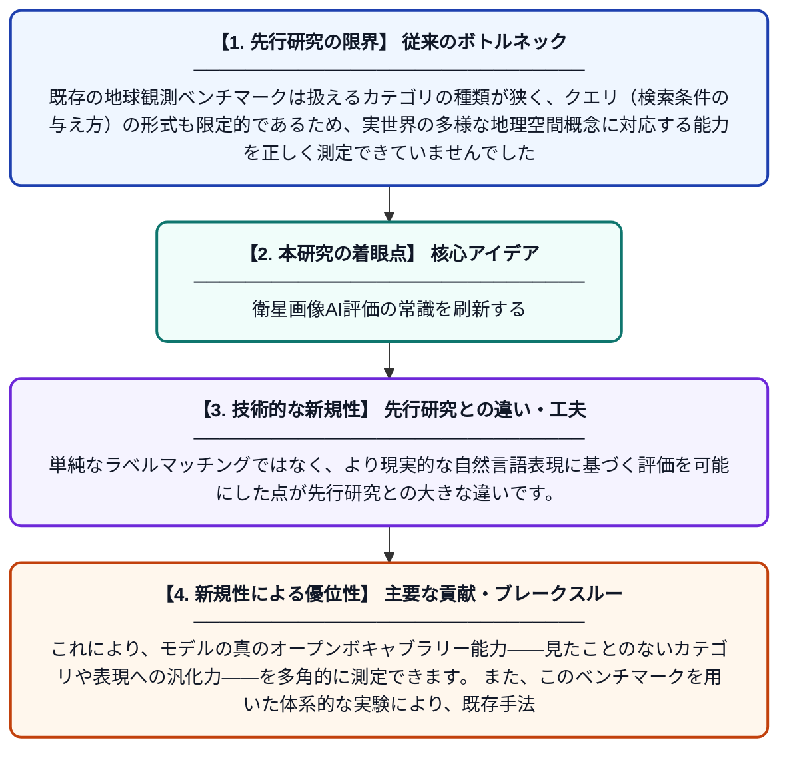

# OVEarth-Bench: オープンボキャブラリー地球観測のためのカテゴリ幅とクエリ多様性の評価基準

**Original Title**: *OVEarth-Bench: Evaluating Category Breadth and Query Diversity for Open-Vocabulary Earth Observation*

> **💡 一言要約**: 衛星画像AI評価の常識を刷新する

| 項目 | 内容 |
|---|---|
| **著者** | K Li, Z Xin, Z Jiang, J Fu, L Xue, L Zhang, X Cao |
| **掲載誌** | arXiv preprint arXiv:2607.27278 2026 |
| **アラートキーワード** | Open-Vocabulary Object ... |
| **PDF** | [https://arxiv.org/pdf/2607.27278](https://arxiv.org/pdf/2607.27278) |
| **原文リンク** | [https://arxiv.org/pdf/2607.27278](https://arxiv.org/pdf/2607.27278) |
| **PDF版要約** | [README.pdf](./README.pdf) |

---

## 📊 新規性の図解（先行研究との違いと本研究のブレークスルー）

## 📝 要約

本論文は、自然言語で指定した地理空間概念を衛星画像から検出する「オープンボキャブラリー地球観測（EO）」の評価基準の欠如という問題に取り組んでいます。既存のベンチマークはカテゴリの種類が限られ、クエリの形式も画一的であるという課題を指摘し、より広範なカテゴリと多様なクエリ形式を備えた新しいベンチマーク「OVEarth-Bench」を提案しています。これにより、オープンボキャブラリー地球観測モデルの能力をより包括的かつ公平に評価できる環境を整備しています。

## ❓ どんな問題に取り組んだか

既存の地球観測ベンチマークは扱えるカテゴリの種類が狭く、クエリ（検索条件の与え方）の形式も限定的であるため、実世界の多様な地理空間概念に対応する能力を正しく測定できていませんでした。自然言語による柔軟な指定に対応するオープンボキャブラリー手法が登場しているにもかかわらず、それを適切に評価するための基盤が整っていなかったのです。

## ✨ 何が新しい？何がすごい？（新規性）

OVEarth-Benchは、従来のベンチマークと比較して格段に広いカテゴリボキャブラリーと、多様なクエリ形式（短文・長文・属性指定など）を兼ね備えた新しい評価基準です。単純なラベルマッチングではなく、より現実的な自然言語表現に基づく評価を可能にした点が先行研究との大きな違いです。これにより、モデルの真のオープンボキャブラリー能力——見たことのないカテゴリや表現への汎化力——を多角的に測定できます。また、このベンチマークを用いた体系的な実験により、既存手法の強みと限界を明確に示しています。

## 🎓 大学1年生向けの解説

衛星写真を使って「川はどこ？」「ビルはどこ？」などの質問に自動で答えるAIを想像してください。このAIをきちんとテストするには、様々な種類の場所や、様々な聞き方に対応できるかを確かめる必要があります。しかし従来のテスト問題集は、種類も聞き方も少なすぎて、AIの本当の実力を測れていませんでした。この論文では、もっとたくさんの種類の場所と、もっと多様な聞き方を含む新しいテスト問題集「OVEarth-Bench」を作りました。これによって、衛星画像AIがどれだけ柔軟に対応できるかをより正確に評価できるようになります。
