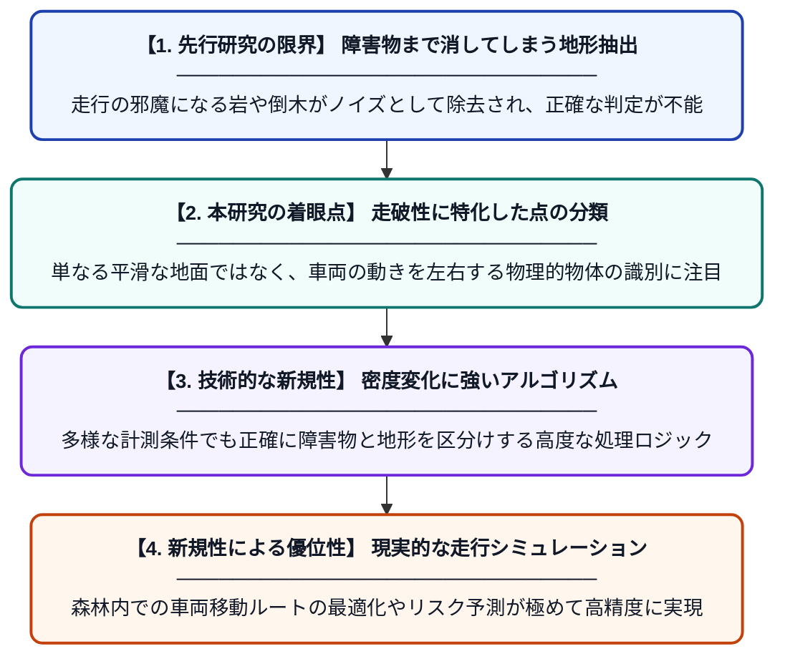

# 車両走破性解析のための地形モデル構築に向けたALSデータにおける障害物を含む地上点分類

**Original Title**: *Inclusion of obstacles in ground point classification in ALS data for terrain models used for analysis of vehicle traversability*

> **💡 一言要約**: 車両走行を支える、障害物まで捉えた超精密な地形図作り

| 項目 | 内容 |
|---|---|
| **著者** | M Lundbäck, E Wallin, S Mohtasami, M Servin… |
| **掲載誌** | arXiv preprint arXiv … 2026 |
| **アラートキーワード** | ALS |
| **PDF** | [https://arxiv.org/pdf/2611.30471](https://arxiv.org/pdf/2611.30471) |
| **原文リンク** | [https://arxiv.org/pdf/2611.30471](https://arxiv.org/pdf/2611.30471) |
| **PDF版要約** | [README.pdf](./README.pdf) |

---

## 📊 新規性の図解（先行研究との違いと本研究のブレークスルー）

## 📝 要約

森林地帯のALS（航空レーザー計測）データから、車両の走行に影響を与える障害物を考慮した高精度な地形モデルを生成する研究です。従来の地上点分類では除去されがちだった岩や倒木などの「走行の妨げとなる物体」を適切に識別・保持する新しい手法を提案しています。

## ❓ どんな問題に取り組んだか

森林環境におけるALSデータの分類は、地形の複雑さや点群密度のばらつきにより非常に困難です。特に車両の走破性を分析する場合、従来のアルゴリズムでは岩や倒木などの障害物を「ノイズ」として地面から除去してしまい、正確な走行シミュレーションができないという課題がありました。

## ✨ 何が新しい？何がすごい？（新規性）

本研究の最大の新規性は、地形抽出において「車両の走破性（トラバーサビリティ）」という視点を取り入れ、障害物を地面の一部として戦略的に保持する点にあります。多様なセンサーや飛行条件から得られる密度の異なる点群データに対しても頑健に動作する分類フレームワークを構築しました。これにより、先行研究では実現できなかった、現実の物理的制約を反映したデジタルツインの構築が可能となりました。

## 🎓 大学1年生向けの解説

山の中で自動運転車や重機を走らせるためには、地面がどれくらいデコボコしているか、大きな岩が転がっていないかを正確に知る必要があります。飛行機からレーザーを使って地形を測る技術がありますが、これまでは地面をきれいに見せようとするあまり、邪魔な岩まで消してしまうことがありました。この研究は、地面と「車が通れない障害物」を賢く見分ける新しい計算方法を開発しました。これによって、パソコンの中で「この道は車が安全に通れるか」を本物そっくりに試せるようになります。
