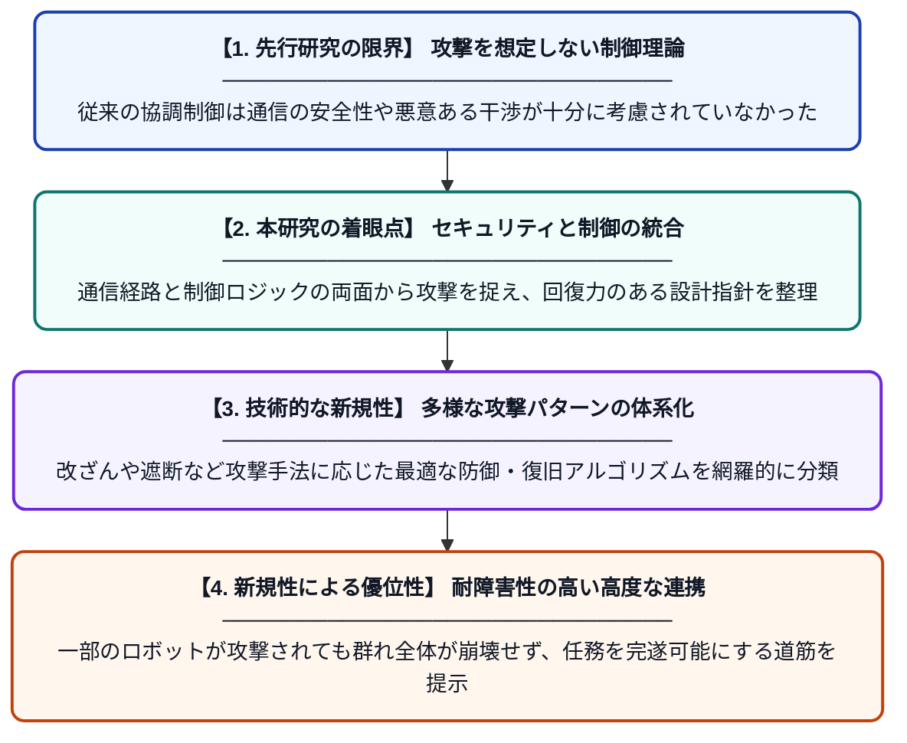

# サイバー攻撃下におけるマルチエージェントシステムのセキュア制御：包括的サーベイ

**Original Title**: *Secure control of multi-agent systems under cyber attacks: a comprehensive survey*

> **💡 一言要約**: サイバー攻撃からロボットの群れを守る制御技術の全貌

| 項目 | 内容 |
|---|---|
| **著者** | K Huang, B Shi, J Chen |
| **掲載誌** | Intelligence & Robotics 2026 |
| **アラートキーワード** | multi agent |
| **原文リンク** | [https://www.oaepublish.com/articles/ir.2026.40](https://www.oaepublish.com/articles/ir.2026.40) |
| **PDF版要約** | [README.pdf](./README.pdf) |

---

## 📊 新規性の図解（先行研究との違いと本研究のブレークスルー）

## 📝 要約

ドローンや自律走行車などのマルチエージェントシステム（MAS）を対象に、サイバー攻撃下でも安全に動作させるための制御技術を網羅した調査論文です。従来の制御理論では不十分な新しいセキュリティ課題を整理し、最新の研究動向と将来の設計指針を提示しています。

## ❓ どんな問題に取り組んだか

無人航空機や移動ロボットの連携システムは通信ネットワークに依存しているため、悪意のあるデータ改ざんや通信妨害に対して非常に脆弱です。従来の制御手法はシステムの物理的な動作に特化しており、攻撃によって通信の整合性が崩れた場合に群れ全体の制御が破綻するリスクがありました。

## ✨ 何が新しい？何がすごい？（新規性）

本論文は、従来の汎用的なマルチエージェント定式化では対応できなかった「セキュリティと制御の相互作用」に焦点を当て、攻撃の種類に応じたレジリエンス（回復力）の評価軸を体系化しました。単なるセキュリティ対策の紹介に留まらず、攻撃を受けても制御目的を達成し続けるための動的な適応アルゴリズムの貢献度を具体的に分析しています。これにより、将来の複雑なMASにおけるセキュアなシステム設計のロードマップを明確に示しました。

## 🎓 大学1年生向けの解説

たくさんのドローンが協力して空を飛ぶとき、それらは通信を使って情報をやり取りしています。もし悪いハッカーがその通信を邪魔したり、ウソの情報を送り込んだりしたら、ドローン同士が衝突してしまうかもしれません。この論文は、そんな攻撃を受けても騙されずに、ロボットたちが安全にミッションを続けられるようにするための最新の「守り方」をまとめた教科書のようなものです。どんな攻撃があって、どうやって機械たちがそれを見破るのかを分かりやすく解説しています。
