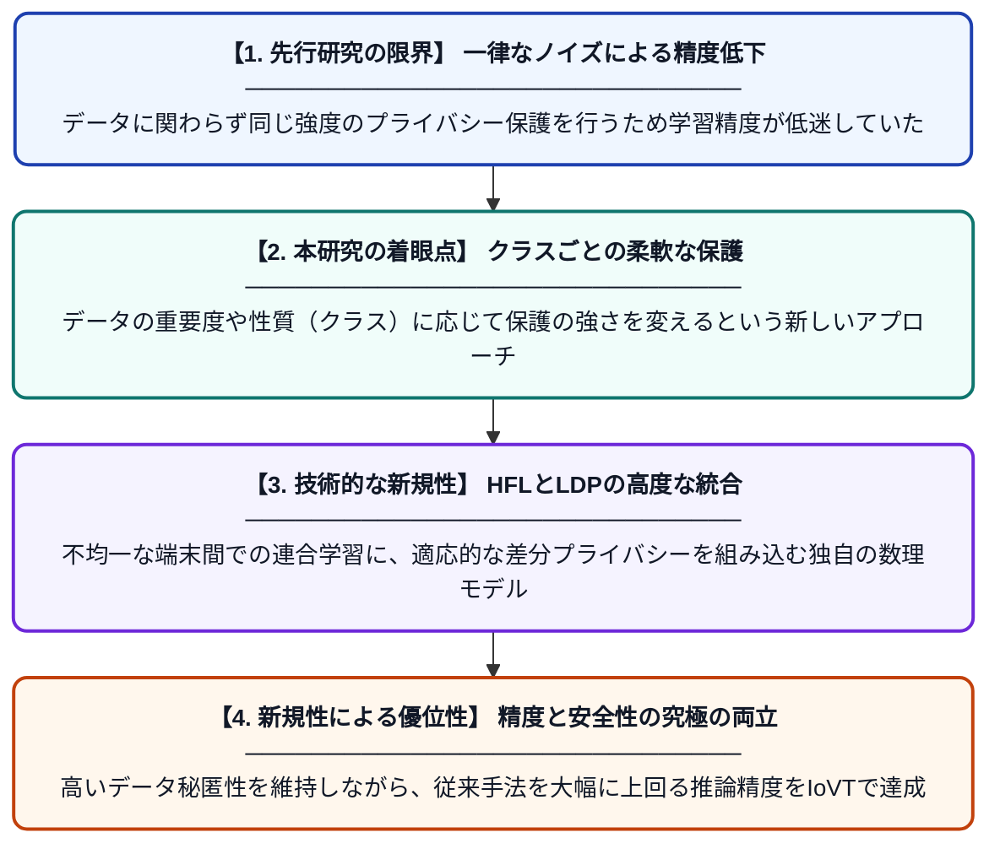

# (ε c, H fl)-プライバシー：IoVTのための不均一な連合学習を用いたクラス適応型ローカル差分プライバシーフレームワーク

**Original Title**: *(ε c, H fl)-Privacy: Class-Adaptive Local Differential Privacy Framework using Heterogeneous Federated Learning for IoVT*

> **💡 一言要約**: 車両データの多様性と秘匿性を両立する次世代の共同学習法

| 項目 | 内容 |
|---|---|
| **著者** | A Hussain, S Li, R Khan, R Ullah, W Akbar, N Waheed |
| **掲載誌** | IEEE Internet of Things … 2026 |
| **アラートキーワード** | Federated Learning |
| **原文リンク** | [https://ieeexplore.ieee.org/abstract/document/11806598/](https://ieeexplore.ieee.org/abstract/document/11806598/) |
| **PDF版要約** | [README.pdf](./README.pdf) |

---

## 📊 新規性の図解（先行研究との違いと本研究のブレークスルー）

## 📝 要約

車両インターネット（IoVT）において、データの多様性とプライバシー保護の両立を目指す新しいフレームワークを提案しています。不均一なデータ分布を持つ車両間での共同学習を可能にする「不均一連合学習（HFL）」と、データのクラスごとにプライバシー強度を調整する「クラス適応型ローカル差分プライバシー」を組み合わせています。

## ❓ どんな問題に取り組んだか

従来のIoVTシステムでは、車両ごとにデータの分布が異なるため、一律のプライバシー保護手法を適用すると学習精度が著しく低下するという課題がありました。また、生のデータをサーバーに送ることなく、高いセキュリティを保ちながら高度な推論モデルを構築する必要がありました。

## ✨ 何が新しい？何がすごい？（新規性）

本研究の核心は、データの「クラス（種類）」に応じてノイズの量を動的に調整するクラス適応型LDPを導入した点にあります。先行研究では一律だったプライバシー強度を柔軟に変えることで、不均一なデータを持つ車両間でも効率的な学習（HFL）を可能にしました。これにより、プライバシーの厳格な保護とモデルの予測精度の維持という相反する課題を、IoVT環境で初めて高度に解決しています。

## 🎓 大学1年生向けの解説

たくさんの車が走る中で、それぞれの車が持っている情報をプライバシーを守りつつみんなで共有して、より賢いAIを作ろうとする研究です。これまでは、情報を隠すための「ノイズ」を混ぜすぎるとAIがバカになり、混ぜ方が足りないと個人の情報が漏れるという問題がありました。この研究では、データの種類に合わせてノイズの混ぜ方を工夫することで、秘密を守りながらも非常に賢いAIを作ることに成功しました。これにより、プライバシーを気にせず安全で便利な自動運転社会などの実現に貢献します。
