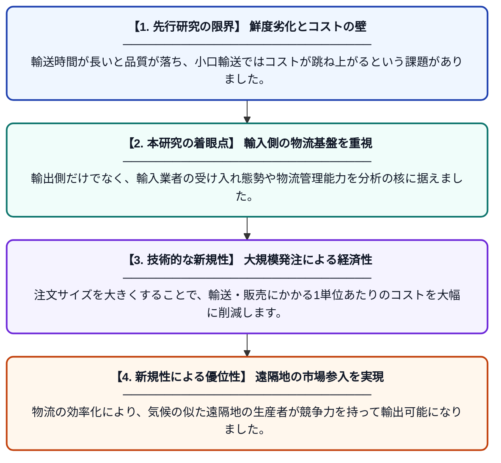

# 生鮮食品貿易における物流と製品品質の関係性

**Original Title**: *Logistics and product quality in perishable food trade*

> **💡 一言要約**: 物流の進化が、生鮮食品の鮮度と市場の壁を壊す

| 項目 | 内容 |
|---|---|
| **著者** | A Oglend, F Asche, HM Straume |
| **掲載誌** | Food Policy 2026 |
| **アラートキーワード** | logistics |
| **原文リンク** | [https://www.sciencedirect.com/science/article/pii/S030691922600196X](https://www.sciencedirect.com/science/article/pii/S030691922600196X) |
| **PDF版要約** | [README.pdf](./README.pdf) |

---

## 📊 新規性の図解（先行研究との違いと本研究のブレークスルー）

## 📝 要約

生鮮食品の国際貿易において、輸入側の物流効率が製品の品質維持や取引機会に与える影響を分析した論文です。大規模な発注による規模の経済がコストを抑え、同様の気候を持つ他国の生産者にも市場参入のチャンスを広げることを明らかにしました。

## ❓ どんな問題に取り組んだか

生鮮食品は時間が経つほど価値が下がるため、輸送の遅れや非効率は致命的です。しかし、物流の仕組みや注文の大きさが、具体的にどのように製品の品質や供給元の選択肢に影響しているのかは明確ではありませんでした。

## ✨ 何が新しい？何がすごい？（新規性）

本研究は、物流を単なる「運び方」ではなく、製品品質を決定づける戦略的要素として再定義しました。特に、輸入業者の物流能力が向上し、一度に大量の注文が可能になることで、マーケティングコストの削減と鮮度維持が両立できることを示しました。これにより、地理的に遠くても似た気候を持つ地域の農家が、新たに国際市場へ参入できる可能性を理論的に提示した点が画期的です。

## 🎓 大学1年生向けの解説

海外の果物などが新鮮なままお店に並ぶのは、実はすごい工夫のおかげです。この論文は、一度にたくさんの量を効率よく運ぶ「物流の魔法」が、商品の質を守りつつ、値段を下げる役割を果たしていることを説明しています。物流がうまくいくと、今まで輸出を諦めていた遠くの国の農家さんも、世界中に美味しいものを届けられるようになります。私たちの食卓が豊かになる裏側には、こうした物流の進化があるのです。
