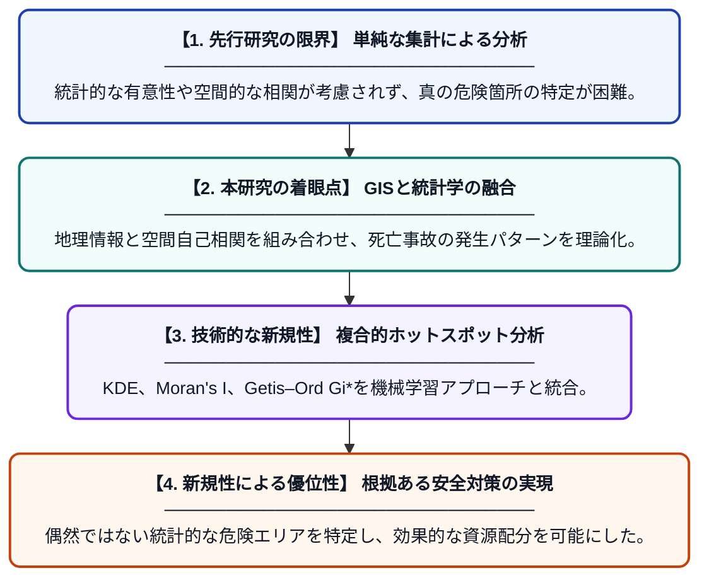

# GISと機械学習を用いた特定地域における交通事故ホットスポットの分析：死亡事故のバイナリ評価

**Original Title**: *Analysis of Road Traffic Accident Hotspots on Selected Study Area Using GIS-Machine Learning-A Binary Assessment of Fatal Crashes*

> **💡 一言要約**: GIS×機械学習で死亡事故の危険箇所を科学的に特定

| 項目 | 内容 |
|---|---|
| **著者** | CJ Pallavi |
| **掲載誌** | Journal of Intelligent Decision Making and Information … 2026 |
| **アラートキーワード** | kernel density estimation |
| **PDF** | [https://jidmis.org/index.php/jidmis/article/download/6019/2564](https://jidmis.org/index.php/jidmis/article/download/6019/2564) |
| **原文リンク** | [https://jidmis.org/index.php/jidmis/article/download/6019/2564](https://jidmis.org/index.php/jidmis/article/download/6019/2564) |
| **PDF版要約** | [README.pdf](./README.pdf) |

---

## 📊 新規性の図解（先行研究との違いと本研究のブレークスルー）

## 📝 要約

GIS（地理情報システム）と機械学習を組み合わせ、交通事故の死亡リスクが高い「ホットスポット」を特定する手法を提案した研究です。カーネル密度推定（KDE）や空間自己相関分析を用いることで、事故の密集パターンを可視化し、統計的に有意な危険地点を精密に特定しました。

## ❓ どんな問題に取り組んだか

従来の事故分析では、単純な発生件数の集計に留まることが多く、死亡事故が空間的にどのように集中しているかを統計的に捉えることが困難でした。また、限られた予算で効果的な安全対策を講じるためには、真に危険なエリアを客観的に特定する高度な分析手法が不可欠でした。

## ✨ 何が新しい？何がすごい？（新規性）

本研究の新規性は、GISによる高度な空間統計（KDEやGetis–Ord Gi*統計）と機械学習による評価を統合し、死亡事故に特化したバイナリ評価モデルを構築した点にあります。単に事故の多寡を見るだけでなく、Global Moran's Iを用いて空間的な自己相関を測定することで、偶然ではない統計的な「熱溜まり（ホットスポット）」を科学的に証明しました。これにより、特定地域における重大事故の地理的要因をより高い精度で把握することを可能にしています。

## 🎓 大学1年生向けの解説

この研究は、地図データと数学的な計算を使って「どこで命に関わる事故が起きやすいか」を突き止めるものです。まず、事故が起きた場所を地図に描き込み、AIや統計学を使って事故が密集している不気味なエリアを探し出します。単に事故が多い場所を探すだけでなく、「偶然にしては事故が起きすぎている場所」を数学的に証明するのが特徴です。これによって、警察や道路を作る人が、優先的に対策すべき危険な場所がはっきりと分かるようになります。
