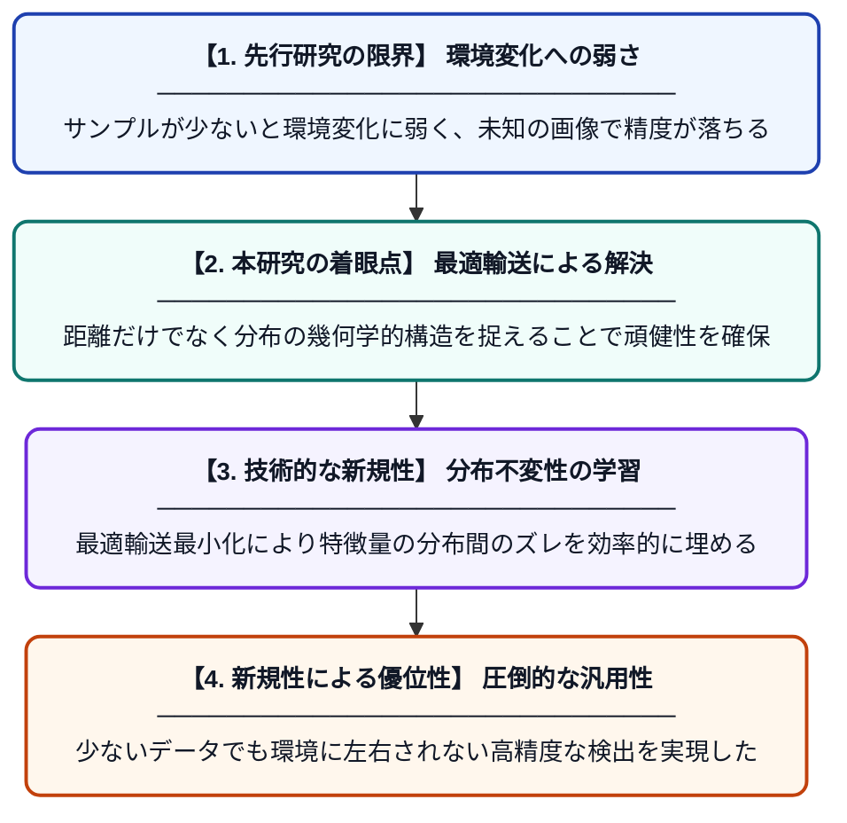

# 最適輸送の最小化：ワンショット物体検出のための潜在的な分布不変性の学習

**Original Title**: *Optimal Transport Minimization: Learning Implicit Distribution Invariance for One-Shot Object Detection*

> **💡 一言要約**: 最適輸送で1枚の画像から未知の物体を正確に検出

| 項目 | 内容 |
|---|---|
| **著者** | C Zhang, Z Lyu, J Xiao, Y Ju, KM Lam, Q Wang |
| **掲載誌** | IEEE Transactions on Multimedia 2026 |
| **アラートキーワード** | one shot |
| **原文リンク** | [https://ieeexplore.ieee.org/abstract/document/11793879/](https://ieeexplore.ieee.org/abstract/document/11793879/) |
| **PDF版要約** | [README.pdf](./README.pdf) |

---

## 📊 新規性の図解（先行研究との違いと本研究のブレークスルー）

## 📝 要約

本論文は、たった1枚の見本画像から未知の物体を検出するワンショット物体検出において、データの分布変化に左右されない「分布不変性」を学習する新手法を提案しています。最適輸送理論を用いることで、画像間の特徴的な差異を効率的に埋め、汎用性の高い物体認識を実現しました。

## ❓ どんな問題に取り組んだか

ワンショット物体検出では、参照画像と対象画像の間で照明や視点などの環境条件（データ分布）が異なると、検出精度が著しく低下するという課題がありました。従来の手法は、これらの潜在的な分布の変化に対して十分な耐性を持っておらず、新しい環境への適応力が不足していました。

## ✨ 何が新しい？何がすごい？（新規性）

本研究の最大の特徴は、最適輸送（Optimal Transport）を最小化する枠組みを導入し、データの潜在的な分布不変性を直接学習可能にした点にあります。単なる点対点の比較ではなく、特徴量の集合（分布）としての整合性を最適化することで、ドメイン間のギャップを数学的に解消する表現を獲得しました。これにより、ノイズや環境変化に極めて強い頑健な検出モデルを構築し、従来手法を上回る性能を達成しています。

## 🎓 大学1年生向けの解説

「たった1枚の見本を見ただけで、複雑な写真の中から同じものを探し出す」という難しいAI技術の研究です。これまでは見本の画像と探し出す画像で明るさや角度が少し違うだけで失敗しやすかったのですが、この研究では「最適輸送」という数学の魔法を使って、物の本質的な特徴だけをうまく抜き出すことに成功しました。これにより、少し見え方が違っても賢く探し出せるようになります。
