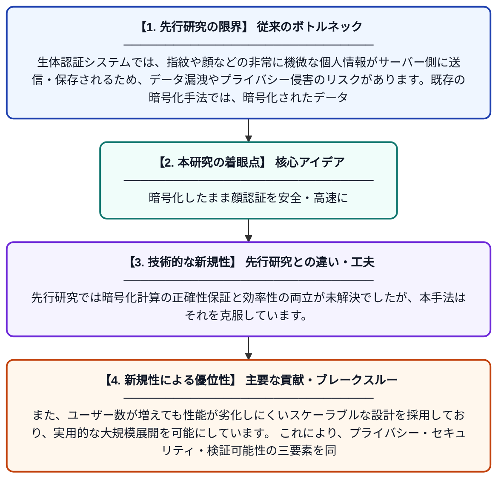

# BioZKFHE: 検証可能な準同型類似度評価による拡張性のある暗号化生体認証識別システム

**Original Title**: *BioZKFHE: Scalable Encrypted Biometric Identification via Verifiable Homomorphic Similarity Evaluation*

> **💡 一言要約**: 暗号化したまま顔認証を安全・高速に

| 項目 | 内容 |
|---|---|
| **著者** | R Xin, T Wang, X Wu, W Meng, S Zhang, S Yu |
| **掲載誌** | IEEE Transactions on Dependable and Secure Computing 2026 |
| **アラートキーワード** | Secure Computing |
| **PDF** | [https://arxiv.org/pdf/2607.22065](https://arxiv.org/pdf/2607.22065) |
| **Git リポジトリ** | [https://github.com/plan-lab-szu/BioZKFHE.measurements](https://github.com/plan-lab-szu/BioZKFHE.measurements) |
| **原文リンク** | [https://arxiv.org/pdf/2607.22065](https://arxiv.org/pdf/2607.22065) |
| **PDF版要約** | [README.pdf](./README.pdf) |

---

## 📊 新規性の図解（先行研究との違いと本研究のブレークスルー）

## 📝 要約

本論文は、生体情報（指紋や顔など）を暗号化したまま照合・認証できるシステム「BioZKFHE」を提案しています。準同型暗号（FHE）とゼロ知識証明（ZKP）を組み合わせることで、プライバシーを守りながら生体認証の正確性と計算結果の正当性を同時に保証します。さらに、大規模なユーザー数にも対応できるスケーラビリティを実現している点が特徴です。

## ❓ どんな問題に取り組んだか

生体認証システムでは、指紋や顔などの非常に機微な個人情報がサーバー側に送信・保存されるため、データ漏洩やプライバシー侵害のリスクがあります。既存の暗号化手法では、暗号化されたデータ上での類似度計算が非効率であったり、計算結果が正しく行われたかを検証できないという課題がありました。特に大規模なシステムでは、処理速度とセキュリティを両立させることが困難でした。

## ✨ 何が新しい？何がすごい？（新規性）

本研究は、準同型暗号（FHE）とゼロ知識証明（ZKP）を融合させた新しいフレームワークを構築し、暗号化された生体データのまま類似度評価を実行しつつ、その計算結果の正当性を第三者が検証できる仕組みを初めて実現しました。先行研究では暗号化計算の正確性保証と効率性の両立が未解決でしたが、本手法はそれを克服しています。また、ユーザー数が増えても性能が劣化しにくいスケーラブルな設計を採用しており、実用的な大規模展開を可能にしています。これにより、プライバシー・セキュリティ・検証可能性の三要素を同時に満たす点が主要な貢献です。

## 🎓 大学1年生向けの解説

スマホの顔認証や指紋認証では、あなたの顔や指紋のデータがサーバーに送られて照合されますが、そのデータが盗まれると大変なことになります。この研究では、データを「暗号化した鍵のかかった箱」に入れたまま、中身を見ずに「本人かどうか」を判定できる技術を作りました。さらに、その判定結果が正しく計算されたかどうかを数学的に証明できる仕組みも組み込んでいます。銀行のATMや入退室管理など、多くの人が使う大規模なシステムでも速く動くように工夫されています。つまり、プライバシーを守りながら、安全で信頼できる生体認証を実現する新しいシステムです。
