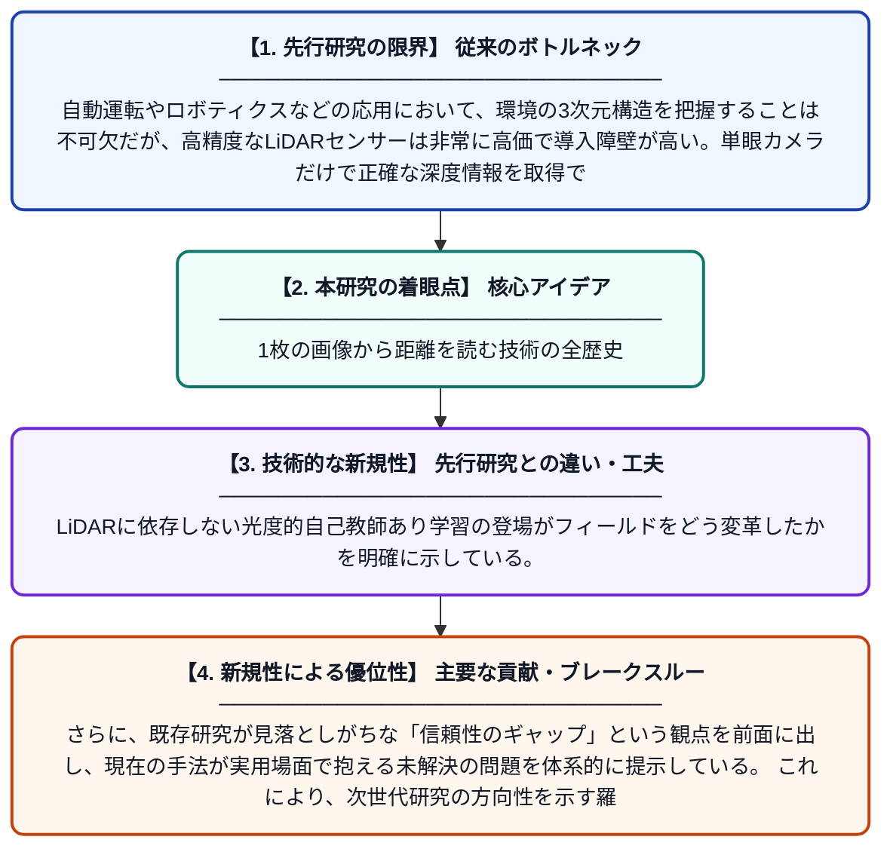

# 単眼深度推定の進化：空間回帰から生成的基盤モデルへ、そして信頼性の課題

**Original Title**: *The Evolution of Monocular Depth Estimation: From Spatial Regression to GenerativeFoundations and the Reliability Gaps*

> **💡 一言要約**: 1枚の画像から距離を読む技術の全歴史

| 項目 | 内容 |
|---|---|
| **著者** | HM Shanto, MT Islam, MR Hasan, SS Pranto, T Ahmed |
| **掲載誌** | AIUB Journal of Science and Engineering 2026 |
| **アラートキーワード** | Markov random"  fields |
| **PDF** | [https://ajse.aiub.edu/index.php/ajse/article/download/1693/239](https://ajse.aiub.edu/index.php/ajse/article/download/1693/239) |
| **原文リンク** | [https://ajse.aiub.edu/index.php/ajse/article/download/1693/239](https://ajse.aiub.edu/index.php/ajse/article/download/1693/239) |
| **PDF版要約** | [README.pdf](./README.pdf) |

---

## 📊 新規性の図解（先行研究との違いと本研究のブレークスルー）

## 📝 要約

本論文は、単眼カメラ1台から距離情報（深度）を推定する技術の歴史的発展を体系的にサーベイした研究である。手工芸的なマルコフ確率場から畳み込みニューラルネットワーク（CNN）、自己教師あり学習、そして最新の生成モデルに至るまでの技術変遷を詳細に追跡している。さらに、現在の手法が抱える信頼性のギャップや実用上の課題についても分析・考察している。

## ❓ どんな問題に取り組んだか

自動運転やロボティクスなどの応用において、環境の3次元構造を把握することは不可欠だが、高精度なLiDARセンサーは非常に高価で導入障壁が高い。単眼カメラだけで正確な深度情報を取得できれば低コスト化が可能だが、1枚の画像から距離を推定することは本質的に不良設定問題（解が一意に定まらない）であり、精度と信頼性の確保が大きな課題となっている。特に、既存手法の実環境での信頼性のギャップが未解決のまま残っている。

## ✨ 何が新しい？何がすごい？（新規性）

本研究は単眼深度推定の手法を時系列的・技術的系譜で横断的に整理した包括的サーベイであり、古典的手法から最新の生成モデルベースの手法までを一貫した視点で比較・分析している点が新しい。LiDARに依存しない光度的自己教師あり学習の登場がフィールドをどう変革したかを明確に示している。さらに、既存研究が見落としがちな「信頼性のギャップ」という観点を前面に出し、現在の手法が実用場面で抱える未解決の問題を体系的に提示している。これにより、次世代研究の方向性を示す羅針盤的な役割を果たしている。

## 🎓 大学1年生向けの解説

私たちの目は2つあるから遠近感がわかりますが、カメラ1台だけで「この物体は何メートル先にあるか」を当てることを「単眼深度推定」と言います。この論文は、その技術がどのように進化してきたかを歴史の教科書のようにまとめたものです。昔は人間がルールを細かく決める方法が主流でしたが、今はAI（ニューラルネットワーク）が画像から自動で距離を学習できるようになりました。さらに最近は、高価なセンサーなしで普通のカメラ映像だけから学習できる技術も生まれています。ただし、まだ「本当に信頼できるか」という問題が残っており、この論文はその課題を整理して今後の研究への道筋を示しています。
