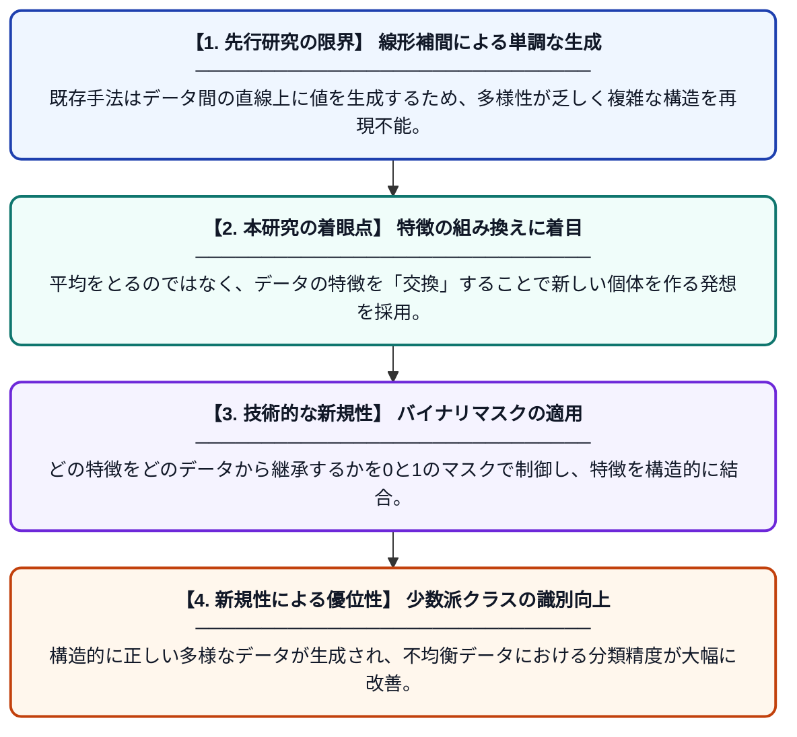

# バイナリマスク再結合SMOTE：不均衡データに対する特徴レベルの交差を用いた少数派オーバーサンプリング

**Original Title**: *Binary-mask Recombination SMOTE: Structuring Feature-level Crossover for Binary Imbalanced Data Minority Oversampling*

> **💡 一言要約**: 組み換えの力で、不均衡データの壁を打破する新手法

| 項目 | 内容 |
|---|---|
| **著者** | J Zhang |
| **アラートキーワード** | SMOTE |
| **PDF** | [https://www.academia.edu/download/133318122/Binary_mask_Recombination_SMOTE_Structuring_Feature_level_Crossover_for_Binary_Imbalanced_Data_Minority_Oversampling.pdf](https://www.academia.edu/download/133318122/Binary_mask_Recombination_SMOTE_Structuring_Feature_level_Crossover_for_Binary_Imbalanced_Data_Minority_Oversampling.pdf) |
| **原文リンク** | [https://www.academia.edu/download/133318122/Binary_mask_Recombination_SMOTE_Structuring_Feature_level_Crossover_for_Binary_Imbalanced_Data_Minority_Oversampling.pdf](https://www.academia.edu/download/133318122/Binary_mask_Recombination_SMOTE_Structuring_Feature_level_Crossover_for_Binary_Imbalanced_Data_Minority_Oversampling.pdf) |
| **PDF版要約** | [README.pdf](./README.pdf) |

---

## 📊 新規性の図解（先行研究との違いと本研究のブレークスルー）

## 📝 要約

不均衡データの学習を改善するため、特徴レベルでの「組み換え」を行う新アルゴリズム「BMR-SMOTE」を提案しています。従来の線形補間に頼る手法とは異なり、バイナリマスクを用いて複数のデータの特徴を交差させることで、より多様で構造的な少数派データを生成します。

## ❓ どんな問題に取り組んだか

従来のSMOTE手法は、2つのデータの間の直線上の値を計算する「線形補間」に依存していました。しかし、この手法では特徴同士の複雑な関係性を捉えきれず、生成されたデータが実態から乖離したり、学習に十分な多様性を提供できなかったりする課題がありました。

## ✨ 何が新しい？何がすごい？（新規性）

遺伝的アルゴリズムで見られる「交差（クロスオーバー）」の概念をSMOTEに導入した点が画期的です。バイナリマスクを用いて特徴量を選択的に組み替えることで、単なる中間値の生成ではなく、データの論理的構造を維持した新しいサンプルの生成を可能にしました。これにより、境界付近のデータ分布をより精密に補強し、分類器の汎化性能を向上させています。

## 🎓 大学1年生向けの解説

AIに何かを教えるとき、データの数に偏りがあると、少ない方の種類（少数派）を無視しがちになります。この「少ないデータ」を人工的に増やす有名な方法がありますが、これまでは「既存のデータ同士のちょうど真ん中」を作るという単純なものでした。この論文では、2つのデータの特徴をパズルのように組み替える手法を提案しています。この工夫により、より自然でバリエーション豊かなデータを作ることができ、AIが珍しいケースも正しく判別できるようになります。
