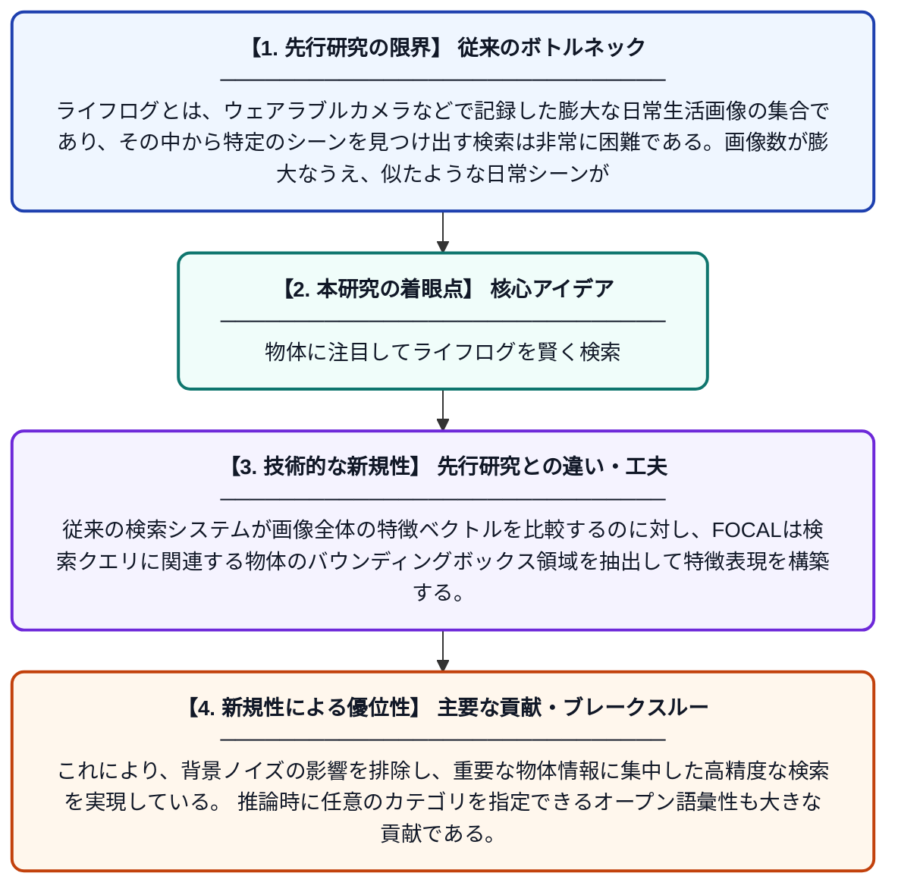

# FOCAL：ライフログ検索のための物体中心型注意機構

**Original Title**: *FOCAL: Focused Object-Centric Attention for Lifelog Retrieval*

> **💡 一言要約**: 物体に注目してライフログを賢く検索

| 項目 | 内容 |
|---|---|
| **著者** | AK Dinh-Duc, DT Dinh, MQ Ho-Le, VT Ninh, MT Tran |
| **掲載誌** | Proceedings of the 9th Annual … 2026 |
| **アラートキーワード** | Open-Vocabulary Object ... |
| **原文リンク** | [https://dl.acm.org/doi/full/10.1145/3810984.3817076](https://dl.acm.org/doi/full/10.1145/3810984.3817076) |
| **PDF版要約** | [README.pdf](./README.pdf) |

---

## 📊 新規性の図解（先行研究との違いと本研究のブレークスルー）

## 📝 要約

本論文は、日常生活を記録したライフログ画像から目的のシーンを効率的に検索するシステム「FOCAL」を提案している。YOLO-World v2を活用したオープン語彙物体検出により、テキストで指定した任意カテゴリの物体をバウンディングボックスで特定し、物体に焦点を当てた注意機構で検索精度を高める。画像全体を漠然と比較する従来手法と異なり、重要な物体領域に絞った特徴表現によりライフログ検索の課題に対応する。

## ❓ どんな問題に取り組んだか

ライフログとは、ウェアラブルカメラなどで記録した膨大な日常生活画像の集合であり、その中から特定のシーンを見つけ出す検索は非常に困難である。画像数が膨大なうえ、似たような日常シーンが多く、単純な画像類似度検索では目的のシーンを正確に絞り込めないという課題がある。特に「特定の物体が写っているシーン」を自然言語で検索する際の精度向上が求められている。

## ✨ 何が新しい？何がすごい？（新規性）

本研究の新規性は、YOLO-World v2によるオープン語彙物体検出をライフログ検索に組み込み、テキストクエリで指定した物体領域に動的に注意を向ける「物体中心型注意機構」を提案した点にある。従来の検索システムが画像全体の特徴ベクトルを比較するのに対し、FOCALは検索クエリに関連する物体のバウンディングボックス領域を抽出して特徴表現を構築する。これにより、背景ノイズの影響を排除し、重要な物体情報に集中した高精度な検索を実現している。推論時に任意のカテゴリを指定できるオープン語彙性も大きな貢献である。

## 🎓 大学1年生向けの解説

スマートグラスやウェアラブルカメラで1日中撮影すると、何千枚もの写真が溜まります。その中から「コーヒーカップが写っている場面」などを探すのはとても大変です。この研究では、AIに「注目すべき物体だけをしっかり見る」能力を持たせることで、自然な言葉で検索しても素早く正確に目的の写真を見つけられるシステムを作りました。人間が「あの赤いカップがあった場面はどこだっけ？」と思い出す感覚に近い検索を実現しています。
