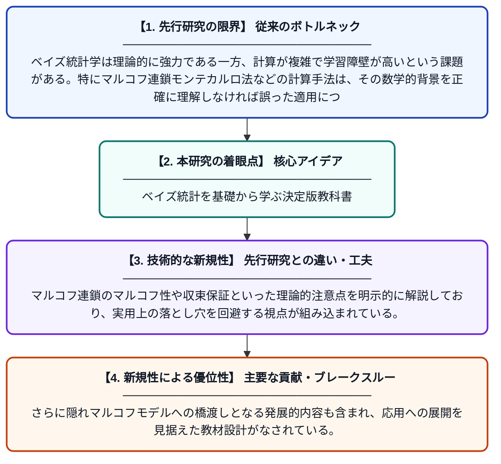

# ベイズ統計の基礎：教科書的入門

**Original Title**: *Springer Texts in Statistics Jean-Michel Marin Christian Robert Bayesian Essentials*

> **💡 一言要約**: ベイズ統計を基礎から学ぶ決定版教科書

| 項目 | 内容 |
|---|---|
| **著者** | G Casella, R DeVeaux, SE Fienberg, I Olkin |
| **アラートキーワード** | MRFs Markov |
| **原文リンク** | [https://ir.mksu.ac.ke/server/api/core/bitstreams/2cb8c80c-6fd2-4018-b864-8ac31414f0d7/content](https://ir.mksu.ac.ke/server/api/core/bitstreams/2cb8c80c-6fd2-4018-b864-8ac31414f0d7/content) |
| **PDF版要約** | [README.pdf](./README.pdf) |

---

## 📊 新規性の図解（先行研究との違いと本研究のブレークスルー）

## 📝 要約

本書はベイズ統計学の基礎を体系的に解説した教科書であり、マルコフ連鎖モンテカルロ法（MCMC）などの計算手法を中心に扱っている。マルコフ連鎖の理論的背景とその収束保証についても丁寧に説明されており、隠れマルコフモデルへの発展的な内容も含まれる。統計学を学ぶ学生や研究者が実践的にベイズ推定を理解・活用できるよう構成されている。

## ❓ どんな問題に取り組んだか

ベイズ統計学は理論的に強力である一方、計算が複雑で学習障壁が高いという課題がある。特にマルコフ連鎖モンテカルロ法などの計算手法は、その数学的背景を正確に理解しなければ誤った適用につながる危険性がある。初学者がこれらの手法を体系的かつ正確に学べる教材が求められていた。

## ✨ 何が新しい？何がすごい？（新規性）

本書はベイズ統計の理論と計算手法を一冊にまとめ、初学者から中級者まで段階的に学習できる構成を採用している点が特徴的である。マルコフ連鎖のマルコフ性や収束保証といった理論的注意点を明示的に解説しており、実用上の落とし穴を回避する視点が組み込まれている。さらに隠れマルコフモデルへの橋渡しとなる発展的内容も含まれ、応用への展開を見据えた教材設計がなされている。

## 🎓 大学1年生向けの解説

ベイズ統計とは、新しいデータが得られるたびに自分の予測を更新していく考え方です。たとえば天気予報で、朝の情報を元に昼の予測を修正するようなイメージです。この本はそのベイズ統計の基本的な考え方から、コンピュータを使った計算方法まで丁寧に説明しています。マルコフ連鎖というランダムな系列を使った計算技術も、わかりやすく解説されています。統計学をこれから学ぶ人にとって、しっかりした基礎を作るための一冊です。
