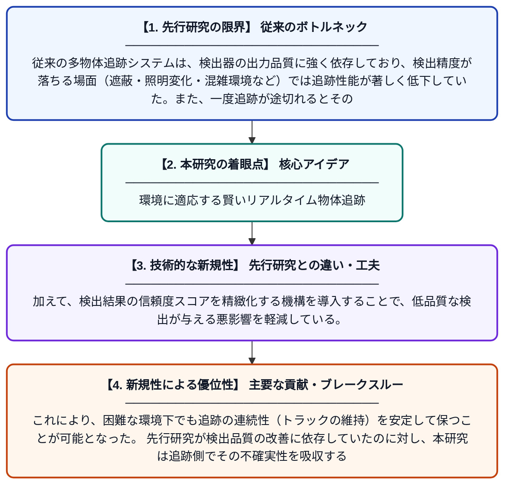

# AdaptiveTrack：環境適応型かつ信頼度精緻化によるオンライン多物体追跡フレームワーク

**Original Title**: *AdaptiveTrack: An Environment-Aware and Confidence-Refined Framework for Online Multi-Object Tracking*

> **💡 一言要約**: 環境に適応する賢いリアルタイム物体追跡

| 項目 | 内容 |
|---|---|
| **著者** | SBJ Khan, P Zhang, MM Kamal, HS Samkari |
| **アラートキーワード** | Multi Camera Tracking |
| **PDF** | [https://www.researchgate.net/profile/Jahfar-Said-Baz/publication/410685807_INFORMATION_Keywords_Multi-object_tracking_YOLOX_association_occlusion_trajectory_crowded_conditions_AdaptiveTrack_An_Environment-Aware_and_Confidence-Refined_Framework_for_Online_Multi-Object_Trackin/links/6a60c2f4a4d94b202f21d6e9/INFORMATION-Keywords-Multi-object-tracking-YOLOX-association-occlusion-trajectory-crowded-conditions-AdaptiveTrack-An-Environment-Aware-and-Confidence-Refined-Framework-for-Online-Multi-Object-Trackin.pdf](https://www.researchgate.net/profile/Jahfar-Said-Baz/publication/410685807_INFORMATION_Keywords_Multi-object_tracking_YOLOX_association_occlusion_trajectory_crowded_conditions_AdaptiveTrack_An_Environment-Aware_and_Confidence-Refined_Framework_for_Online_Multi-Object_Trackin/links/6a60c2f4a4d94b202f21d6e9/INFORMATION-Keywords-Multi-object-tracking-YOLOX-association-occlusion-trajectory-crowded-conditions-AdaptiveTrack-An-Environment-Aware-and-Confidence-Refined-Framework-for-Online-Multi-Object-Trackin.pdf) |
| **原文リンク** | [https://www.researchgate.net/profile/Jahfar-Said-Baz/publication/410685807_INFORMATION_Keywords_Multi-object_tracking_YOLOX_association_occlusion_trajectory_crowded_conditions_AdaptiveTrack_An_Environment-Aware_and_Confidence-Refined_Framework_for_Online_Multi-Object_Trackin/links/6a60c2f4a4d94b202f21d6e9/INFORMATION-Keywords-Multi-object-tracking-YOLOX-association-occlusion-trajectory-crowded-conditions-AdaptiveTrack-An-Environment-Aware-and-Confidence-Refined-Framework-for-Online-Multi-Object-Trackin.pdf](https://www.researchgate.net/profile/Jahfar-Said-Baz/publication/410685807_INFORMATION_Keywords_Multi-object_tracking_YOLOX_association_occlusion_trajectory_crowded_conditions_AdaptiveTrack_An_Environment-Aware_and_Confidence-Refined_Framework_for_Online_Multi-Object_Trackin/links/6a60c2f4a4d94b202f21d6e9/INFORMATION-Keywords-Multi-object-tracking-YOLOX-association-occlusion-trajectory-crowded-conditions-AdaptiveTrack-An-Environment-Aware-and-Confidence-Refined-Framework-for-Online-Multi-Object-Trackin.pdf) |
| **PDF版要約** | [README.pdf](./README.pdf) |

---

## 📊 新規性の図解（先行研究との違いと本研究のブレークスルー）

## 📝 要約

本論文では、検出品質への過度な依存によって追跡性能が低下する問題を解決するため、「AdaptiveTrack」と呼ばれるオンライン多物体追跡フレームワークを提案している。このフレームワークは環境の変化に適応しながら、追跡の信頼度を精緻化することでトラッキングの継続性を維持する。様々なシナリオにおける追跡の安定性と精度の向上を目指している。

## ❓ どんな問題に取り組んだか

従来の多物体追跡システムは、検出器の出力品質に強く依存しており、検出精度が落ちる場面（遮蔽・照明変化・混雑環境など）では追跡性能が著しく低下していた。また、一度追跡が途切れるとその連続性を回復することが難しく、追跡IDの断絶や誤対応が頻発するという課題があった。

## ✨ 何が新しい？何がすごい？（新規性）

AdaptiveTrackは、環境の状態を認識しながら動的に追跡戦略を切り替える「環境適応型」のアプローチを採用しており、従来の静的な追跡パイプラインとは大きく異なる。加えて、検出結果の信頼度スコアを精緻化する機構を導入することで、低品質な検出が与える悪影響を軽減している。これにより、困難な環境下でも追跡の連続性（トラックの維持）を安定して保つことが可能となった。先行研究が検出品質の改善に依存していたのに対し、本研究は追跡側でその不確実性を吸収する設計思想が新しい。

## 🎓 大学1年生向けの解説

例えば監視カメラで複数の人を同時に追いかけるシステムを想像してください。人が重なったり影になったりすると、カメラのAIが人を正しく認識できなくなり、誰が誰だかわからなくなる問題が起きます。AdaptiveTrackは、そのような難しい状況でも「今の環境はどんな状態か」を判断しながら追跡方法を自動で調整します。また、AIの認識結果がどれくらい信頼できるかを再評価する仕組みも持っているため、間違った情報に引きずられにくくなっています。その結果、複数の人や車などをリアルタイムで正確に追い続けることができるようになります。
