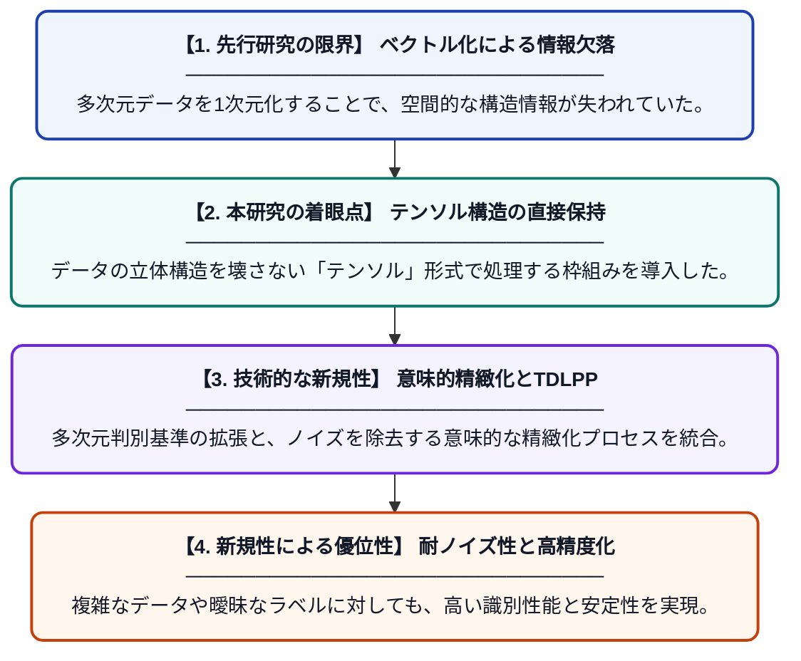

# ハイパースペクトル画像分類のための意味的に精緻化されたテンソル判別多様体学習

**Original Title**: *Semantic-purified tensor discriminant manifold learning for hyperspectral image classification*

> **💡 一言要約**: 多次元構造を守り抜き、画像の正体を正確に見抜く

| 項目 | 内容 |
|---|---|
| **著者** | T Zhang, L Zeng, F Wang |
| **掲載誌** | Pattern Recognition 2026 |
| **アラートキーワード** | manifold learning |
| **原文リンク** | [https://www.sciencedirect.com/science/article/pii/S003132032602234X](https://www.sciencedirect.com/science/article/pii/S003132032602234X) |
| **PDF版要約** | [README.pdf](./README.pdf) |

---

## 📊 新規性の図解（先行研究との違いと本研究のブレークスルー）

## 📝 要約

ハイパースペクトル画像の多次元的な構造を保持したまま、判別性能を向上させる「意味的精緻化テンソル判別多様体学習」フレームワークを提案しています。テンソル判別局所保持投影（TDLPP）により、情報の欠落を防ぎつつ、ノイズの影響を抑えた高精度な分類を実現しました。

## ❓ どんな問題に取り組んだか

従来のハイパースペクトル画像分析では、多次元データを1次元のベクトルに変換する際に重要な空間情報が失われる課題がありました。また、データのラベルに含まれる意味的な曖昧さやノイズが、判別モデルの学習を阻害していました。

## ✨ 何が新しい？何がすごい？（新規性）

従来のDLPPをテンソル空間へ拡張したTDLPPを開発し、多次元の相関関係を壊さずに特徴を抽出できるようにしました。さらに、データの「意味的な純度」を高める精緻化プロセスを導入することで、ラベルの不確かさに強い堅牢なモデルを構築しています。これにより、限られた学習サンプルでも従来手法を凌駕する分類精度を達成しました。

## 🎓 大学1年生向けの解説

「ハイパースペクトル画像」という、普通の写真よりもはるかに多くの色情報を持つ画像があります。これまでは、この複雑なデータを無理やり細長い列に並べ替えて計算していたため、形や隣り合わせの情報が消えてしまっていました。この研究では、データの立体的な構造を崩さずにそのまま計算する新しい方法を編み出しました。これにより、ノイズに邪魔されることなく、画像の中に何が写っているかをより正確に判別できるようになりました。
