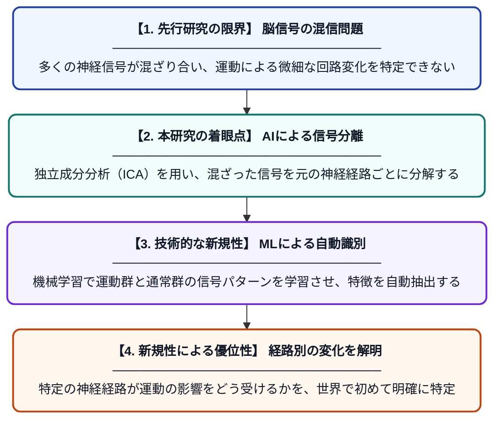

# 慢性的運動はマウス海馬において経路依存的な電気生理学的特徴を誘発する

**Original Title**: *Chronic exercise induces a pathway-dependent electrophysiological signature in the mouse hippocampus*

> **💡 一言要約**: 運動が脳回路を書き換える痕跡をAIで特定

| 項目 | 内容 |
|---|---|
| **著者** | P Muela, J Makarova, R Muñoz-Arnaiz, JB Aballay… |
| **掲載誌** | Communications Biology 2026 |
| **アラートキーワード** | independent component ... |
| **PDF** | [https://www.nature.com/articles/s42003-026-11267-9_reference.pdf](https://www.nature.com/articles/s42003-026-11267-9_reference.pdf) |
| **原文リンク** | [https://www.nature.com/articles/s42003-026-11267-9_reference.pdf](https://www.nature.com/articles/s42003-026-11267-9_reference.pdf) |
| **PDF版要約** | [README.pdf](./README.pdf) |

---

## 📊 新規性の図解（先行研究との違いと本研究のブレークスルー）

## 📝 要約

3週間の継続的な運動がマウスの海馬に与える影響を、独立成分分析（ICA）と機械学習を組み合わせた高度な信号処理によって解析した研究です。その結果、運動によって特定の神経経路に固有の電気生理学的な変化が生じ、脳活動に明確な「運動の痕跡」が残ることが明らかになりました。

## ❓ どんな問題に取り組んだか

運動が認知機能や脳の健康に良いことは広く知られていますが、複雑に入り組んだ海馬の神経回路において、どの経路が具体的にどのような変化を起こしているのかは不明でした。従来の解析手法では、複数の神経活動が混ざり合った信号から特定の回路の変化のみを正確に抽出することが困難という課題がありました。

## ✨ 何が新しい？何がすごい？（新規性）

本研究の革新性は、独立成分分析（ICA）と教師あり機械学習を組み合わせた新しい信号解析パイプラインを開発し、海馬内の微細な電気活動を「経路単位」で分離・評価できるようにした点にあります。先行研究では捉えきれなかった、特定の入力経路に依存した電気生理学的な署名（シグネチャー）を初めて特定しました。これにより、運動が脳のどの回路をどのように強化するのかを、高精度なデータとして提示することに成功しました。

## 🎓 大学1年生向けの解説

運動を続けると記憶力が上がると言われますが、その時脳の中では何が起きているのでしょうか。この研究では、3週間運動したマウスの脳波をAIを使って詳しく分析しました。すると、脳の中の「情報の通り道」ごとに、運動したマウス特有の電気信号のパターンが見つかりました。運動が脳の特定の回路をピンポイントで鍛えている様子を、電気の波として捉えることができたのです。
