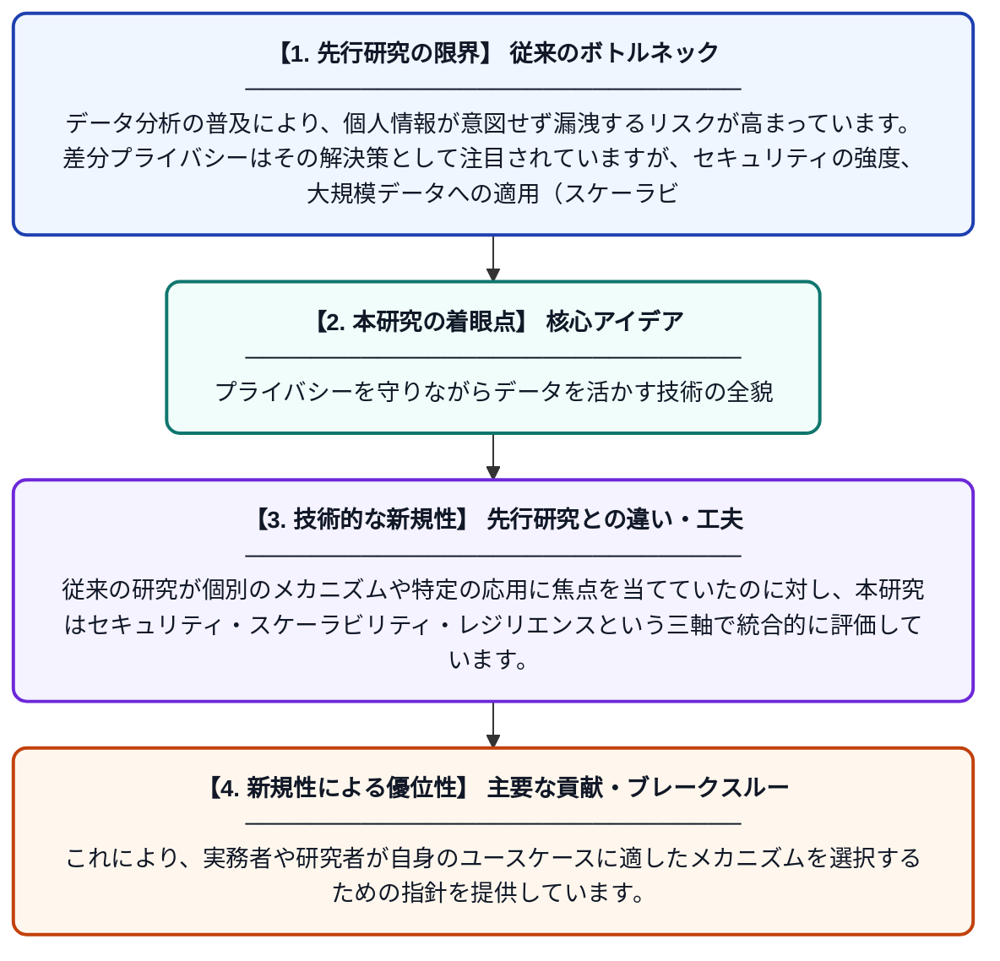

# データ分析における差分プライバシーメカニズム

**Original Title**: *Differential Privacy Mechanisms in Data Analysis*

> **💡 一言要約**: プライバシーを守りながらデータを活かす技術の全貌

| 項目 | 内容 |
|---|---|
| **著者** | S Mohamed, R Mohamed |
| **アラートキーワード** | differential privacy |
| **PDF** | [https://www.researchgate.net/profile/Safa-Mohamed-16/publication/410814112_Differential_Privacy_Mechanisms_in_Data_Analysis/links/6a6497abf475b23f400e92b1/Differential-Privacy-Mechanisms-in-Data-Analysis.pdf](https://www.researchgate.net/profile/Safa-Mohamed-16/publication/410814112_Differential_Privacy_Mechanisms_in_Data_Analysis/links/6a6497abf475b23f400e92b1/Differential-Privacy-Mechanisms-in-Data-Analysis.pdf) |
| **原文リンク** | [https://www.researchgate.net/profile/Safa-Mohamed-16/publication/410814112_Differential_Privacy_Mechanisms_in_Data_Analysis/links/6a6497abf475b23f400e92b1/Differential-Privacy-Mechanisms-in-Data-Analysis.pdf](https://www.researchgate.net/profile/Safa-Mohamed-16/publication/410814112_Differential_Privacy_Mechanisms_in_Data_Analysis/links/6a6497abf475b23f400e92b1/Differential-Privacy-Mechanisms-in-Data-Analysis.pdf) |
| **PDF版要約** | [README.pdf](./README.pdf) |

---

## 📊 新規性の図解（先行研究との違いと本研究のブレークスルー）

## 📝 要約

本論文は、データ分析における差分プライバシーメカニズムの急速な発展を体系的に分析したものです。セキュリティ、スケーラビリティ、レジリエンスといった複雑な課題を整理し、現代のコンピューティングにおける差分プライバシーの適用可能性を検討しています。プライバシー保護と実用性のバランスをどのように取るかについて、構造化された知見を提供しています。

## ❓ どんな問題に取り組んだか

データ分析の普及により、個人情報が意図せず漏洩するリスクが高まっています。差分プライバシーはその解決策として注目されていますが、セキュリティの強度、大規模データへの適用（スケーラビリティ）、システムの耐障害性（レジリエンス）など、実用化に向けた複合的な課題が残されています。これらの課題を整理・分析する包括的な枠組みが求められていました。

## ✨ 何が新しい？何がすごい？（新規性）

本論文は、差分プライバシーメカニズムの多様な手法を横断的に比較・整理する構造化された分析フレームワークを提示している点が新しいです。従来の研究が個別のメカニズムや特定の応用に焦点を当てていたのに対し、本研究はセキュリティ・スケーラビリティ・レジリエンスという三軸で統合的に評価しています。これにより、実務者や研究者が自身のユースケースに適したメカニズムを選択するための指針を提供しています。

## 🎓 大学1年生向けの解説

私たちが使うアプリやサービスは、便利にするために個人データを分析しますが、その際にプライバシーが漏れる危険があります。「差分プライバシー」とは、データに少しノイズ（ランダムなズレ）を加えることで、個人を特定されないようにしながら統計的な分析はできるようにする技術です。この論文は、そうした差分プライバシーの様々な手法を整理し、どれが安全で、大量のデータに使えて、システムが壊れにくいかを比べています。たとえるなら、「個人情報を守りながらアンケート結果の傾向は分かる」仕組みの設計ガイドブックのようなものです。
