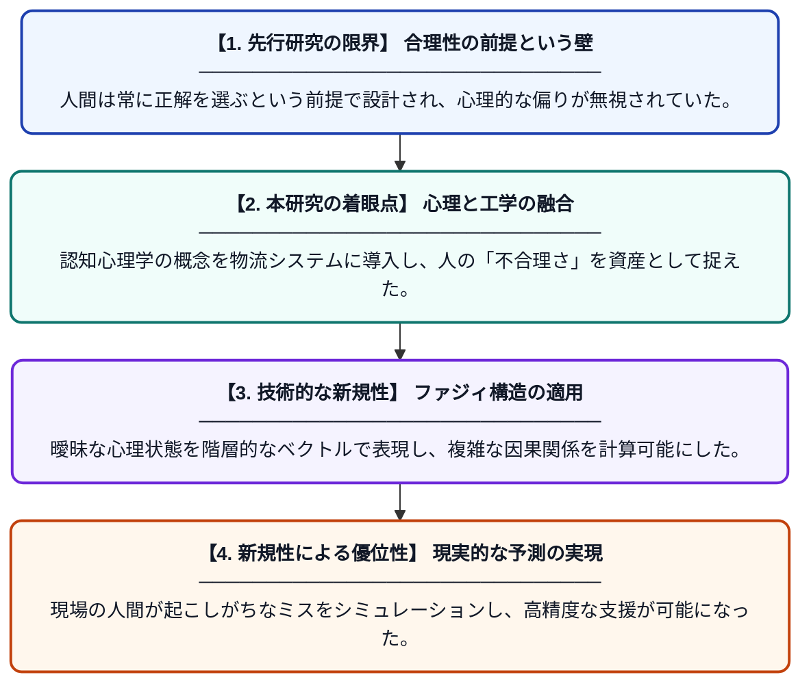

# ファジィシグネチャを用いた物流意思決定における認知バイアスの影響のモデリング

**Original Title**: *Modeling the Effects of Cognitive Biases in Logistics Decisions Using Fuzzy Signature-Based Systems*

> **💡 一言要約**: 物流の意思決定に潜む「人の偏り」を数理モデルで再現

| 項目 | 内容 |
|---|---|
| **著者** | E Sós, B Ferenczi, F Lilik |
| **掲載誌** | Engineering Proceedings 2026 |
| **アラートキーワード** | logistics |
| **原文リンク** | [https://www.mdpi.com/2673-4591/157/1/43](https://www.mdpi.com/2673-4591/157/1/43) |
| **PDF版要約** | [README.pdf](./README.pdf) |

---

## 📊 新規性の図解（先行研究との違いと本研究のブレークスルー）

## 📝 要約

物流の意思決定支援システムにおいて、人間の判断を歪める「認知バイアス」を統合するための手法を提案する研究です。ファジィシグネチャという数学的構造を用いることで、複雑で曖昧な人間の心理的要因をシステムに組み込むことを可能にしました。

## ❓ どんな問題に取り組んだか

従来の物流意思決定システムは、人間が常に合理的な判断を下すことを前提として設計されてきました。しかし、実際には先入観や感情などの「認知バイアス」が判断を左右し、非効率な結果を招くことが大きな課題となっていました。

## ✨ 何が新しい？何がすごい？（新規性）

本研究は、階層的で曖昧な情報を扱うのに適した「ファジィシグネチャ」を、認知バイアスのモデル化に適用した点が革新的です。先行研究では困難だった「複数の心理的要因が相互に影響し合うプロセス」を構造的に定義しました。これにより、人間の不合理な行動パターンを定量的に評価し、より現実に即した物流支援を提供できる基盤を構築しました。

## 🎓 大学1年生向けの解説

物流の現場では、人間が「どのルートが最適か」などを判断しますが、疲れや思い込みで間違った決断をすることがあります。この研究は、そうした人間特有の「心のクセ（認知バイアス）」をコンピュータで計算できる形にする方法を考えました。これを使うことで、人間のミスをあらかじめ予測したり、サポートしたりする賢いシステムが作れるようになります。数学を使って、目に見えない人間の心を整理する面白い研究です。
