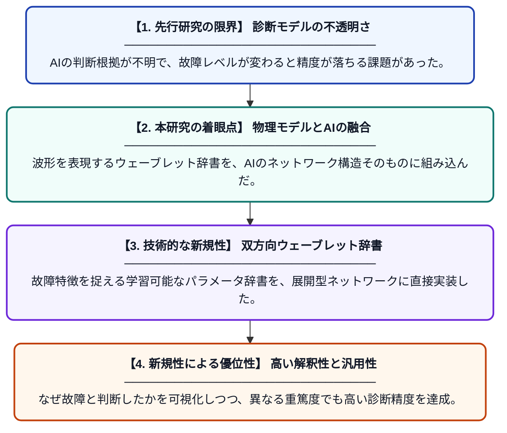

# パラメータ化バイラテラルウェーブレット辞書に基づく、故障の重篤度を跨ぐ診断のための解釈可能な展開型スパースコーディングネットワーク

**Original Title**: *An Interpretable Unrolled Sparse Coding Network Based on a Parameterized Bilateral Wavelet Dictionary for Cross-Severity Fault Diagnosis*

> **💡 一言要約**: 物理的意味を持つAIで、未知の故障の深さを正確に見抜く

| 項目 | 内容 |
|---|---|
| **著者** | Z Song, J Shi, C Zheng, W Huang, C Shen, Z Zhu |
| **掲載誌** | IEEE Transactions on Reliability 2026 |
| **アラートキーワード** | sparse coding |
| **原文リンク** | [https://ieeexplore.ieee.org/abstract/document/11754040/](https://ieeexplore.ieee.org/abstract/document/11754040/) |
| **PDF版要約** | [README.pdf](./README.pdf) |

---

## 📊 新規性の図解（先行研究との違いと本研究のブレークスルー）

## 📝 要約

故障診断において、解釈性の高い「展開型スパースコーディング」と故障特徴に特化した「パラメータ化ウェーブレット辞書」を統合した新しいネットワークを提案しました。この手法により、故障の深刻度が異なる条件下でも、根拠が明確で高精度な診断を可能にしています。

## ❓ どんな問題に取り組んだか

従来の故障診断AIは判断の根拠が不明瞭なブラックボックスになりがちで、信頼性に欠けるという課題がありました。また、軽微な故障から深刻な故障まで、異なる重篤度のデータを跨いで正確に診断することは困難でした。

## ✨ 何が新しい？何がすごい？（新規性）

故障に特化した「パラメータ化バイラテラルウェーブレット辞書」を考案し、それを数理最適化アルゴリズムを層として積み重ねる「Unrolled Network」のフロントエンドに直接統合しました。先行研究とは異なり、辞書自体を物理的な波形として学習可能にしたことで、診断プロセスの透明性が飛躍的に向上しています。これにより、ドメインの変化に強い頑健な特徴抽出を実現しました。

## 🎓 大学1年生向けの解説

工場の機械が壊れそうな時、その音や振動から「どこがどのくらい悪いか」をAIで当てる研究です。これまでのAIは「なぜそう判断したか」が人間には分かりにくいという問題がありましたが、この研究では数学的な「波の形」をAIの部品に使うことで、人間にも納得できる判断基準を持たせました。また、少しの傷から大きな壊れ方まで、どんな状態でも正しく見分けることができるのがすごいところです。
