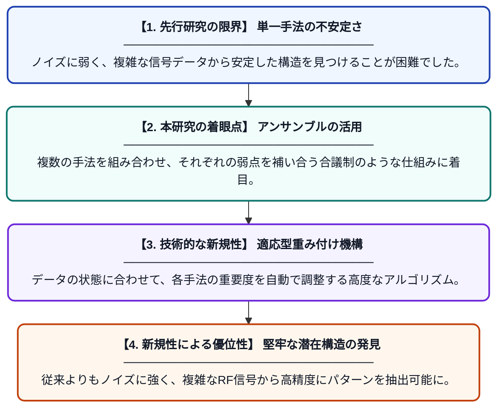

# RF信号データセットにおける堅牢な潜在構造発見のための適応型重み付きアンサンブルクラスタリング

**Original Title**: *Adaptive Weighted Ensemble Clustering for Robust Latent Structure Discovery in RF Signal Datasets*

> **💡 一言要約**: 適応型重み付けでRF信号の隠れた構造を暴く

| 項目 | 内容 |
|---|---|
| **著者** | RR Jorge |
| **アラートキーワード** | manifold learning |
| **PDF** | [https://www.dline.info/dspai/fulltext/v5n2/dspaiv5n2_3.pdf](https://www.dline.info/dspai/fulltext/v5n2/dspaiv5n2_3.pdf) |
| **原文リンク** | [https://www.dline.info/dspai/fulltext/v5n2/dspaiv5n2_3.pdf](https://www.dline.info/dspai/fulltext/v5n2/dspaiv5n2_3.pdf) |
| **PDF版要約** | [README.pdf](./README.pdf) |

---

## 📊 新規性の図解（先行研究との違いと本研究のブレークスルー）

## 📝 要約

複雑な無線信号（RF）データから隠れた構造を正確に抽出するために、適応的な重み付けを用いるアンサンブルクラスタリング手法を提案しています。複数のクラスタリング手法の結果を動的に統合することで、ノイズやデータの不確実性に対して高い耐性を持ち、安定した分析を可能にしました。

## ❓ どんな問題に取り組んだか

RF信号はノイズが多く、その複雑な特性ゆえに単一のクラスタリングアルゴリズムでは潜在的なパターンを正確に捉えることが困難でした。また、複数の手法を組み合わせる際も、データの特性に応じて各手法をどのように評価し統合すべきかという課題がありました。

## ✨ 何が新しい？何がすごい？（新規性）

複数のクラスタリング結果を統合するアンサンブル学習において、各構成要素の信頼性を動的に評価する「適応型重み付け」を導入した点が革新的です。これにより、RF信号特有の不規則な構造に対しても頑健（ロバスト）な分類が可能になりました。将来的にUMAPやTransformerなどの最新技術と組み合わせるための基礎となる、柔軟なフレームワークを構築した点が大きな貢献です。

## 🎓 大学1年生向けの解説

スマホやWi-Fiが使う「無線信号」は目に見えない上に、ノイズなどの影響で非常に複雑な形をしています。この研究では、一つの方法で分析するのではなく、たくさんの分析方法を「チーム」としてまとめ、さらに「どのメンバーの意見が今正しいか」を自動で判断する仕組みを作りました。これにより、複雑なデータの中に隠れている大切なルールやパターンを、より正確に見つけ出すことができるようになります。
