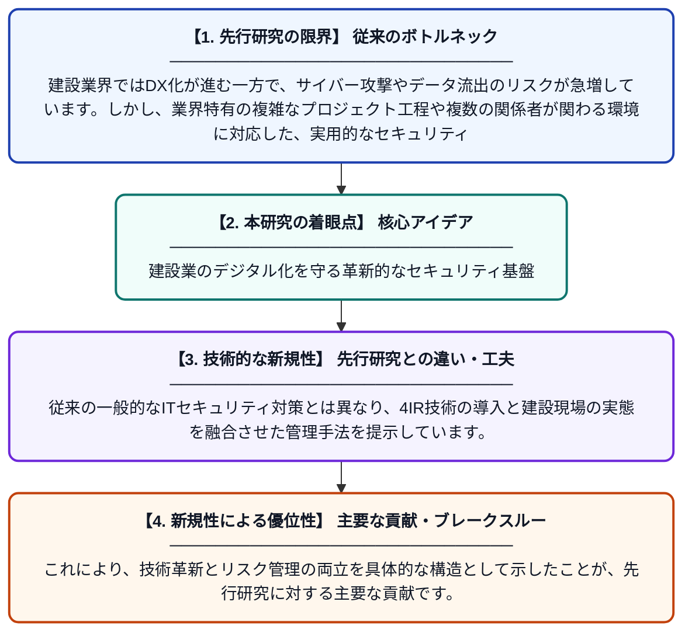

# 建設業界におけるデータセキュリティフレームワーク：データリスク低減への一歩

**Original Title**: *A Data Security Framework: A Step Towards Reducing Data Risks in the Construction Industry*

> **💡 一言要約**: 建設業のデジタル化を守る革新的なセキュリティ基盤

| 項目 | 内容 |
|---|---|
| **著者** | O Tambwe, C Aigbavboa, T Ogunade, G Akanyawie… |
| **掲載誌** | Applied Human Factors and … 2026 |
| **アラートキーワード** | Secure Computing |
| **原文リンク** | [https://pure.uj.ac.za/en/publications/a-data-security-framework-a-step-towards-reducing-data-risks-in-t/](https://pure.uj.ac.za/en/publications/a-data-security-framework-a-step-towards-reducing-data-risks-in-t/) |
| **PDF版要約** | [README.pdf](./README.pdf) |

---

## 📊 新規性の図解（先行研究との違いと本研究のブレークスルー）

## 📝 要約

第4次産業革命（4IR）の進展により建設業界で深刻化するデータセキュリティリスクを軽減するための、包括的なフレームワークを提案しています。プロジェクトの全ライフサイクルを通じて組織に安心感を提供し、サイバー攻撃やデータ漏洩から建設プロセスを守ることを目指しています。

## ❓ どんな問題に取り組んだか

建設業界ではDX化が進む一方で、サイバー攻撃やデータ流出のリスクが急増しています。しかし、業界特有の複雑なプロジェクト工程や複数の関係者が関わる環境に対応した、実用的なセキュリティ管理基準が不足していることが課題となっていました。

## ✨ 何が新しい？何がすごい？（新規性）

本研究は、建設プロジェクトの全ライフサイクルを一貫してカバーする業界特化型のデータセキュリティフレームワークを開発した点が極めて独創的です。従来の一般的なITセキュリティ対策とは異なり、4IR技術の導入と建設現場の実態を融合させた管理手法を提示しています。これにより、技術革新とリスク管理の両立を具体的な構造として示したことが、先行研究に対する主要な貢献です。

## 🎓 大学1年生向けの解説

最近の建設現場では、ドローンやAIなどの最新技術が使われていますが、その分だけ大切な設計図などが盗まれる危険も増えています。この研究は、建設会社がどうやってデータを守るべきかという「安全なルールのテンプレート」を作ったものです。建物を作る最初の段階から最後のアフターケアまで、すべての工程で情報を守る方法を提案しています。これによって、新しい技術を安心して使いこなせるようになります。
