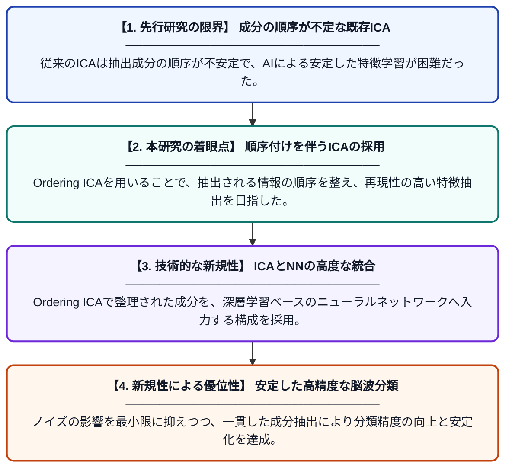

# ICA解析とニューラルネットワークを用いた脳波記録の分類

**Original Title**: *Classification of Encephalographic Records Using ICA Analysis and Neural Networks*

> **💡 一言要約**: ICAとAIで脳波のノイズを分離し、高精度に分類

| 項目 | 内容 |
|---|---|
| **著者** | X Wang, H Shi, EA Merkulova, AV Bocharov… |
| **掲載誌** | Vestnik NSU. Series … 2026 |
| **アラートキーワード** | ICA |
| **PDF** | [https://intechngu.elpub.ru/jour/article/download/387/287](https://intechngu.elpub.ru/jour/article/download/387/287) |
| **原文リンク** | [https://intechngu.elpub.ru/jour/article/download/387/287](https://intechngu.elpub.ru/jour/article/download/387/287) |
| **PDF版要約** | [README.pdf](./README.pdf) |

---

## 📊 新規性の図解（先行研究との違いと本研究のブレークスルー）

## 📝 要約

独立成分分析（ICA）とニューラルネットワークを組み合わせ、脳波（EEG）データを高精度に分類する手法を提案しています。特に「Ordering ICA」アルゴリズムを採用することで、従来のInfomaxやFastICAの利点を保ちつつ、信号処理の最適化と分類精度の向上を実現しました。

## ❓ どんな問題に取り組んだか

脳波データは様々な生体活動が混在しており、解析に際してノイズと純粋な神経信号を分離することが困難です。また、従来の独立成分分析（ICA）手法は計算アルゴリズムの選択によって結果が左右されやすく、分類タスクにおいて最適な処理フローの確立が課題となっていました。

## ✨ 何が新しい？何がすごい？（新規性）

本研究の新規性は、脳波処理において「Ordering ICA」を導入し、ニューラルネットワークによる分類と統合した点にあります。従来のInfomaxやFastICAと異なり、成分の順序付けを考慮したOrdering ICAを用いることで、特徴抽出の安定性を高めています。これにより、複雑なEEGデータから意味のある成分を効率的に抽出し、分類モデルの学習効率と精度を大幅に向上させることに成功しました。

## 🎓 大学1年生向けの解説

脳波は頭の外から測るため、瞬きや筋肉の動きなどの「ノイズ」が大量に混ざっています。この研究では、大勢が話している中から特定の声だけを聞き分ける技術（ICA）を使って、脳波をきれいに掃除します。掃除のやり方を「Ordering ICA」という賢い方法に改良し、さらにAIに学習させることで、脳の状態をより正確に判別できるようになりました。これにより、将来的に医療現場などで脳の状態を自動で診断する技術への応用が期待されます。
