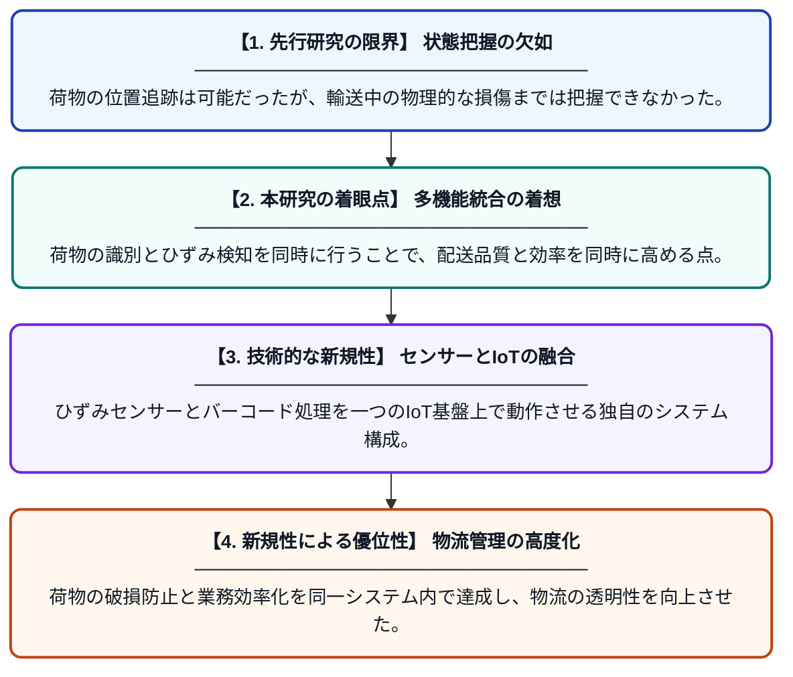

# ひずみ検知とバーコード処理を統合したスマート物流監視システム

**Original Title**: *Smart Logistics Monitoring System with Strain Sensing and Barcode Processing*

> **💡 一言要約**: センサーとIoTで物流の安全性と効率を最大化

| 項目 | 内容 |
|---|---|
| **著者** | T Daine, A Yedake, O Kela, D Kanade, A Talele |
| **掲載誌** | 11th International Conference … 2026 |
| **アラートキーワード** | logistics |
| **原文リンク** | [https://ieeexplore.ieee.org/abstract/document/11762528/](https://ieeexplore.ieee.org/abstract/document/11762528/) |
| **PDF版要約** | [README.pdf](./README.pdf) |

---

## 📊 新規性の図解（先行研究との違いと本研究のブレークスルー）

## 📝 要約

IoT技術を基盤とし、ひずみセンサーによる物理的な負荷の監視とバーコード処理を組み合わせた物流自動化システムを提案しています。物流業界に根強く残る低効率の問題を、リアルタイムのデータ収集と分析によって解決することを目指しています。

## ❓ どんな問題に取り組んだか

物流業界では、荷物の配送状況や物理的な状態をリアルタイムで把握する手段が不足しており、作業効率が低いまま停滞していました。特に、輸送中の荷物に加わる過度な負荷や損傷を自動で検知し、迅速に対応する仕組みが求められていました。

## ✨ 何が新しい？何がすごい？（新規性）

本研究は、バーコードによる識別技術にひずみセンサーを用いた物理負荷計測を組み合わせ、IoT環境下で統合管理する仕組みを構築しました。単なる位置情報の追跡に留まらず、荷物の物理的な状態変化をリアルタイムで可視化できる点が革新的です。この多角的なアプローチにより、物流の自動化レベルと信頼性を同時に引き上げることに成功しました。

## 🎓 大学1年生向けの解説

荷物が今どこにあるかだけでなく、輸送中に重みで歪んだり壊れたりしていないかを自動でチェックする技術です。バーコードを読み取るのと同時に、センサーが荷物の異変を感知して、インターネットを通じて管理者に知らせます。これにより、荷物の破損を未然に防いだり、配送の無駄をなくしたりできます。物流を「賢く」することで、私たちの生活に届く荷物の安全を守る研究です。
