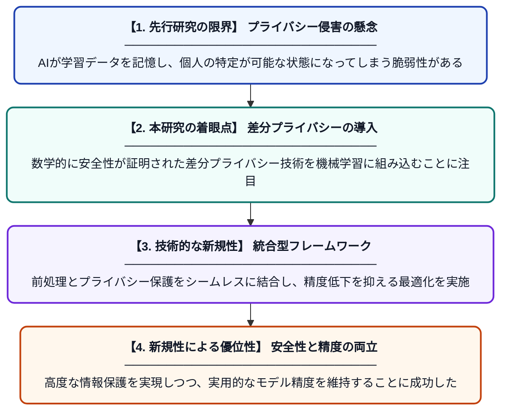

# 差分プライバシー技術を用いたプライバシー保護型機械学習フレームワーク

**Original Title**: *Privacy-Preserving Machine Learning Framework using Differential Privacy Techniques*

> **💡 一言要約**: 数学でプライバシーを死守する次世代のAI学習術

| 項目 | 内容 |
|---|---|
| **著者** | S Sumana, M Sharmila, V Divya, VK Manam, D Srikar |
| **掲載誌** | IEEE World Skills … 2026 |
| **アラートキーワード** | differential privacy |
| **原文リンク** | [https://ieeexplore.ieee.org/abstract/document/11766710/](https://ieeexplore.ieee.org/abstract/document/11766710/) |
| **PDF版要約** | [README.pdf](./README.pdf) |

---

## 📊 新規性の図解（先行研究との違いと本研究のブレークスルー）

## 📝 要約

機械学習における個人情報の漏洩リスクを防ぐため、差分プライバシー（Differential Privacy）を活用した包括的なフレームワークを提案しています。データの前処理からモデル学習の工程に数学的なノイズを加える仕組みを統合し、データの有用性と安全性を両立させています。

## ❓ どんな問題に取り組んだか

機械学習モデルが学習データ内の個人情報を記憶してしまい、外部からの攻撃によって個人の特定や情報の漏洩を招くリスクが深刻化しています。従来の匿名化技術では、情報の保護を強めるとデータの精度が低下するというトレードオフの解決が課題でした。

## ✨ 何が新しい？何がすごい？（新規性）

本研究は、データの前処理から差分プライバシーの適用までを一貫して管理する統合的なフレームワークを構築した点が画期的です。単なるノイズの付加に留まらず、学習プロセスの各段階で数学的な安全性を保証するメカニズムを組み込むことで、先行研究よりも高いレベルのプライバシー保証を実現しました。これにより、特定の個人データが結果に与える影響を厳密に制限し、計算機科学的な安全証明を提供しています。

## 🎓 大学1年生向けの解説

AIが賢くなるためには大量のデータが必要ですが、その中に個人の名前や住所などの秘密が混ざっていると、後からバレてしまうかもしれません。この研究では、データに「ちょうど良い加減のノイズ」を混ぜることで、全体の傾向は変えずに、特定の誰かの情報を特定できないようにする技術を開発しました。これにより、プライバシーをしっかり守りながら、安全にAIを活用できるようになります。
