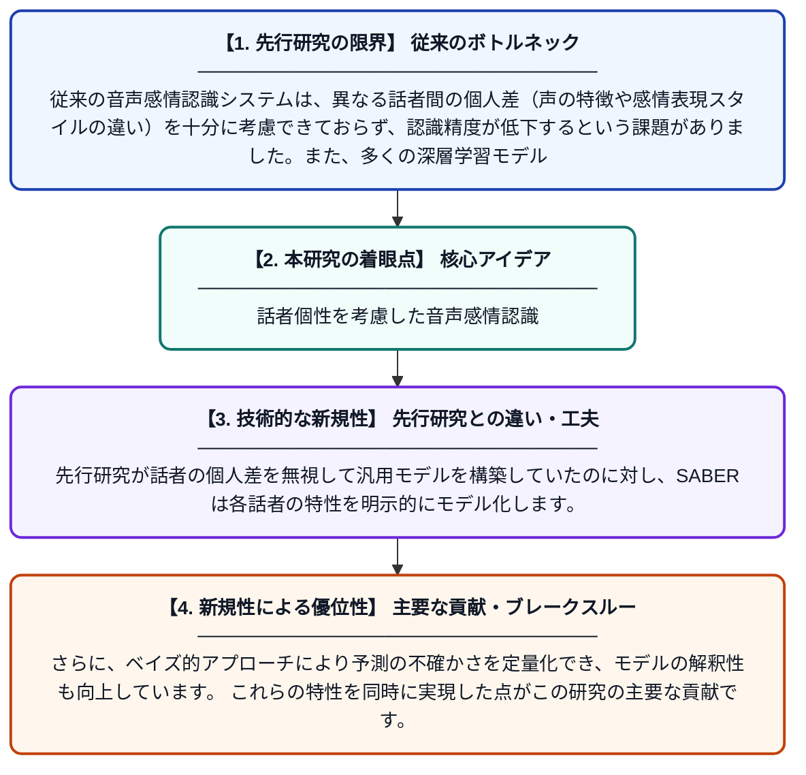

# SABER: 話者を考慮したベイズ感情認識

**Original Title**: *SABER: Speaker-Aware Bayesian Emotion Recognition*

> **💡 一言要約**: 話者個性を考慮した音声感情認識

| 項目 | 内容 |
|---|---|
| **著者** | X Zeng, S Beheshti |
| **掲載誌** | 2026 IEEE Canadian Conference on Electrical and Computer Engineering 2026 |
| **アラートキーワード** | Bayesian hierarchical ... |
| **原文リンク** | [https://ieeexplore.ieee.org/abstract/document/11610445/](https://ieeexplore.ieee.org/abstract/document/11610445/) |
| **PDF版要約** | [README.pdf](./README.pdf) |

---

## 📊 新規性の図解（先行研究との違いと本研究のブレークスルー）

## 📝 要約

SABERは、音声から感情を認識する際に「誰が話しているか」という話者情報を考慮したベイズ階層推論と深層学習を組み合わせたハイブリッドシステムです。深層学習の高い表現能力と、ベイズ推論の解釈性・不確かさ推定能力を融合することで、頑健な感情認識を実現します。これにより、個人差を考慮した、より信頼性の高い音声感情認識が可能となっています。

## ❓ どんな問題に取り組んだか

従来の音声感情認識システムは、異なる話者間の個人差（声の特徴や感情表現スタイルの違い）を十分に考慮できておらず、認識精度が低下するという課題がありました。また、多くの深層学習モデルは予測の不確かさを定量化できず、ブラックボックス的で解釈が難しいという問題も抱えています。

## ✨ 何が新しい？何がすごい？（新規性）

SABERは、話者固有の特性をモデル化するベイズ階層推論と、高性能な深層学習表現を組み合わせた新しいハイブリッドアーキテクチャを提案しています。先行研究が話者の個人差を無視して汎用モデルを構築していたのに対し、SABERは各話者の特性を明示的にモデル化します。さらに、ベイズ的アプローチにより予測の不確かさを定量化でき、モデルの解釈性も向上しています。これらの特性を同時に実現した点がこの研究の主要な貢献です。

## 🎓 大学1年生向けの解説

人間は感情を声に乗せて伝えますが、同じ「怒り」でも人によって声の出し方はさまざまです。この研究は、「この人はどんな話し方をする人か」という情報を使って、感情をより正確にコンピューターに判断させる仕組みを作りました。ベイズ推論という統計的な手法と、最新のAI技術を組み合わせることで、「どれくらい自信があるか」も分かるようにしています。たとえると、声だけで感情を読み取る「AI聴診器」が、患者ごとの個性を学んでより正確な診断ができるようになったイメージです。
