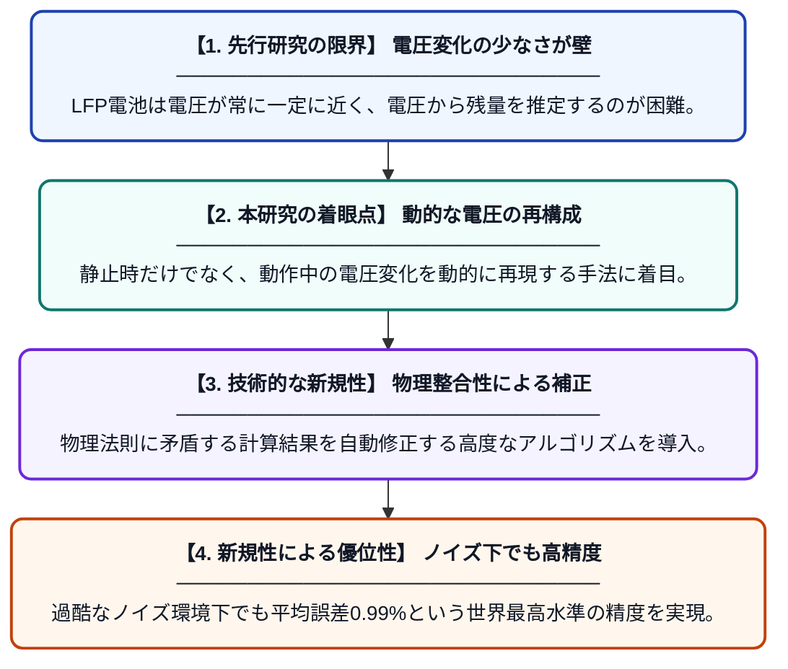

# 動的OCV再構成と物理整合的補正によるリン酸鉄リチウム電池の充電状態推定

**Original Title**: *State-of-charge estimation of LiFePO₄ batteries via dynamic OCV reconstruction and physics-consistent correction*

> **💡 一言要約**: 物理法則と動的再構成でLFP電池のSOCを高精度に推定

| 項目 | 内容 |
|---|---|
| **著者** | X Lai, M Zhi, Q Chen, W Zhang, Y Zheng |
| **掲載誌** | Journal of Energy Storage 2027 |
| **アラートキーワード** | kalman filter |
| **原文リンク** | [https://www.sciencedirect.com/science/article/pii/S2352152X26055623](https://www.sciencedirect.com/science/article/pii/S2352152X26055623) |
| **PDF版要約** | [README.pdf](./README.pdf) |

---

## 📊 新規性の図解（先行研究との違いと本研究のブレークスルー）

## 📝 要約

リン酸鉄リチウム（LFP）電池の特有の課題である平坦な電圧特性を克服するため、動的な開放電圧（OCV）再構成と物理法則に基づいた補正を組み合わせたSOC推定手法を提案しています。電流計測にノイズが含まれる環境下でも、幅広い温度範囲で平均誤差0.99%という極めて高い推定精度を達成しました。

## ❓ どんな問題に取り組んだか

LFP電池は放電中の電圧変化が非常に小さいため、電圧からバッテリー残量を正確に割り出すことが困難です。さらに、センサーの計測ノイズや環境温度の変化が、推定精度のさらなる悪化を招くという課題がありました。

## ✨ 何が新しい？何がすごい？（新規性）

従来の静的なルックアップテーブルに依存せず、動的にOCVを再構成し、物理的な整合性を維持しながら逐次補正を行うアルゴリズムを開発しました。この物理整合的補正により、センサーノイズの影響を効果的に抑制し、先行研究の誤差1.53%を0.99%まで低減させることに成功しました。特に広範な温度条件下で安定した性能を発揮する点が、実用上の大きな貢献です。

## 🎓 大学1年生向けの解説

スマートフォンの電池残量表示が急に増減して驚いたことはありませんか？この研究は、電圧の変化が少なくて残量が分かりにくい「リン酸鉄リチウム電池」の残量を、正確に計算する新しい方法を開発しました。物理のルールを計算式に組み込むことで、測定データのわずかな「ブレ」に惑わされないように工夫しています。その結果、暑い場所でも寒い場所でも、非常に正確に「あと何％使えるか」を予測できるようになりました。
