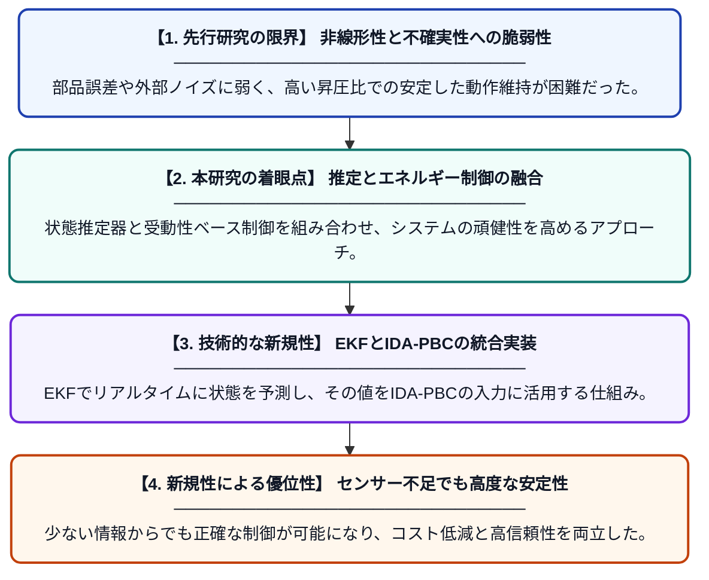

# 2次ブーストコンバータへの拡張カルマンフィルタとIDA-PBCの適用：MATLAB/Simulinkによる実装

**Original Title**: *Application of the Extended Kalman Filter and IDA-PBC to a Quadratic Boost Converter: A MATLAB/Simulink Implementation*

> **💡 一言要約**: 推定と制御の融合で電力変換をより安定に

| 項目 | 内容 |
|---|---|
| **著者** | A Ahmadi, S Minagar, B Rezaie |
| **掲載誌** | Contributions of Science and Technology for … 2026 |
| **アラートキーワード** | kalman filter |
| **原文リンク** | [https://journals.umz.ac.ir/article_6891.html](https://journals.umz.ac.ir/article_6891.html) |
| **PDF版要約** | [README.pdf](./README.pdf) |

---

## 📊 新規性の図解（先行研究との違いと本研究のブレークスルー）

## 📝 要約

不確実性を持つ2次ブーストコンバータに対し、拡張カルマンフィルタ（EKF）による状態推定とIDA-PBC法による制御を統合した新しい戦略を提案しています。MATLAB/Simulinkを用いた実装により、非線形システムにおける高い安定性とロバスト性を実証しました。

## ❓ どんな問題に取り組んだか

2次ブーストコンバータは高い電圧変換比を持ちますが、強い非線形性があり、パラメータの変動や外部ノイズに対して安定性を維持することが困難でした。また、すべての状態量を物理センサーで測定することはコストや回路の複雑化を招くという課題がありました。

## ✨ 何が新しい？何がすごい？（新規性）

状態推定に優れた拡張カルマンフィルタ（EKF）と、エネルギーの観点から安定化を図るIDA-PBCを組み合わせた点が革新的です。従来のIDA-PBCは正確なパラメータと全状態の観測を前提としていましたが、本手法はEKFを用いることで不確実な環境下でも高精度な制御を可能にしました。これにより、センサー数を抑えつつ動的な応答性能を大幅に向上させることに成功しています。

## 🎓 大学1年生向けの解説

電圧を大きく引き上げる装置（2次ブーストコンバータ）は、構造が複雑で制御が難しいという弱点があります。この研究では、「センサーがない部分の状態を賢く予測する計算式」と「エネルギーの流れを整えて安定させるルール」を組み合わせました。これにより、部品のバラつきや急な変化があっても、狙った電圧を正確に維持できるようになります。実験の結果、この新しい組み合わせが非常に効果的であることが証明されました。
