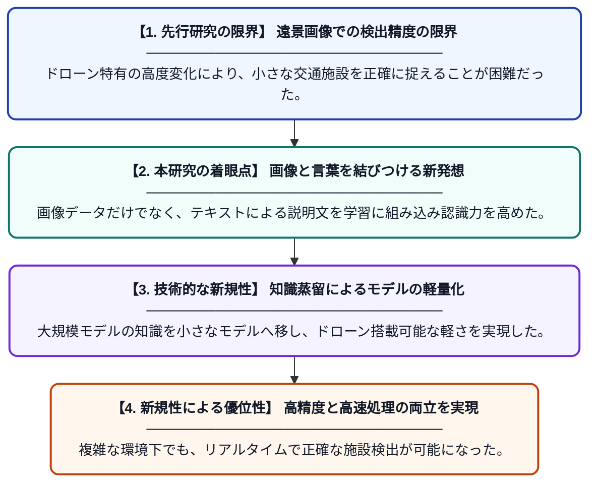

# 知識蒸留と視覚・言語アライメント技術に基づくドローン画像からの効率的な交通施設検出

**Original Title**: *An Efficient Traffic Facility Detection in UAV Imagery Based on Knowledge Distillation and Vision-Language Alignment Technique*

> **💡 一言要約**: 言葉と画像の融合でドローンの交通監視を高速・高精度化

| 項目 | 内容 |
|---|---|
| **著者** | B Wang, J Li, K Xi, C Zuo |
| **掲載誌** | CICTP 2026 |
| **アラートキーワード** | Open-Vocabulary Object ... |
| **原文リンク** | [https://ascelibrary.org/doi/abs/10.1061/9780784486948.241](https://ascelibrary.org/doi/abs/10.1061/9780784486948.241) |
| **PDF版要約** | [README.pdf](./README.pdf) |

---

## 📊 新規性の図解（先行研究との違いと本研究のブレークスルー）

## 📝 要約

ドローン（UAV）で撮影された画像から、道路標識などの交通施設を正確に検出するための新しいマルチモーダルフレームワークを提案しています。画像データとテキスト記述を対応付けるアライメント技術と、モデルを軽量化する知識蒸留を組み合わせることで、高精度かつ効率的な検出を実現しました。

## ❓ どんな問題に取り組んだか

ドローンによる上空からの撮影は、高度や角度が頻繁に変わるため、小さな交通施設を正確に特定することが困難でした。また、従来の画像のみに頼る手法では、背景が複雑な場合に誤検出が多く、処理の重さからリアルタイムでの活用にも課題がありました。

## ✨ 何が新しい？何がすごい？（新規性）

本研究の最大の特徴は、視覚情報だけでなくテキスト情報を学習に取り入れる「視覚・言語アライメント」を採用し、交通施設の特徴理解を深めた点にあります。さらに、巨大で高性能なモデルの知識を小さなモデルに継承させる「知識蒸留」を適用することで、高い検出精度を維持したまま計算量を劇的に削減しました。これにより、限られた計算リソースしかないドローン端末上でも、高度な物体検出が可能になっています。

## 🎓 大学1年生向けの解説

空を飛ぶドローンから、道路にある標識や信号機などを自動で見つける技術についての研究です。これまでは写真の情報だけで判断していましたが、この研究では「これはどのような形の標識か」という言葉の説明もAIに教えることで、より賢く判断できるようにしました。さらに、AIの「頭脳」をコンパクトにする工夫も加えているため、小さなドローンでも素早く動かすことができます。これによって、将来はドローンが街の交通状況をリアルタイムでパトロールできるようになります。
