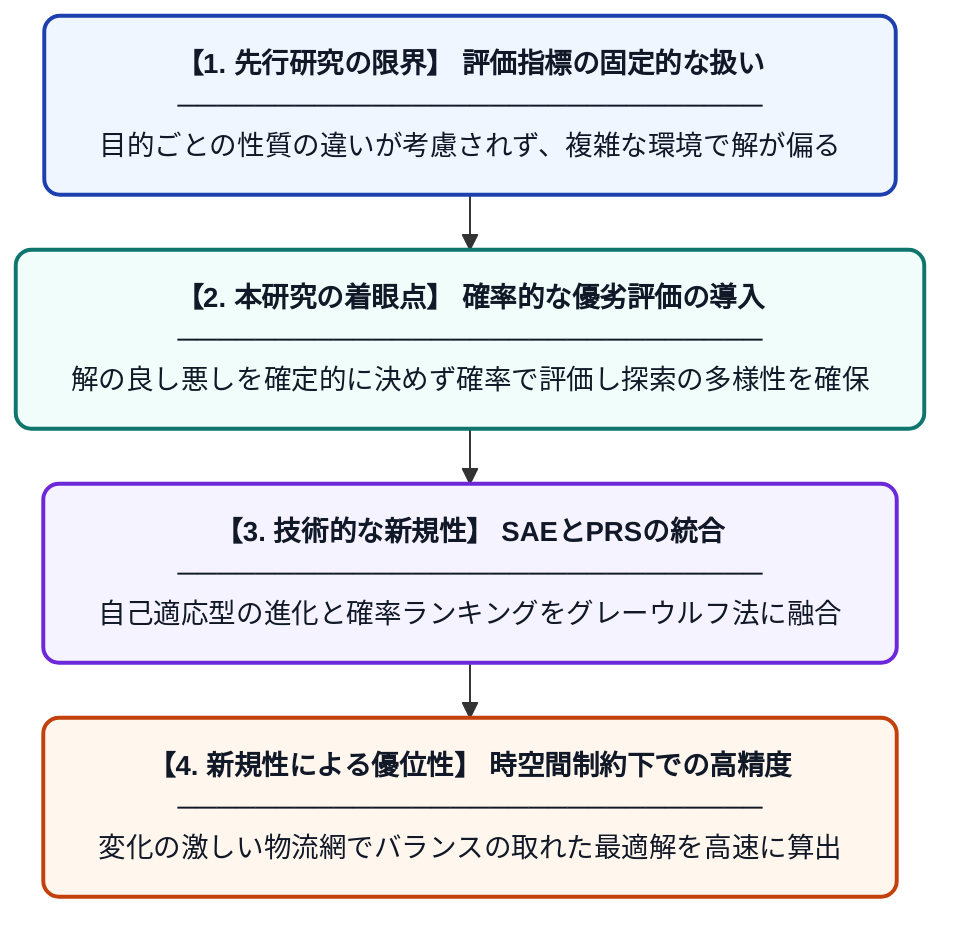

# SAE-MOGWO-PRS：時空間適応型共同物流ネットワーク最適化のための確率ランキング戦略に基づくグレーウルフ最適化手法

**Original Title**: *SAE-MOGWO-PRS: A probability ranking strategy-based grey wolf optimizer for spatio-temporal adaptive collaborative logistics network optimization*

> **💡 一言要約**: 確率戦略で物流の複雑な難問を解く次世代最適化手法

| 項目 | 内容 |
|---|---|
| **著者** | Y Liu, T Li, H Zhang |
| **掲載誌** | PLoS One 2026 |
| **アラートキーワード** | logistics |
| **原文リンク** | [https://journals.plos.org/plosone/article?id=10.1371/journal.pone.0362456](https://journals.plos.org/plosone/article?id=10.1371/journal.pone.0362456) |
| **PDF版要約** | [README.pdf](./README.pdf) |

---

## 📊 新規性の図解（先行研究との違いと本研究のブレークスルー）

## 📝 要約

複雑な物流ネットワークにおける時空間的な制約と複数の最適化目的を同時に解決するため、確率ランキング戦略を用いた新しい進化的アルゴリズムを提案した論文です。評価指標間の不均一性を考慮することで、従来の多目的最適化手法よりも高い精度で効率的な物流ルートや拠点の配置を導き出しています。

## ❓ どんな問題に取り組んだか

物流ネットワークの最適化には時間と空間の両方の制約が絡み合い、さらにコストや配送時間といった複数の相反する目的が存在します。従来のアルゴリズムでは、これらの異なる評価指標が持つ性質の違い（不均一性）を十分に考慮できておらず、実用的な最適解を効率的に見つけることが困難でした。

## ✨ 何が新しい？何がすごい？（新規性）

本研究は、オオカミの狩り行動を模倣した「グレーウルフ最適化（GWO）」に、目的関数間の不均一性を扱う「確率ランキング戦略（PRS）」と「自己適応型進化メカニズム（SAE）」を統合した点が画期的です。これにより、解の探索範囲を広げつつ、特定の目的に偏らないバランスの良い最適解を維持する能力が大幅に向上しました。特に、動的に変化する時空間的な配送環境においても、高いロバスト性を発揮できる点が先行研究との大きな違いです。

## 🎓 大学1年生向けの解説

ネット通販などの荷物を効率よく運ぶには、コストを安くすることと、時間を短くすることの両立が必要です。しかし、これらは「あちらを立てればこちらが立たず」という関係にあり、さらに交通状況などの時間や場所の制約も加わると計算が非常に難しくなります。この研究では、オオカミの群れのチームワークを真似た計算手法に「確率によるランク付け」という新しいアイデアを組み合わせました。これにより、数え切れないほどの選択肢の中から、もっとも効率的な配送プランを賢く見つけ出せるようになりました。
